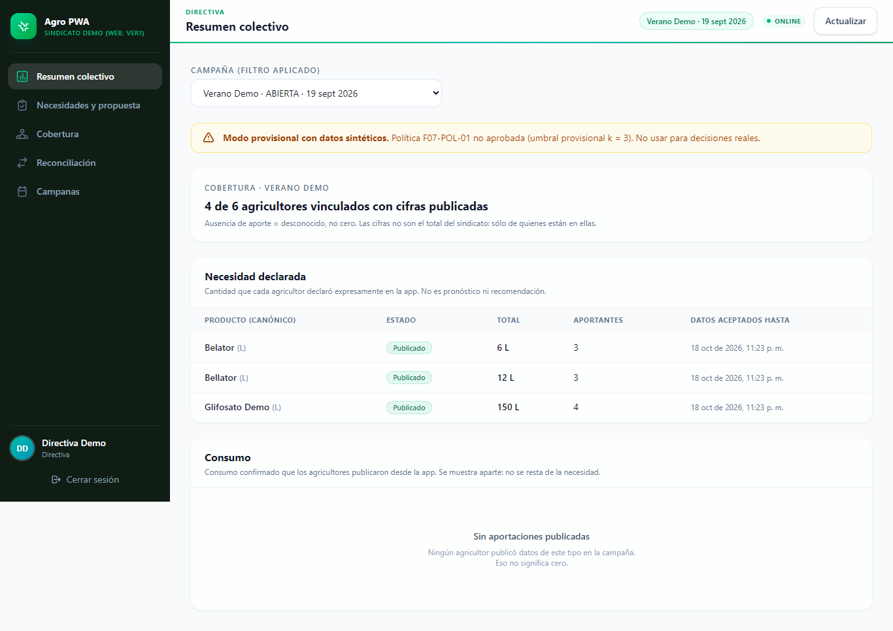
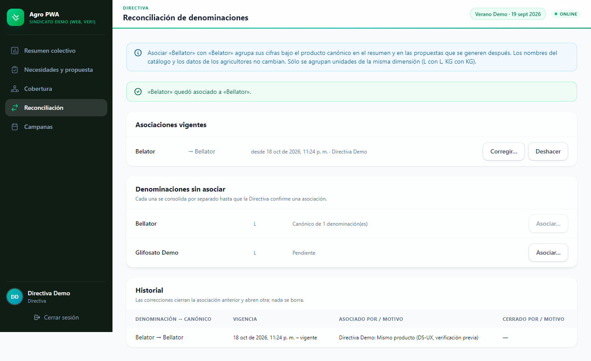
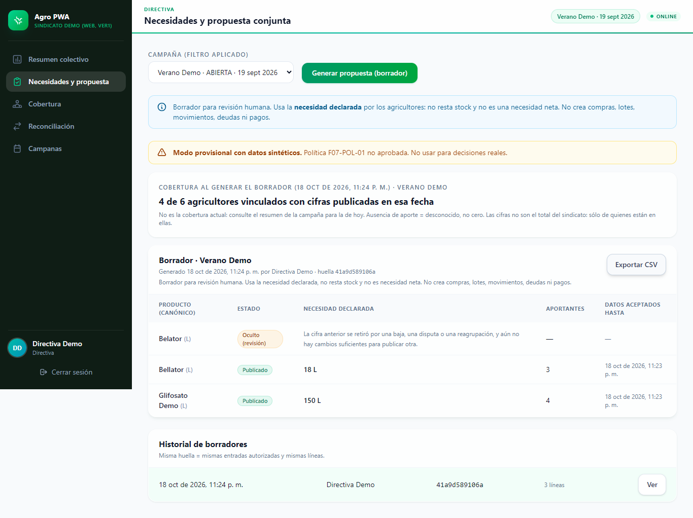
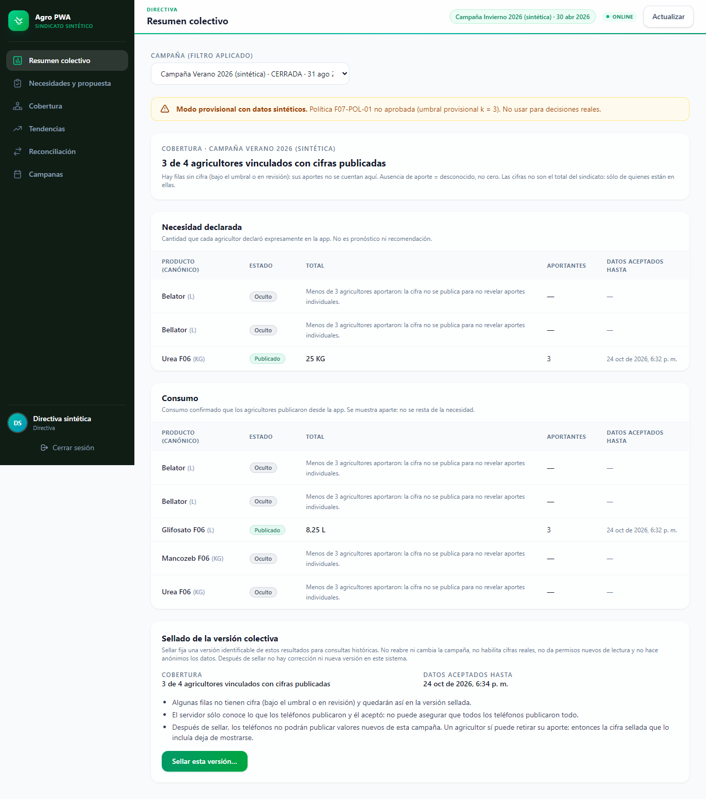
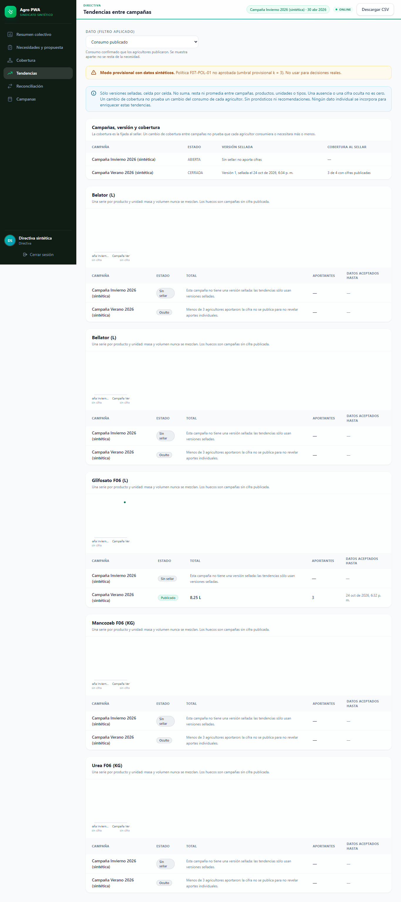
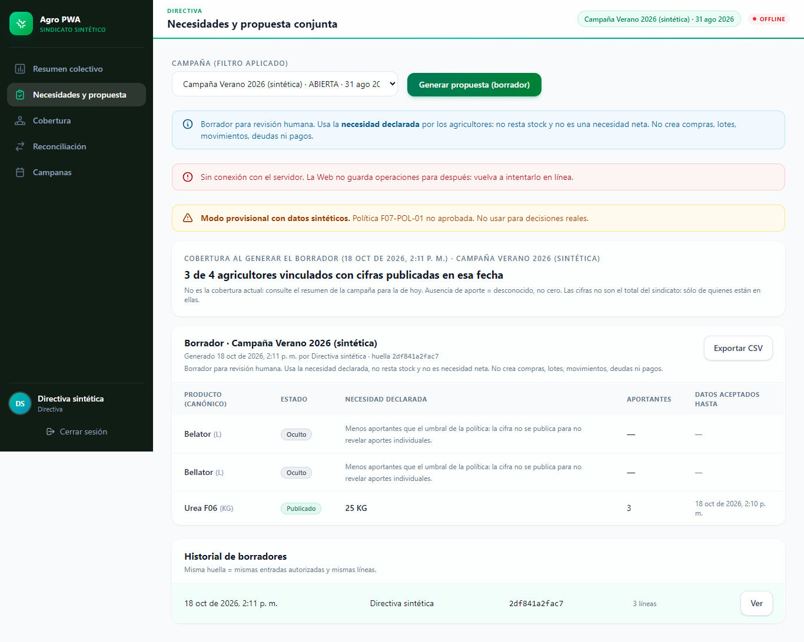

# Manual de usuario de Agrocuentas: app móvil y Web de la Directiva (borrador F11)

| Campo | Valor |
|---|---|
| Estado | **Borrador revisable de F11** (BE #53). No es un release. GATE-F11 no se evalúa con este documento |
| Fecha de redacción | 2026-10-19 |
| Actualización | 2026-10-24: funciones de F03, RF-13, RF-03, F07 y F08 que ve el usuario (§1.1, §1.2, §2.1, §3, §6, §7, §9.5 y §9.6) |
| Versión descrita | App móvil Mobile `1d77c14`; Central y Web Backend `4bcb1ea`. La redacción del 2026-10-19 describía Mobile `463d3ec` y Backend `2a69fe6` (código `f0b55ee`) |
| Manual técnico | [`F11_MANUAL_TECNICO.md`](F11_MANUAL_TECNICO.md) (BE #54): instalación, configuración, respaldos del servidor y recuperación |
| Revisión | Sesión A, el recorrido de usuario. Las decisiones las toma Roderich Rendón |

**Cómo se hizo este borrador:**
- Los textos entre comillas («…») se copiaron del código de esa versión: botones, menús y mensajes.
- No se usó ningún teléfono ni se arrancó ningún servicio.
- Cuando una pantalla o un paso no tiene una prueba fechada en un dispositivo, se marca **[Verificar]**.
- **La versión `463d3ec` se probó en un teléfono el 2026-10-19:** activación, subida y restauración desde la nube, comparación de la copia y liberación de la cola (Backend `docs/evidence/F08_BKP_07_B2_ENSAYO_REAL.md` §2, POCO X5 Pro). Las demás pantallas tienen sus ensayos físicos en versiones anteriores, que se citan en cada sección. Desde `27c4654`, la app sólo cambió los rótulos de las cifras netas, la bitácora del chaco y el CSV.
- **Las funciones añadidas el 2026-10-24** (PIN del titular, «Recuperar acceso», reversión con motivo y PIN, «Operaciones tardías», respaldo cifrado con clave de recuperación y copias previas a restauraciones) se probaron en el POCO X5 Pro el 2026-10-24, en tres rondas (Mobile `docs/evidence/F01_F08_DEVICE_COMPOSICION_2026-10-24.md`). La tercera ronda usó una composición (`8b53ad8`) cuyo código de la app (`lib/`, `android/` y `pubspec.yaml`) es igual al de `1d77c14`. La segunda difiere sólo en el aviso de «Registrar para revisión» (§2.1). Lo que quedó sin probar en el teléfono se marca **[Verificar]**.
- **Sesión DEVICE final del 2026-10-24** (POCO X5 Pro, APK de `1d77c14`; Mobile `docs/evidence/F01_F08_DEVICE_FINAL_2026-10-24.md`, todavía sin integrar en `main`): el aviso de «Registrar para revisión» corregido, la compra tardía sin red, la reversión de una compra sin red, el rechazo `CAMPAIGN_SEALED` y la restauración en una instalación nueva con la copia cifrada desde Backblaze B2. Se citan en cada sección.

**Capturas:**
- **App móvil:** todas las capturas de la app que hay en el repositorio Mobile (`artifacts/ui-audit/`) son del 2026-09-05/06, anteriores a la activación, la modalidad, la sincronización, el respaldo en la nube y las cifras netas. **No se usan en este manual.** Hay que tomar capturas nuevas con datos sintéticos **[Verificar]**.
- **Web:** se enlazan capturas vigentes, con datos sintéticos.

**Datos reales:** este manual describe la app y la Web tal como se probaron con **datos sintéticos**. No se ha autorizado su uso con datos reales del sindicato (§11).

---

## Parte I. La app móvil (agricultor)

La app es **su cuaderno**: sus compras, su inventario, sus aplicaciones y sus cuentas se guardan en su teléfono y funcionan **sin Internet**. Al sindicato sólo llegan los totales que usted decide enviar (§6). La Directiva no ve sus datos privados ni sus respaldos.

La barra inferior tiene cinco secciones: «Inicio», «Operaciones», «Inventario», «Personas» y «Cuentas». El botón «Nuevo» abre los registros más usados.

### 1. Activar la app y elegir el titular

La primera vez hay que **activar en línea** con la cuenta que le dio el sindicato. Después la app funciona sin conexión.

1. Abra la app. Si dice «Active la aplicación en línea con su cuenta para empezar a registrar.», pulse «Activar en línea».
2. En «Primera activación», escriba su «Correo» y su «Contraseña» y pulse «Activar». La app muestra los pasos («Verificando credenciales…», «Registrando instalación…», …).
3. Cuando diga «Cuenta activada. Elija el titular para terminar la activación.», se abre «Titular de los datos».

**El titular** es el agricultor dueño de los registros de este teléfono:
- elija una persona que ya exista o pulse «Crear el titular» y escriba su «Nombre»;
- si la persona elegida tiene el rol «Administrador», marque «Confirmo que esta persona es el agricultor titular»;
- un «Tercero» no puede ser titular.

**Modalidad de inventario.** En la misma pantalla:

| Opción | Qué significa (texto de la app) |
|---|---|
| «Compartido» (la opción marcada por defecto: Mobile `lib/presentation/screens/owner_setup_screen.dart:50`) | «Varias personas (familiares o terceros) compran, aplican y transfieren productos; cada una tiene su inventario y su cuenta.» |
| «Propio» | «Sólo el titular compra, aplica y paga. No hay transferencias ni hay que elegir persona en los formularios.» |

Pulse «Confirmar titular».

**Cambiar la modalidad después:**
- Se hace en Operaciones › «Modo de uso». No borra ni reasigna registros y no necesita conexión.
- De propio a compartido se puede siempre.
- De compartido a propio sólo se puede si nadie más que el titular tiene existencias, planes abiertos o saldos. Si no, la app explica qué falta: «Todavía no se puede pasar a inventario propio. Resuélvalo en modo compartido: …».

**Lo que no se puede hacer:**
- **No hay pantalla para cambiar el titular** una vez elegido.
- **No hay opción de cerrar sesión ni de recuperar la contraseña** en la app. Si olvida la contraseña, consulte al Administrador del sindicato, que la restablece desde la Web (§10). «Recuperar acceso» (§1.2) vuelve a entrar con la cuenta del titular; no cambia ni recupera la contraseña. La única salida de una sesión es «Salir de esta sesión», cuando la sesión del teléfono es de otra cuenta.

**Evidencia:** P1–P13 en el POCO X5 Pro, 2026-10-17 (Mobile `docs/evidence/F03_F04_DEVICE_2026-10-17.md`). Activación temprana: F04-REP-01 en el HONOR, 2026-10-18 (`F04_REPETICION_DEVICE.md`).

#### Avisos de estado de la instalación

| La app dice | Qué significa | ¿Puede registrar? |
|---|---|---|
| «La sesión no está disponible. Los datos locales se conservan y puede seguir registrando; las funciones en línea están en pausa.» | Está sin conexión o la sesión venció | Sí |
| «Datos anteriores sin vincular a una cuenta. …» | Datos de una versión anterior | Sí; para enviar al sindicato debe activar y elegir titular |
| «Estos datos se activaron en otra instalación. Active la aplicación con la misma cuenta para seguir. Los datos se conservan.» | Restauró una copia de otro teléfono | No, hasta activar |
| «La cuenta de esta sesión no corresponde al titular de estos datos. …» | Entró con otra cuenta | No. Los datos no se borran |
| «Se requiere volver a autenticar para las funciones en línea. …» | Hay que volver a entrar: «Volver a autenticar» | Sí, sin conexión |

Cuando la sesión guardada no se puede usar, Inicio o la pantalla de estado ofrecen «Recuperar acceso» o «Salir de esta sesión» (§1.2).

### 1.1 PIN del titular

Tres cosas distintas, que no se sustituyen entre sí:

| Qué | Para qué sirve | Qué **no** hace |
|---|---|---|
| **Contraseña de la cuenta** | Entrar en línea: activar, «Recuperar acceso», configurar el PIN | No autoriza reversiones ni descifra respaldos |
| **PIN del titular** (6 dígitos) | Autorizar en este teléfono, también sin conexión, lo que sólo aprueba el titular: revertir y revisar operaciones tardías | No entra en línea y no descifra respaldos |
| **Clave de recuperación del respaldo** (§7.2) | Descifrar sus copias en la nube | No es la contraseña ni el PIN |

Recuperar una no recupera las otras.

**Configurar el PIN** (Inicio › «PIN del titular»):
1. La app explica: «El PIN autoriza en este teléfono, incluso sin conexión, las acciones que sólo puede aprobar el titular: revertir una operación o revisar una operación tardía. No se guarda en el respaldo y no sirve para descifrar copias: la clave de recuperación del respaldo es otra.»
2. «Primero confirme la cuenta del titular en línea.» Escriba el «Correo» y la «Contraseña» de la cuenta del titular y pulse «Confirmar en línea». Hace falta conexión.
3. «Elija un PIN de 6 dígitos que no sea una secuencia.» Escríbalo en «PIN» y en «Repita el PIN», y pulse «Guardar PIN».
4. La app confirma: «PIN del titular configurado. Funciona sin conexión.»

**Cómo se usa:** cuando una acción lo necesita, la app abre un diálogo con lo que hará la acción y el campo «PIN del titular». Pulse «Autorizar», o «Cancelar» para no hacer nada.

**Si algo falla:**

| La app dice | Qué hacer |
|---|---|
| «Esta acción la autoriza sólo el titular con su PIN. Configure el PIN del titular primero.» | Pulse «Configurar PIN» y siga los pasos de arriba |
| «PIN incorrecto.» | Vuelva a escribirlo |
| «Demasiados intentos. Espere antes de volver a intentarlo.» | Tras 5 errores seguidos la app hace esperar, cada vez más |
| «El PIN quedó bloqueado. Restablézcalo acreditando al titular en línea.» | Tras 10 errores. Vuelva a «PIN del titular», confirme la cuenta en línea y elija un PIN nuevo |
| «No se pudo acreditar al titular en línea. …» | Revise el correo, la contraseña y la conexión, y vuelva a intentarlo |
| «Para configurar o restablecer el PIN, la instalación debe estar activada con la sesión del titular disponible.» | Active la app o use «Recuperar acceso» (§1.2) |

**Olvidé el PIN:** no hay un botón con ese nombre. Haga lo mismo que para configurarlo: «PIN del titular», «Confirmar en línea» y un PIN nuevo. El PIN anterior deja de valer. **Sin conexión no se puede restablecer.**

**El PIN no viaja en los respaldos.** Después de restaurar una copia en otro teléfono hay que configurar un PIN nuevo en ese teléfono.

**Lo que el PIN prueba:** que el titular autorizó la acción en este teléfono. No prueba quién tenía el teléfono en la mano.

### 1.2 Recuperar acceso

Sirve cuando la sesión guardada en el teléfono no se puede usar, por ejemplo porque se dañó o porque restauró una copia en un teléfono nuevo. **Vuelve a entrar con la cuenta del titular de estos datos.** No borra nada: ni los registros, ni los titulares, ni los envíos pendientes, ni los respaldos.

1. Pulse «Recuperar acceso», en Inicio o en la pantalla de estado de la instalación.
2. La app explica, por ejemplo: «Entre con la cuenta del titular de estos datos. Sus datos locales, titulares y pendientes se conservan. Si entra con otra cuenta no se guarda nada.»
3. Escriba el correo y la contraseña de la cuenta del titular y pulse «Recuperar acceso».

**Si entra con otra cuenta,** la app no guarda nada y lo dice: «Esa cuenta no es la vinculada a este teléfono. … No se envió nada ni cambió el titular.» Los datos siguen como estaban.

**Si la sesión del teléfono es de otra cuenta,** la app ofrece «Salir de esta sesión»: «Se cierra la sesión de la cuenta que no es la del titular. Los datos de este teléfono no cambian y no se habilitan para esa cuenta. Después podrá entrar con la cuenta del titular.»

**Recuperar el acceso no envía nada.** Los envíos en «Pausado: restauración» siguen en pausa hasta que usted pulse «Liberar» (§7.3).

**Evidencia:**
- PIN, ver la clave con el PIN y reversión: segunda ronda del 2026-10-24 (casos D3a–D3c, D4 y D6);
- «Recuperar acceso» con la misma cuenta y con otra, tras una pérdida real de la respuesta del servidor: tercera ronda del 2026-10-24 (D1 y D2).

Las dos están en Mobile `F01_F08_DEVICE_COMPOSICION_2026-10-24.md`, en el POCO X5 Pro. Las pruebas en el ordenador están en Mobile `F03_F04_RECUPERAR_ACCESO_RF13_RF03_HOST.md`. **[Verificar]** la espera tras 5 errores y el bloqueo tras 10 en un teléfono: sólo tienen pruebas en el ordenador.

### 2. Campañas y fechas

Cada compra y cada aplicación pertenece a una **campaña**, según su **fecha**.

**Dónde se manejan:** Operaciones › «Administrar datos» › pestaña «Campañas».

**Crear una campaña:**
- Pulse «Agregar campaña», escriba el «Nombre de campaña» y la fecha en «Empieza el».
- Si no hay ninguna activa, queda activa. Si ya hay una activa, queda «Planificada».
- La app explica: «Si la campaña anterior sigue abierta, terminará el día anterior a este inicio; las operaciones desde ese día serán de la campaña nueva, que habrá que activar para registrarlas.»

**Activar una campaña:**
- En el menú de la campaña planificada, pulse «Activar».
- Si hay otra activa, la app pregunta «¿Desea cerrarla y activar …?», con el botón «Cerrar y activar».

**Cerrar una campaña:**
1. En el menú de la campaña activa, pulse «Cerrar».
2. Elija la fecha en «Termina el». Si había un fin previsto, la fecha que confirme lo sustituye.
3. Lea el resumen: compras, aplicaciones, planes pendientes y saldos.
4. Pulse «Cerrar definitivamente».

Al cerrar:
- **una campaña cerrada no se puede volver a activar**; si necesita seguir, cree otra;
- **el inventario físico no se pierde**: sigue en la campaña siguiente.

**Fin previsto sin cerrar:** se fija en Sincronización › «Vincular con el sindicato», menú de la campaña › «Fijar fin previsto…». No cierra la campaña: sólo fija hasta cuándo va.

**Fecha de un registro:**
- Los formularios tienen «Fecha de la compra» o «Fecha de la aplicación», con «Cambiar».
- No se admiten fechas futuras.
- Si la fecha cae fuera de la campaña activa, la app **no registra la operación** y explica por qué. Por ejemplo: «La fecha … corresponde a la campaña cerrada «…». Una operación de un período cerrado requiere revisión y no se registra en otra campaña. No se registró nada.»
- Si la fecha es de una **campaña cerrada**, la app ofrece además registrarla **para revisión** (§2.1).

**Lo que no se puede hacer:**
- registrar directamente una operación en un período cerrado: sólo para revisión (§2.1);
- mover registros a otra campaña;
- cambiar las fechas de una campaña desde «Catálogos», que sólo permite cambiar el nombre.

Es un límite declarado (D-F04-C1).

### 2.1 Operaciones tardías

Una compra o una aplicación que olvidó registrar y cuya fecha cae en una **campaña cerrada** se registra **para revisión**. Mientras está pendiente no cuenta para nada.

**Registrar para revisión:**
1. Registre la compra o la aplicación con su fecha real.
2. La app muestra «Fecha de una campaña cerrada», con el motivo del rechazo y: «Puede registrar … para revisión: queda pendiente, sin efecto en existencias, costos ni publicaciones, hasta que el titular la confirme o la rechace con su PIN.»
3. Escriba el «Motivo (obligatorio)» y pulse «Registrar para revisión».
4. La app dice: «Guardada para revisión. Confírmela en «Operaciones tardías».» **Todavía no está confirmada**: no hay compra, lote, aplicación ni cambio de inventario.

**Revisar** (Operaciones › «Operaciones tardías»):
- Cada borrador muestra el tipo, la fecha, la campaña, el motivo y su estado: «Pendiente de revisión: sin efectos todavía», «Confirmada por el titular» o «Rechazada».
- **Confirmar** (icono «Confirmar»): la app pide el PIN del titular (§1.1) en «Confirmar operación tardía». Vuelve a comprobar la campaña y las existencias de esa fecha y aplica la operación **una sola vez**, en la campaña de su fecha. El diálogo lo advierte: «Es una corrección privada: el consolidado del sindicato no cambia.» Al terminar, la app dice, por ejemplo: «Confirmada en «Pasada ensayo». Es una corrección privada de una campaña cerrada: el consolidado del sindicato (sellado o no) no se actualiza con ella.»
- **Rechazar** (icono «Rechazar»): con el PIN, en «Rechazar operación tardía». «Rechazada sin efectos.»
- Si no se puede confirmar, el borrador sigue pendiente y explica por qué: «Último intento: las existencias de esa fecha no alcanzan» o «Último intento: la fecha ya no corresponde a esa campaña».

**Período histórico:** si la fecha no está en ninguna campaña, el botón «Período histórico» crea un período cerrado anterior a hoy, sin solaparse con otros: «Es un período local: nunca se publica al sindicato desde él.» Después la operación sigue el mismo recorrido de revisión.

**Lo que no cambia:**
- No se reabre la campaña ni se cambia la campaña activa.
- **Confirmar no envía nada al sindicato.** Si quiere que el consumo de esa campaña cambie en el sindicato, tiene que publicarlo usted (§6), y el sindicato puede rechazarlo si la campaña ya no admite publicaciones o está sellada.

**Evidencia:** segunda ronda del 2026-10-24 (D5a–D5c) en el POCO X5 Pro: registrar, confirmar y rechazar una compra. En esa ronda, la lista de compras anunciaba por error una compra confirmada. Se corrigió en Mobile `967006e`, que ya está en `1d77c14`. En la sesión DEVICE final (Mobile `docs/evidence/F01_F08_DEVICE_FINAL_2026-10-24.md`) se observaron en el teléfono:
- el aviso corregido (caso B2);
- una **compra** tardía registrada y confirmada **sin red**, con un doble toque y sin duplicarse (B3–B4).

**[Verificar]** una **aplicación** tardía en un teléfono.

**Evidencia:** HONOR JDY-LX3P, 2026-10-17/18 (`F04_FECHA_EFECTIVA_DEVICE.md`, `F04_C2_DEVICE.md`) y 2026-10-18 (`F04_REPETICION_DEVICE.md`).

### 3. Compras, aplicaciones, planes y transferencias

| Qué | Dónde | Propio | Compartido |
|---|---|---|---|
| **Compra** | «Nuevo» › «Compra», u Operaciones › «Compras» › «Nueva compra» | Todo es para el titular: «Para el titular: …» | Se reparte entre personas en «Asignaciones» |
| **Aplicación** | «Nuevo» › «Aplicación», u Operaciones › «Aplicaciones» | «Aplica el titular» | Se elige la «Persona» |
| **Plan** | «Nuevo» › «Planificación», u Operaciones › «Planificación» › «Nuevo plan» | Sí | Sí |
| **Transferencia** | «Nuevo» › «Transferencia», u Operaciones › «Transferencias» | **No existe** en modo propio | Sí: origen, productos, destino y «Revisar y confirmar» |

**Compra** («Nueva compra»):
1. Rellene «Proveedor», «Campaña», «Fecha de la compra» y «N.º de factura». Si quiere, añada una foto de la factura con «Cámara» o «Galería».
2. Para cada producto: «Agregar producto», «Producto», «Cantidad comprada», «Moneda» (BOB o USD), el precio y el tipo de cambio.
3. Si ya pagó, marque «Registrar pago total ahora».
4. Pulse «Confirmar compra». La app crea los lotes y suma el inventario.

Si todavía no hay ningún proveedor, el selector dice «No hay opciones disponibles.» y la compra no avanza. Cree antes el proveedor en Catálogos › Proveedores.

En modo compartido, **sólo una persona con rol «Administrador» puede pagar al proveedor**. Un titular creado con «Crear el titular» es «Familiar», no «Administrador».

**Aplicación** («Nueva aplicación»):
- Rellene «Chaco», «Área tratada (ha)» y, para cada producto, la «Dosis (u/ha)» y la «Cantidad real (u)».
- La app muestra lo «Disponible» y el stock que quedará después. Pulse «Confirmar aplicación».
- **Si no hay stock suficiente, no se guarda**: «Revise las cantidades: todos los productos deben tener stock suficiente.»
- Sin campaña activa, la app pide «Active una campaña antes de registrar aplicaciones.»

**Plan:**
- Rellene «Chaco», «Área planificada (ha)» y los productos con su dosis, y pulse «Guardar planificación».
- Cuando aplique, use «Aplicar este plan». Un plan se aplica una sola vez.

**Corregir un error:** no se edita ni se borra. Se **revierte**: «Revertir compra», «¿Revertir esta aplicación?», «¿Revertir esta transferencia?». La reversión no se puede deshacer, y lo revertido deja de contar en las cifras netas.

**Quién revierte:** sólo el titular, también en modo compartido.
1. La app muestra lo que hará la reversión y pide el «Motivo (obligatorio)».
2. Después pide el PIN del titular (§1.1): «Confirme con el PIN del titular. Motivo: …».
3. La operación revertida muestra quién la autorizó, por ejemplo «Revertida · Autorizada por el titular con el PIN de este teléfono · <motivo>».

Si se restauró una copia de otro teléfono o se cambió el PIN después, dice «con un PIN que ya no está configurado en este teléfono (anterior o de otra instalación)». Las reversiones anteriores a esta versión dicen «Actor no registrado». **Sin PIN configurado no se puede revertir**; el resto de la app funciona igual.

**Evidencia de la reversión:**
- compra revertida con motivo y PIN, también tras reabrir la app: segunda ronda del 2026-10-24 (D4a y D4b);
- reversión de una **compra sin red**, con motivo y PIN, con el actor registrado y sin publicar nada: sesión DEVICE final, Mobile `docs/evidence/F01_F08_DEVICE_FINAL_2026-10-24.md` (A1–A3).

**[Verificar]** la reversión de una aplicación y de una transferencia en un teléfono.

**Voz (F09):** la app muestra «Registrar por voz» en Operaciones y un micrófono («Dictar con voz») en los formularios de compra, aplicación y plan. **El reconocimiento de voz no está validado**: en el ensayo físico quedó `NOT_MEASURED`, y F09 sigue pendiente. Este manual **no describe su uso**. Registre siempre con los formularios.

**Evidencia:**
- compra sin conexión, aplicación y necesidad, y después «Sincronizar ahora»: preflight DS-UX en el POCO, 2026-10-19 (`F10_PREFLIGHT_DSUX.md`);
- modalidades propia y compartida: `F03_F04_DEVICE_2026-10-17.md`;
- en las tarjetas de usabilidad T1, T2 y T6 (`docs/evaluation/usabilidad/03_tarjetas_movil_T1-T6.md`) **no hay todavía sesiones con personas**.

### 4. Inventario, cifras netas, cuentas y reportes

**Inventario:**
- La lista muestra, por producto, «Físico … · comprometido …» y el saldo proyectado.
- El detalle de un producto muestra:

| Cifra | Qué es |
|---|---|
| «Comprado neto» | Lo comprado, sin contar lo revertido |
| «Consumido neto» | Lo aplicado, sin contar lo revertido |
| «Físico» | Lo que debería haber: comprado neto menos consumido neto |
| «Comprometido» y «Libre proyectado» | Lo reservado en planes y lo que quedaría libre |

En modo compartido aparece «Distribución por persona». La «Asignación neta» de cada persona es «lo comprado para esta persona, más lo que recibió y menos lo que entregó por transferencias», y restando su consumido queda su físico. **La parte de una persona no es el total**: el total es la línea «Físico» del producto.

**Cuentas** («Liquidación y cuentas»):
- Cargos, pagos, adelantos y saldos por persona, sin borrar el historial.
- En el menú de una persona: «Ver detalle cronológico», «Exportar estado de cuenta», «Registrar pago» y «Registrar adelanto».
- Los pagos al proveedor se registran desde Compras.
- En modo propio, los pagos son sólo del titular.

**Reportes** (Operaciones › «Reportes»):
- Tipos: «Inventario», «Costo por producto», «Costo por chaco», «Resumen de campaña» y «Estado de cuenta».
- Formatos: «CSV» para hoja de cálculo y «PDF» para imprimir.
- **El archivo no va cifrado.** La app avisa y pide «Exportar igualmente».
- El archivo se guarda en el teléfono, en la carpeta que indica el mensaje «Reporte guardado», dentro de `reportes/`.
- No hay botón para compartirlo.
- El reporte de inventario muestra físico, comprometido, proyectado y valor, pero **no** las columnas netas.

**Evidencia:**
- **Cifras netas:** hay pruebas en host (MOB #140, `76eea02`). Se vieron en pantalla en el POCO durante la preparación del piloto (2026-10-19), pero **sin evidencia versionada** **[Verificar]**.
- **Reportes:** capturas de la serie EV2, del 2026-09, anteriores a esta versión **[Verificar]**.

### 5. Necesidad declarada

Es **lo que usted pide al sindicato para una campaña**. No cambia su inventario y no es una compra.

1. Vaya a Planificación › «Necesidad declarada al sindicato», o a Sincronización › «Necesidades declaradas».
2. Pulse «Declarar», elija el «Producto» y escriba la «Cantidad total». «Cero es una declaración válida.»
3. Pulse «Continuar» y después «Declarar».

**Cómo funciona:**
- Funciona **sin conexión**: queda «Pendiente» hasta que se envíe.
- Para cambiarla, use «Cambiar cantidad…». Para retirarla, «Anular». Para ver lo anterior, «Historial».
- Antes, sus productos tienen que estar **vinculados** con los del sindicato: Sincronización › «Vincular con el sindicato». Nada se vincula por el nombre: usted elige el equivalente.

### 6. Enviar al sindicato: consumo, acceso y sincronización

**Qué se envía:** sólo **totales propios del titular**, nunca sus compras, precios, cuentas ni fotos:
- la necesidad declarada;
- el **consumo total** por campaña y producto, cuando usted lo publica.

**Publicar el consumo** (Sincronización › «Consumo para el sindicato»):
- La app calcula los totales de sus aplicaciones confirmadas y no revertidas.
- Pulse «Publicar consumo al sindicato» y confirme.
- Cada total **sustituye** al anterior; no se suma.
- No se incluye el consumo de familiares ni de terceros.

**Enviar** (Inicio › «Sincronización con el sindicato»):
- **Cuándo envía:**
  - cuando usted pulsa «Sincronizar ahora»;
  - **y también sola**, cada minuto, mientras la app está abierta y el acceso en línea está verificado. El acceso verificado dura 10 minutos.
- **Con la app cerrada o en segundo plano no envía nada.**
- Una acción en línea que verifica el acceso, como «Verificar acceso en línea» o subir un respaldo a la nube, **puede disparar el envío de lo que ya estaba pendiente**. En el ensayo del 2026-10-19, la app envió una necesidad pendiente justo después de subir un respaldo (ensayo B2 §2, fila «Desviación»).
- Si el acceso no está verificado, primero lo comprueba en línea. Si falla: «Verifique el acceso en línea para enviar. Sus datos siguen guardados.»
- Resultado: «Aceptados: n. Conflictos: n. Rechazados: n.» o «No hay envíos pendientes.»

**Estados de cada envío:**

| Estado | Qué significa |
|---|---|
| «Pendiente» | Todavía no se envió |
| «Pendiente (sin confirmar)» | Se intentó enviar, pero no llegó la confirmación. Se reenvía con **el mismo contenido** y el sindicato no lo duplica |
| «Sincronizado» | El sindicato lo recibió |
| «Conflicto» | Hay que decidir: la app ofrece «Resolver conflicto…» o «Enviar mi total actual» |
| «Rechazado» / «Rechazado (no admitido)» | El sindicato no lo admite. La fila puede mostrar un código técnico |
| «Pausado: autorización», «Pausado: otro titular», «Pausado: versión» | Detenido hasta resolver la causa |
| «Pausado: restauración» | Llegó con un respaldo restaurado (§7.3) y espera que usted lo libere |

**Campaña sellada o que ya no admite publicaciones.** Si el sindicato ya no acepta datos de esa campaña, el envío queda «Rechazado» y la fila lo explica:

| La fila dice | Qué significa |
|---|---|
| «Requiere intervención: Esta campaña está sellada en el sindicato: el histórico colectivo sellado no se actualiza con correcciones posteriores. Su registro privado se conserva.» | La Directiva selló la versión colectiva de esa campaña (§9.5) |
| «Requiere intervención: La campaña ya no admite publicaciones en el sindicato. Su registro privado se conserva.» | La campaña está cerrada en el sindicato |

En los dos casos:
- **sus datos en el teléfono no cambian;**
- la app no reintenta, ni ahora ni al volver a abrirla;
- no envía el dato a otra campaña.

**Evidencia:** el rechazo `CAMPAIGN_SEALED` se observó en el teléfono, con el texto literal de la tabla, en la sesión DEVICE final (Mobile `docs/evidence/F01_F08_DEVICE_FINAL_2026-10-24.md`, C3–C5). Pruebas en el ordenador: Mobile `caca66c`. El sellado está desactivado en el servidor salvo que se active expresamente (§9.5).

**Pregunta T5, «¿Ya llegó su necesidad al sindicato?»:** sí, cuando su fila dice «Sincronizado».

**Evidencia:**
- `F05_MOBILE_SYNC_DEVICE.md` (2026-10-15);
- `F05_SYNC_06_DEVICE_F10.md` (2026-10-16);
- `F06_D4_DEVICE.md`, publicación del consumo (2026-10-16);
- `F10_PREFLIGHT_DSUX.md` (2026-10-19).

Todos se hicieron en el POCO X5 Pro.

### 7. Respaldos

Hay dos tipos. Los dos están en Cuentas › icono de carpeta («Copias de seguridad»).

#### 7.1 Respaldo en el teléfono

**Crear un respaldo:** «Exportar respaldo» guarda un archivo `agroquimicos_backup_….agrobackup`, con la base de datos y las fotos de las facturas, en la carpeta que indica el mensaje. Si falta alguna foto, la app avisa y guarda todo lo demás.

**Dónde queda el archivo:** en la carpeta de descargas propia de la app (`Android/data/<paquete>/files/Download`), no en las Descargas compartidas del teléfono. **Si desinstala la app o borra sus datos, el archivo exportado se borra con ellos.** Cópielo fuera del teléfono, por ejemplo con un cable a un ordenador: la app no tiene botón para compartirlo. **[Verificar]** en un teléfono: se dedujo del código (`backup_service.dart`, `getDownloadsDirectory`) y del complemento `path_provider_android`.

**Restaurar un respaldo:**
1. Pulse «Restaurar respaldo» y elija la copia.
2. La app **comprueba la copia antes de preguntar**:
   - si está dañada (SHA-256), no la restaura;
   - si es de otro titular: «Esta copia pertenece a otro titular … No se restauró; sus datos actuales se conservan.»
3. Confirme «Restaurar». **Todos los datos actuales se reemplazan.** La app guarda antes una copia de los datos actuales por si necesita volver atrás (§7.5).

**Lo que no hace:**
- no hay botón para compartir el archivo;
- no hay respaldo automático;
- **el archivo no va cifrado.** Quien tenga el archivo puede leer sus datos. Guárdelo como guardaría un cuaderno.

**El respaldo de Google y el paso a un teléfono nuevo no traen sus datos.** La app excluye su base de datos, sus archivos y sus claves del respaldo automático de Android y de la transferencia entre teléfonos. **Si desinstala la app, borra sus datos o cambia de teléfono sin un respaldo propio, pierde los datos.** Hace falta una exportación guardada fuera del teléfono, o una copia en la nube junto con su clave de recuperación anotada (§7.2).

#### 7.2 Respaldo en la nube

Es una **copia privada y cifrada de su cuenta** en el servidor del sindicato: «Copia privada y cifrada de sus datos. No se comparte con el sindicato.» Necesita conexión y acceso verificado. Sólo la cuenta del titular puede usarla.

**Se cifra en el teléfono, antes de salir,** con su **clave de recuperación**. «El servidor sólo recibe la copia cifrada: nadie más puede leerla, tampoco la Directiva. No se publica ningún dato al sindicato.»

##### Clave de recuperación

Es la llave de sus copias en la nube. **Es distinta de su contraseña y de su PIN.**

**Crearla** («Respaldo en la nube» › tarjeta «Clave de recuperación» › «Crear la clave»). Antes de crearla, la tarjeta dice: «Antes de subir un respaldo hay que crear su clave de recuperación y anotarla fuera del teléfono.»
1. La app muestra la clave en 14 grupos numerados.
2. «Anótela en papel, tal como aparece, y guárdela fuera del teléfono. No le haga una foto ni la copie en mensajes.»
3. Marque «La anoté en papel y la guardo fuera del teléfono.»
4. «Escriba la clave completa tal como la anotó. Así se comprueba que la tiene fuera del teléfono antes de depender de ella.» Escríbala y pulse «Confirmar la clave».
5. La app dice: «Clave de recuperación confirmada. Ya puede subir respaldos cifrados.»

Mientras no la confirme, **no se sube nada**: «Falta confirmar la clave de recuperación que se le mostró. Hasta entonces no se sube nada.» Si se equivocó al anotarla, «Volver a ver la clave» la muestra otra vez. «Descartar esta clave y no subir respaldos» la abandona sin usarla.

**Verla o cambiarla después** (tarjeta «Clave de recuperación»):
- **«Ver la clave»** pide el PIN del titular (§1.1). «Compruebe que coincide con la que tiene anotada.»
- **«Cambiar la clave»** también pide el PIN. Se crea y se confirma una clave nueva como arriba, o se pulsa «Cancelar el cambio (se mantiene la clave actual)».
- **Conserve también la clave anterior:** «las copias que ya subió siguen necesitándola hasta que el servidor las sustituya por copias nuevas.» Cada copia de la lista indica «cifrada con su clave actual» o «cifrada con una clave anterior (consérvela)».

**Si la pierde:** «Recuperar la cuenta o el PIN no recupera esta clave. Si pierde el teléfono y también la clave, sus copias cifradas no se podrán recuperar.» Nadie puede recuperarla por usted: ni la Directiva, ni el administrador del servidor, ni el proveedor. Si todavía tiene el teléfono, use «Ver la clave» y anótela de nuevo.

**Pantalla protegida:**
- Mientras la clave está en pantalla, la app impide las capturas y las grabaciones de pantalla (FLAG_SECURE).
- **No la oculta de los servicios de accesibilidad** que usted haya autorizado en Ajustes: TalkBack, por ejemplo, puede leerla en voz alta. Es así a propósito, para que quien usa TalkBack pueda anotarla.
- Tampoco protege frente a una cámara que apunte a la pantalla.

| Acción | Cómo | Resultado |
|---|---|---|
| Subir | «Respaldo en la nube» › «Subir respaldo» › «Subir» | «Respaldo cifrado subido y confirmado por el servidor (N KB).» La copia se prepara en una carpeta privada de la app y se borra al terminar: la subida no deja un respaldo en el teléfono. Para tener uno, use «Exportar respaldo» (§7.1) |
| Ver | «Ver copias en el servidor» | «Copia del dd/mm/aaaa hh:mm» y, debajo, «<tamaño> · esquema N · <protección>». La protección es una de estas: «cifrada con su clave actual»; «cifrada con una clave anterior (consérvela)»; «cifrada; pedirá la clave de recuperación con que se subió», para una copia subida desde otro teléfono o antes de reinstalar; «SIN CIFRAR (formato anterior)», para una copia subida con una versión anterior de la app; o «formato desconocido» |
| Restaurar | Icono «Restaurar» en una copia | §7.3 |
| Eliminar | Icono «Eliminar del servidor» | «Copia eliminada del servidor.» Las copias del teléfono no se tocan |

**Cuántas copias guarda el servidor:**
- El servidor conserva **las 5 copias verificadas más recientes** de cada agricultor.
- Al subir la sexta, se retira la más antigua, y sólo después de comprobar la nueva.
- Ninguna copia caduca por antigüedad, y el servidor nunca retira por su cuenta la última copia.
- Es la decisión técnica para la entrega académica, no un plazo institucional.
- **La app no lo menciona.**

**Si la respuesta no llega:** si la conexión se corta al final de una subida, la app consulta la lista. Si el servidor ya tiene la misma copia, dice: «La respuesta no llegó, pero el servidor ya tiene esta copia (mismo SHA-256): no hace falta volver a subirla.»

#### 7.3 Restaurar desde la nube y la cola de envíos

1. Pulse «Restaurar» en la copia. La app la **descarga, la descifra y la comprueba (SHA-256, tamaño, titular) antes de preguntar**.
2. Si este teléfono no tiene la clave con que se subió, la pide: «Esta copia está cifrada con una clave que este teléfono no tiene. Escriba la clave de recuperación que anotó. Sus datos actuales no cambian hasta que confirme la restauración.»
3. Lea el aviso «¿Restaurar esta copia?»: dice que la copia está «descifrada y verificada» y que «TODOS los datos actuales se reemplazarán. Se guarda una copia de los datos actuales en este teléfono. Los envíos al sindicato que traiga la copia quedarán pausados hasta que usted los libere en Sincronización.»
4. Pulse «Restaurar». Si cancela, nada cambia. Al terminar: «Copia restaurada (n fotografía(s)). Se guardó una copia de los datos anteriores en este teléfono.»

**Clave equivocada:** «La clave de recuperación no corresponde a esta copia. Sus datos actuales se conservan.» No se restaura nada y el teléfono queda como estaba.

**En un teléfono nuevo** necesita dos cosas: **la cuenta del titular** y **la clave de recuperación anotada**.
1. Instale la app y actívela con la cuenta del titular (§1).
2. **Restaure antes de crear una clave nueva.** Vaya a «Respaldo en la nube» › «Ver copias en el servidor». Sus copias aparecen como «cifrada; pedirá la clave de recuperación con que se subió». Pulse «Restaurar» en la copia.
3. Escriba la clave anotada cuando la app la pida, y confirme.
4. Configure un PIN nuevo en este teléfono (§1.1): el PIN no viaja en la copia.

**Por qué importa el orden:**
- Si el teléfono no tiene ninguna clave, la que escribe al restaurar queda como **su clave**, y las próximas subidas la usan: no hace falta crear otra.
- Si crea y confirma una clave nueva **antes** de restaurar, la que escribe queda sólo como clave anterior, para descifrar, y las subidas siguientes usan la nueva. Entonces tendrá que conservar anotadas **las dos**.

**Evidencia del teléfono nuevo:** en la sesión DEVICE final (Mobile `docs/evidence/F01_F08_DEVICE_FINAL_2026-10-24.md`, D3–D5) se probó en una **instalación nueva del mismo modelo** (POCO X5 Pro), no en otro teléfono:
- la copia, cifrada por el teléfono, venía de Backblaze B2 real;
- se restauró con la clave escrita, tras el diálogo «Esta copia está cifrada con una clave que este teléfono no tiene. Escriba la clave de recuperación que anotó.»;
- después hubo que configurar el PIN de nuevo;
- una reversión que venía en la copia muestra «… con un PIN que ya no está configurado en este teléfono (anterior o de otra instalación) …».

Antes se habían probado por separado la restauración con la clave guardada en el mismo teléfono, la clave equivocada en una instalación limpia y la cancelación.

**[Verificar]** el recorrido en **otro modelo** de teléfono.

**Restaurar no envía nada al sindicato.** Lo que estaba sin confirmar en la copia pasa a «Pausado: restauración». Lo que ya estaba «Sincronizado» sigue igual.

**Para liberar:**
1. Vaya a Sincronización › «Envíos pausados por una restauración» › «Liberar».
2. La app pide confirmar «Liberar envíos restaurados». Se envían con **el mismo contenido**, y sólo si la cuenta en sesión es la del titular.

Si el sindicato ya los había recibido, no se duplican.

**Un respaldo no es una sincronización:**
- la copia no se publica ni se comparte con el sindicato;
- pero subirla verifica el acceso en línea, y con el acceso verificado la app **puede enviar lo que ya estaba pendiente en la cola** (§6).

Si quiere que algo pendiente no salga todavía, no use funciones en línea hasta decidirlo. Una vez restaurada una copia, lo que esta traiga sin confirmar no sale hasta que usted pulse «Liberar».

**Evidencia:**
- Restauración en instalación limpia, sin publicar, y liberación con un solo envío, con copias del formato anterior, **sin cifrar**:
  - contra el almacenamiento de disco, 2026-10-16 (`F08_MOBILE_RESTORE.md` §5);
  - contra Backblaze B2, 2026-10-19 (Backend `docs/evidence/F08_BKP_07_B2_ENSAYO_REAL.md` §2).
- Copias alteradas, ajenas o dañadas rechazadas, y vuelta atrás si algo falla: `F10_RESTORE_DEVICE.md` (2026-10-16).
- Una copia **cifrada** por el teléfono, subida a Backblaze B2 real y restaurada en una instalación nueva con la clave escrita: sesión DEVICE final, Mobile `docs/evidence/F01_F08_DEVICE_FINAL_2026-10-24.md` (D3–D5).
- Respaldo cifrado, 2026-10-24 (Mobile `F01_F08_DEVICE_COMPOSICION_2026-10-24.md`):
  - crear y confirmar la clave;
  - la pantalla protegida;
  - subir la copia cifrada;
  - restaurar con la clave del teléfono, con una clave equivocada y cancelar (D6, D7a–D7d y D8, contra el disco de un servidor de pruebas);
  - la pausa tras restaurar y la liberación con un solo envío (D7e, tercera ronda).

Todos se hicieron en el POCO X5 Pro.

#### 7.4 Mensajes de error de los respaldos en la nube

| Mensaje | Qué hacer |
|---|---|
| «La sesión venció. Verifique su acceso en línea y vuelva a intentarlo.» | Inicio › «Verificar acceso en línea» |
| «Esta cuenta no tiene acceso a respaldos privados en el servidor.» | Sólo la cuenta de agricultor titular tiene respaldos |
| «Esa copia no existe o no pertenece a esta cuenta.» | Actualice la lista |
| «El respaldo supera el tamaño que admite el servidor.» | Avise al sindicato. El tamaño máximo lo fija el servidor |
| «La copia no llegó íntegra (la comprobación SHA-256 falló). No se usó y sus datos actuales se conservan.» | Vuelva a intentarlo |
| «El servicio de respaldos no está disponible ahora.» | Vuelva a intentarlo más tarde. **También aparece si ya hay otra subida suya en curso**, por ejemplo desde otro intento que no terminó |
| «No hay conexión con el servidor. No se completó la operación.» | Conéctese y repita |
| «La clave de recuperación no corresponde a esta copia. Sus datos actuales se conservan.» | Revise la clave anotada. Si cambió la clave, esta copia puede necesitar la anterior |
| «La copia no supera la comprobación del cifrado: está alterada o incompleta. No se usó y sus datos actuales se conservan.» | Use otra copia |
| «La copia usa un formato de cifrado que esta aplicación no conoce. Actualice la aplicación.» | Actualice la app |
| La tarjeta «Clave de recuperación» indica que el llavero de claves no se puede leer, con el botón «Empezar un llavero nuevo» | Antes de pulsarlo, tenga a mano su clave anotada. El aviso «¿Empezar un llavero nuevo?» explica que las claves que tenía se pierden, que para restaurar copias antiguas tendrá que escribir su clave de recuperación anotada y que sus copias del servidor no cambian |
| «No se pudo guardar la copia en el teléfono (¿falta espacio?). …» | Libere espacio |

La app tiene además el mensaje «Ya tiene el máximo de copias en el servidor. Elimine una antes de subir otra.», pero **el servidor ya no envía esa respuesta**: desde la retención de 5 copias, una subida con 5 copias retira la más antigua. **[Verificar]** si conviene retirar ese texto en una versión futura de la app. Hoy no cambia nada.

**En los ensayos del servidor** (respaldos en la nube, contra Backblaze B2 y con datos sintéticos):
- una subida cortada a mitad **no hace perder ninguna copia anterior**;
- una segunda subida simultánea se rechaza.

Fuente: ensayo B2 del 2026-10-19, §1.

#### 7.5 Copias previas a restauraciones (`.previo`)

Antes de restaurar una copia, del teléfono o de la nube, la app guarda **una copia de los datos que había** en una carpeta privada del teléfono (archivos `….previo-…`). Sirve para volver atrás si la restauración falla.

**Dónde se ven:** «Respaldo en la nube» › «Copias previas a restauraciones».

**Cuánto duran:** «Se guardan en este teléfono. Se conservan hasta dos, siete días, cuando se abre esta sección o se restaura otra copia; no hay limpieza con la aplicación cerrada. La de una restauración sin terminar no se borra.»

| Estado | Qué significa |
|---|---|
| «restauración terminada» | La restauración salió bien |
| «restauración deshecha» | Algo falló y la app volvió a los datos anteriores |
| «en uso por una restauración» | Hay una restauración en marcha |
| «RESTAURACIÓN SIN TERMINAR: copia protegida» | Una restauración se cortó. La copia no se borra y **no se puede restaurar otra** hasta resolverlo |

**Resolver una restauración sin terminar:** si sus datos actuales están bien, pulse «Mantener los actuales». La app explica: «… la copia se conservará siete días más y después se retirará en la limpieza normal.»

**Otros casos:**
- **«El registro de copias no se puede leer»:** la app no borra ninguna copia ni restaura nada hasta que pulse «Apartar». «Apartarlo no borra copias: quedan como «antiguas» y sólo se borran una a una si usted lo pide.»
- **«Copia sin registro»:** una copia que no figura en el registro, de una versión anterior de la app o de un registro apartado. Sólo se borra si usted lo pide.

Las copias previas **no** van cifradas, no se suben a la nube y no salen del teléfono con el respaldo de Google.

**Evidencia:** la copia previa tras una restauración, en el POCO X5 Pro el 2026-10-24 (D8). **[Verificar]** en un teléfono la restauración sin terminar y la limpieza a los siete días: sólo tienen pruebas en el ordenador (Mobile `F08_RESPALDO_CIFRADO_HOST.md`).

---

## Parte II. La Web de la Directiva

**Quién la usa:** la Web es para la **Directiva** y el **Administrador** (el presidente con funciones de Directiva, ADR-003).

**Qué ve un agricultor:** si entra, ve sólo el aviso «Esta Web es para la Directiva y el Administrador» y «Cerrar sesión». Sus datos se registran en la app.

**Lo que la Web no hace:** no registra operaciones, no guarda nada para después sin conexión y no compra nada.

### 8. Entrar

1. Abra la dirección de la Web, escriba «Correo electrónico» y «Contraseña» y pulse «Ingresar».
2. Se abre «Resumen colectivo». El menú tiene:
   - «Resumen colectivo»;
   - «Necesidades y propuesta»;
   - «Cobertura»;
   - «Tendencias» (§9.6);
   - «Reconciliación»;
   - «Campanas» (así, sin ñ, en esta versión);
   - y, sólo para el Administrador, «Usuarios».

**Mensajes al entrar:**
- «Email o contraseña incorrectos. Verifica tus datos.»
- «Demasiados intentos. Espera un momento antes de intentar nuevamente.» (hay un máximo de 5 intentos por minuto)
- «Error de conexión. Revisa tu acceso a internet.»

**Sesión:**
- Si la sesión vence, la Web vuelve a la pantalla de entrada **sin mostrar ningún mensaje**.
- No hay «¿Olvidó su contraseña?»: el Administrador la restablece en «Usuarios» (§10).

**Rótulos antiguos:** la pantalla de entrada y la barra lateral todavía dicen «Agro PWA» y muestran rótulos antiguos («Inventario en tiempo real», «Modo offline»…). Es un detalle de presentación conocido (`F07_WEB_01.md`) y **no** describe lo que hace la Web.

### 9. Cifras colectivas

> **Política provisional.** Las cifras colectivas se publican según la propuesta **F07-POL-01**, que **no está aprobada** para datos reales:
> - el umbral provisional es **k = 3**: hacen falta al menos 3 agricultores para mostrar una cifra;
> - la aprobación depende del autor, de la Directiva del Sindicato 19 de Agosto y del tutor (#107);
> - GATE-F07 sigue **Pending**.
>
> Mientras tanto, las cifras sólo se muestran en entornos de prueba con **datos sintéticos**, con el aviso amarillo «**Modo provisional con datos sintéticos.** Política F07-POL-01 no aprobada (umbral provisional k = 3). No usar para decisiones reales.». En una instalación de producción, la Web muestra sólo el aviso azul «Política de divulgación pendiente (F07-POL-01). Mientras no se apruebe, el servidor no publica cifras colectivas. …», sin tablas.
>
> Fuente: `docs/architecture/F07_AGGREGATE_DISCLOSURE_POLICY.md`; `F07_POL_01_REVISION_INSTITUCIONAL.md`.

#### 9.1 Resumen colectivo

**Elegir la campaña:** en «Campaña (filtro aplicado)».

**Las dos tablas, siempre separadas:**
- **«Necesidad declarada»**: «Cantidad que cada agricultor declaró expresamente en la app. No es pronóstico ni recomendación.»
- **«Consumo»**: «Consumo confirmado que los agricultores publicaron desde la app. Se muestra aparte: no se resta de la necesidad.»

**Columnas:** «Producto (canónico)», «Estado», «Total», «Aportantes» y «Datos aceptados hasta». No hay totales entre productos.

**Estados de una fila:**

| Estado | Por qué |
|---|---|
| «Publicado» | La cifra se muestra |
| «Oculto» | «Menos de 3 agricultores aportaron: la cifra no se publica para no revelar aportes individuales.» Nunca se muestra cero ni el número de aportantes |
| «Oculto (revisión)» | La cifra anterior se retiró por una baja, una disputa o una reagrupación |
| «Política pendiente» | Sin política aprobada no se muestran cifras |
| «Fuera de rango», «Retirado», «Sustituido» | Casos poco frecuentes. El motivo aparece en la celda |

*Captura sintética del 2026-10-19 sobre el código `cab433d` (`F10_DSUX_CENTRAL_VERIFICACION.md`). Desde `4bcb1ea`, la misma página muestra además el bloque de sellado (§9.5).*

**Versión sellada:** si la campaña tiene una versión sellada (§9.5), el resumen muestra esa versión y no la vuelve a calcular. Arriba aparece «Versión sellada», con «Versión N · sellada el … por …» y la fecha hasta la que el servidor había aceptado datos. Las cifras y la cobertura son las del momento del sellado.

Si un agricultor retira su aporte después del sellado, la fila pasa a «Retirado tras sellar»: «Un aportante retiró su aporte después del sellado: la cifra sellada ya no se muestra. El dato sellado no cambió.»

#### 9.2 Cobertura

**Qué dice la línea de cobertura:** «N de M agricultores vinculados con cifras publicadas». Siempre añade: «Ausencia de aporte = desconocido, no cero. Las cifras no son el total del sindicato: sólo de quienes están en ellas.»

**Pregunta W2, «¿Esa cifra incluye a todos los socios?»:** no. Sólo incluye a los que aparecen en la cobertura.

**La página «Cobertura»** muestra sólo el conteo. Por decisión de alcance **no** muestra qué agricultores aportaron ni cuándo sincronizaron.

#### 9.3 Reconciliación de nombres de producto

Sirve cuando dos nombres son el mismo producto, por ejemplo «Bellator» y «Belator».

**Asociar:**
1. Vaya a «Reconciliación» › «Denominaciones sin asociar» y pulse «Asociar…» en la fila.
2. Elija el «Producto canónico». Sólo se ofrecen productos de la misma unidad.
3. Escriba el «Motivo».
4. Marque «Confirmo que … son el mismo producto…» y pulse «Confirmar asociación».

**Efecto:**
- Las cifras se agrupan bajo el producto canónico en el resumen y en las propuestas nuevas.
- **Los nombres originales y los datos de los agricultores no cambian.**
- No hay sugerencias automáticas.

**Corregir o deshacer:**
- En «Asociaciones vigentes», use «Corregir…» o «Deshacer», siempre con motivo.
- Todo queda en «Historial»: nada se borra.

#### 9.4 Propuesta de compra conjunta y CSV

1. Vaya a «Necesidades y propuesta» y pulse «Generar propuesta (borrador)».
2. El borrador muestra:
   - la campaña, la fecha y el autor;
   - una **huella**: el mismo resultado con los mismos datos da la misma huella;
   - las líneas con la «Necesidad declarada»;
   - la cobertura en la fecha del borrador.
3. Para descargarlo, pulse «Exportar CSV». El archivo se llama `propuesta-<referencia>.csv` y tiene las columnas en inglés.

**Pregunta W5, «¿Generar ese borrador compra los productos?»: no.** El borrador es «para revisión humana. Usa la necesidad declarada por los agricultores: no resta stock y no es una necesidad neta. No crea compras, lotes, movimientos, deudas ni pagos.» No hay ninguna acción para convertirlo en compra.

**Más detalles:**
- Cada vez que genera, se añade un borrador nuevo al «Historial de borradores». No se sobrescribe ninguno.
- Con la política pendiente, no se genera ningún borrador con cifras: «La política de divulgación no está aprobada: no se genera ni se guarda ninguna propuesta con cifras.»

#### 9.5 Sellado de la versión colectiva

**Qué es sellar:** «Sellar fija una versión identificable de estos resultados para consultas históricas. No reabre ni cambia la campaña, no habilita cifras reales, no da permisos nuevos de lectura y no hace anónimos los datos. Después de sellar no hay corrección ni nueva versión en este sistema.» **Cerrar una campaña (§10) y sellarla son pasos distintos.**

**Quién y cuándo:**
- Lo hace una persona de la Directiva o el Administrador, cada uno por sí solo.
- Sólo se sella una campaña **cerrada**.
- El panel está en «Resumen colectivo», debajo de las tablas, con el título «Sellado de la versión colectiva».

**El sellado está desactivado por defecto.** Mientras lo esté, el panel dice «Todavía no se puede sellar.» y da el motivo. Los motivos posibles son:

| Motivo | Qué significa |
|---|---|
| «El sellado está desactivado en este servidor hasta que la app móvil en uso sepa tratar una campaña sellada.» | Quien opera el servidor no lo ha activado |
| «La política de divulgación no está aprobada: no se sella una versión sin cifras autorizadas.» | Sin política no hay cifras que sellar (§9) |
| «Sólo se sella una campaña cerrada. Cerrar y sellar son pasos distintos.» | Cierre antes la campaña |

**Sellar,** cuando el panel lo permite:
1. Revise lo que se va a sellar: la «Cobertura», la fecha de «Datos aceptados hasta» y los avisos. Por ejemplo:
   - «Algunas filas no tienen cifra (bajo el umbral o en revisión) y quedarán así en la versión sellada.»;
   - «El servidor sólo conoce lo que los teléfonos publicaron y él aceptó: no puede asegurar que todos los teléfonos publicaron todo.»;
   - «Después de sellar, los teléfonos no podrán publicar valores nuevos de esta campaña. Un agricultor sí puede retirar su aporte; entonces la cifra sellada que lo incluía deja de mostrarse.»
2. Pulse «Sellar esta versión…».
3. En «Confirmar el sellado», marque «Revisé la cobertura y los avisos, y entiendo que la versión sellada no se corrige ni se reabre.» y pulse «Sellar».
4. Si los datos cambiaron desde la revisión, no se sella nada: «Los datos cambiaron después de su revisión: no se selló nada. Revise de nuevo y confirme.»

**Después de sellar:**
- El resumen muestra la versión sellada (§9.1) y el panel desaparece.
- Un agricultor que intente publicar un valor nuevo de esa campaña recibe en la app el aviso de §6.
- Sus correcciones privadas en el teléfono, como una operación tardía (§2.1), no cambian la versión sellada.

*Captura sintética del 2026-10-24, en un entorno de prueba desechable con el sellado activado (`F07_SELLADO_HISTORICO.md` §7).*

#### 9.6 Tendencias entre campañas

Menú «Tendencias». Compara **sólo versiones selladas**, producto por producto. La página lo advierte:
- «Sólo versiones selladas, celda por celda.»
- «No suma, resta ni promedia entre campañas, productos, unidades o tipos.»
- «Una ausencia o una cifra oculta no es cero.»
- «Un cambio de cobertura no prueba un cambio del consumo de cada agricultor.»
- «Sin pronósticos ni recomendaciones.»

**Cómo se lee:**
- **«Dato (filtro aplicado)»:** elija «Necesidad declarada» o «Consumo publicado». Se muestran por separado.
- **«Campañas, versión y cobertura»:** cada campaña, con «Versión N, sellada el …» o «Sin sellar: no aporta cifras», y su «Cobertura al sellar».
- **Una tarjeta por producto:** una fila por campaña, con «Estado», «Total», «Aportantes» y «Datos aceptados hasta». No hay totales.
- **Los huecos son huecos, no ceros:**

| Estado | Por qué no hay cifra |
|---|---|
| «Sin sellar» | «Esta campaña no tiene una versión sellada: las tendencias sólo usan versiones selladas.» |
| «Sin dato» | «La versión sellada de esta campaña no tiene datos de este producto y unidad. No significa cero.» |
| «Oculto», «Oculto (revisión)», «Retirado tras sellar» | Los mismos motivos que en el resumen (§9.1) |

- **El gráfico** de cada producto sólo dibuja las campañas con cifra publicada y dice cuántas son: «…: n de m campañas con cifra publicada; las demás son huecos, no ceros.»
- **«Descargar CSV»** guarda `tendencias-necesidad.csv` o `tendencias-consumo.csv`, con los mismos estados y el aviso.

Mientras el sellado esté desactivado no hay versiones selladas, así que la página no muestra cifras: «Sin series selladas. Ninguna versión sellada tiene datos de este tipo. Eso no significa cero.»

*Captura sintética del 2026-10-24, en el mismo entorno de prueba.*

**Evidencia de la Parte II:**
- `F10_DSUX_CENTRAL_VERIFICACION.md` (2026-10-19, 48/48);
- `F10_COMPATIBILIDAD_WEB_S2.md` (2026-10-18; Chrome y Edge; W1–W5 CUMPLE);
- `F07_WEB.md` (2026-10-16);
- sellado y tendencias: `F07_SELLADO_HISTORICO.md` §7, recorrido de la Web contra la API (2026-10-24, 48/48, Chrome, datos sintéticos). **[Verificar]** sellado y tendencias en el entorno del piloto: la verificación DS-UX sobre `4bcb1ea` (`F10_DSUX_CENTRAL_VERIFICACION_4BCB1EA.md`, todavía sin integrar en `main`) se hizo con el sellado desactivado, sin versiones selladas.

Sólo hay pruebas automatizadas: las tareas W1–W5 de `docs/evaluation/usabilidad/04_tarjetas_web_W1-W5.md` **no tienen todavía sesiones con personas**.

### 10. Campañas y usuarios en la Web

**«Campanas»** (Directiva y Administrador):
- Acciones: «Nueva campana», «Editar», «Abrir» y «Cerrar», con motivo.
- Al cerrar, la Web avisa: «Al cerrar la campana se bloquearan operaciones normales asociadas a este periodo.»
- No hay acción para cancelar ni borrar una campaña.

**«Usuarios»** (sólo el Administrador):
- «Nuevo usuario», con rol Agricultor, Directiva o Administrador. Para crear otro Administrador hay que marcar una confirmación.
- «Editar». El correo no se puede cambiar.
- «Contraseña», para restablecerla.
- «Desactivar». Un usuario desactivado no puede entrar. Nadie puede desactivar su propia cuenta.

**Mensajes de error frecuentes en la Web:**

| Mensaje | Qué significa |
|---|---|
| «Sin conexión con el servidor. La Web no guarda operaciones para después: vuelva a intentarlo en línea.» | Sin red. No se guardó nada |
| «Su rol no tiene acceso a la información colectiva.» | La cuenta no es de Directiva ni de Administrador |
| «No existe o no pertenece a su organización.» | Referencia equivocada o de otro sindicato |
| «Los datos cambiaron mientras tanto. Recargue la página y vuelva a intentarlo.» | Otra persona cambió algo a la vez |
| «Datos no válidos: revise la confirmación y el motivo.» | Falta la casilla o el motivo |

---

## Parte III. Límites que debe conocer

### 11. Lo que todavía no está disponible

- **Datos reales:**
  - las cifras colectivas reales no están autorizadas (§9);
  - los respaldos en la nube están cerrados en un servidor de producción hasta cumplir las condiciones del modelo de amenazas (manual técnico, §7.3);
  - no existe ningún despliegue productivo.
- **Voz (F09):** pendiente. No usar como forma de registro validada.
- **En la app:**
  - cambiar el titular;
  - cerrar sesión;
  - recuperar la contraseña;
  - reabrir una campaña cerrada;
  - mover registros de campaña;
  - editar o borrar compras y aplicaciones (sólo se revierten);
  - compartir reportes o respaldos desde la app;
  - respaldos automáticos;
  - envío en segundo plano;
  - cifrado de los reportes, de la exportación local («Exportar respaldo») y de las copias previas a restauraciones (sólo se cifra el respaldo en la nube);
  - recuperar la clave de recuperación del respaldo si se pierde (§7.2);
  - restablecer el PIN sin conexión (§1.1).
- **En la Web:**
  - detalle por agricultor;
  - estado de sincronización de cada agricultor;
  - necesidad neta;
  - ejecutar compras o pagos;
  - CSV del resumen;
  - «¿Olvidó su contraseña?».
- **Privacidad de los respaldos en la nube:**
  - Desde esta versión, la app los cifra en el teléfono con la clave de recuperación antes de subirlos (§7.2). El servidor y el proveedor guardan la copia cifrada y no tienen la clave.
  - **Las copias subidas con una versión anterior** aparecen como «SIN CIFRAR (formato anterior)». De ellas sigue valiendo lo que decía la redacción anterior: el proveedor las cifra en reposo, pero quien opera el servidor podría leerlas (manual técnico, §5.2). Puede eliminarlas con «Eliminar del servidor» después de subir una copia cifrada.
  - El cifrado protege el contenido, **no lo hace anónimo**. El servidor sabe de qué cuenta es cada copia, cuándo se subió, cuánto ocupa, la versión de su esquema y un identificador no secreto de la clave, con el que puede saber si dos copias usan la misma clave.
- **La clave en pantalla y la accesibilidad:** mientras se muestra la clave de recuperación no se pueden hacer capturas ni grabaciones de pantalla, pero los servicios de accesibilidad autorizados, como TalkBack, sí pueden leerla (§7.2).
- **Sellado y tendencias (Web):** el sellado está desactivado por defecto. Mientras lo esté, no hay versiones selladas ni tendencias con cifras (§9.5 y §9.6).
- **Equipos probados:**
  - app: POCO X5 Pro (Android 12) y HONOR JDY-LX3P (Android 16);
  - Web: Chrome y Edge.
- **Letra grande en pantallas pequeñas:** con la fuente del sistema aumentada en el HONOR (720 px, configuración A4-F), la compatibilidad está registrada como **NO CUMPLE**, por textos cortados (MOB #129). La corrección está integrada, pero falta repetir la medición en ese equipo (`F10_CONTRASTE_81_Y_VALIDATION.md`, fila 48-1, en BE #153).

### 12. Lo que hay que verificar antes de cerrar este manual

1. Capturas nuevas de la app con datos sintéticos: activación, titular, modalidad, Sincronización, Respaldo en la nube, detalle de inventario con cifras netas y Reportes.
2. Las cifras netas en un teléfono: tienen prueba en host. Se vieron en pantalla en la preparación del piloto, pero falta la evidencia versionada.
3. Que los textos citados de la app coincidan en pantalla con la versión que se entregue. Si la APK final no es `1d77c14`, o la Web no es `4bcb1ea`, hay que releer este manual.
4. Las marcas **[Verificar]** del 2026-10-24:
   - espera y bloqueo del PIN;
   - aplicación tardía;
   - reversión de una aplicación y de una transferencia;
   - restauración en otro modelo de teléfono;
   - restauración sin terminar;
   - dónde queda la exportación local y que se borra al desinstalar;
   - sellado y tendencias en el entorno del piloto.
5. Capturas nuevas de las pantallas «PIN del titular», «Recuperar acceso», «Operaciones tardías» y «Clave de recuperación». **No** se puede capturar la clave: la pantalla está protegida. Para esa pantalla basta una descripción, sin la clave.
6. Las sesiones de usabilidad T1–T6 y W1–W5 (#47, MOB #37): sus resultados pueden pedir cambios de redacción.
7. La relectura del recorrido de usuario por la sesión A, y de las partes F03/F04 (§1.1, §1.2, §2.1 y §3) y F08 (§7) del 2026-10-24 por las sesiones A y C.

### 13. Trazabilidad

| Sección | Contrato o decisión | Evidencia |
|---|---|---|
| 1. Activación y modalidad | ADR-001; `F02_IAM_DESIGN.md` | Mobile `F03_F04_DEVICE_2026-10-17.md`, `F04_ACTIVACION_TITULAR_MODO.md`, `F04_REPETICION_DEVICE.md` |
| 1.1–1.2. PIN del titular y «Recuperar acceso» | Mobile `docs/architecture/F03_RECUPERACION_IDENTIDAD_LOCAL.md` | Mobile `F01_F08_DEVICE_COMPOSICION_2026-10-24.md` (D1–D3, D6); `F03_F04_RECUPERAR_ACCESO_RF13_RF03_HOST.md` |
| 2. Campañas y fechas | `F04_GATE_DECISION_PROPUESTA.md` (D-F04-C1) | `F04_FECHA_EFECTIVA_DEVICE.md`, `F04_C2_DEVICE.md` |
| 2.1 y 3. Operaciones tardías (RF-03) y reversión con motivo y PIN (RF-13) | Mobile `docs/architecture/F04_RF13_RF03_ACTOR_Y_TARDIAS.md` | Mobile `F01_F08_DEVICE_COMPOSICION_2026-10-24.md` (D4, D5) y `F01_F08_DEVICE_FINAL_2026-10-24.md` (A1–A3, B2–B4); `F03_F04_RECUPERAR_ACCESO_RF13_RF03_HOST.md` |
| 3–4. Registro, inventario y cuentas | ADR-001 | `F10_PREFLIGHT_DSUX.md`; Mobile `REC_CONCILIACION_2026-10-19.md` en `b0d169b` (cifras netas, host) |
| 5–6. Necesidad, consumo y sincronización | `F05_SYNC_V1_PUSH_ACK_CONTRACT.md`; `F06_COLLECTIVE_PROJECTION_CONTRACT.md`; `F07_SEALED_HISTORY_CONTRACT.md` §7 (`CAMPAIGN_SEALED`) | `F05_MOBILE_SYNC_DEVICE.md`, `F05_SYNC_06_DEVICE_F10.md`, `F06_D4_DEVICE.md`; `CAMPAIGN_SEALED`: Mobile `caca66c` (ordenador) y `F01_F08_DEVICE_FINAL_2026-10-24.md` (teléfono, C3–C5) |
| 7. Respaldos | `F08_BACKUP_THREAT_MODEL.md`; `F08_BKP_06_RETENCION.md`; Mobile `docs/adr/F08-ADR-003-respaldo-cifrado-y-previo.md` | `F08_MOBILE_RESTORE.md`, `F10_RESTORE_DEVICE.md`; Backend `F08_BKP_07_B2_ENSAYO_REAL.md`; Mobile `F08_RESPALDO_CIFRADO_HOST.md` y `F01_F08_DEVICE_COMPOSICION_2026-10-24.md` (D6–D9) y `F01_F08_DEVICE_FINAL_2026-10-24.md` (D3–D5) |
| 8–10. Web de la Directiva | ADR-003; `F07_AGGREGATE_DISCLOSURE_POLICY.md` (propuesta); `AUTHORIZATION_MATRIX_VIGENTE.md` | `F07_WEB.md`, `F07_WEB_01.md`, `F10_COMPATIBILIDAD_WEB_S2.md`, `F10_DSUX_CENTRAL_VERIFICACION.md` |
| 9.5–9.6. Sellado y tendencias | `F07_SEALED_HISTORY_CONTRACT.md`; F06 §7.2 (`R_COLLECTIVE_HISTORY`) | `F07_SELLADO_HISTORICO.md` (§7, recorrido Web 48/48) |
