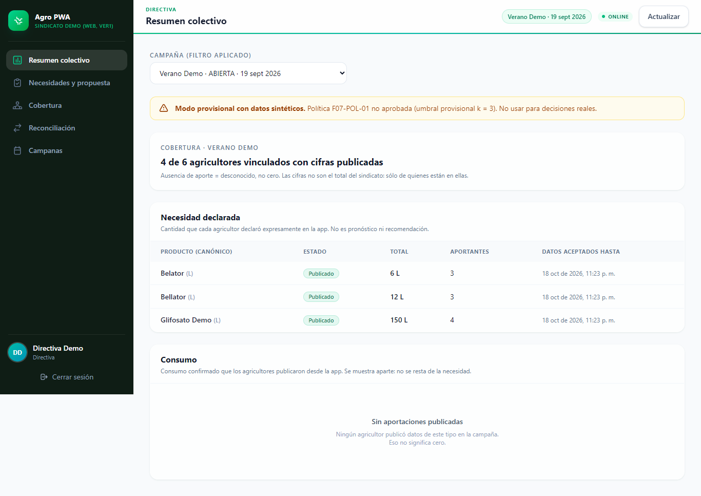
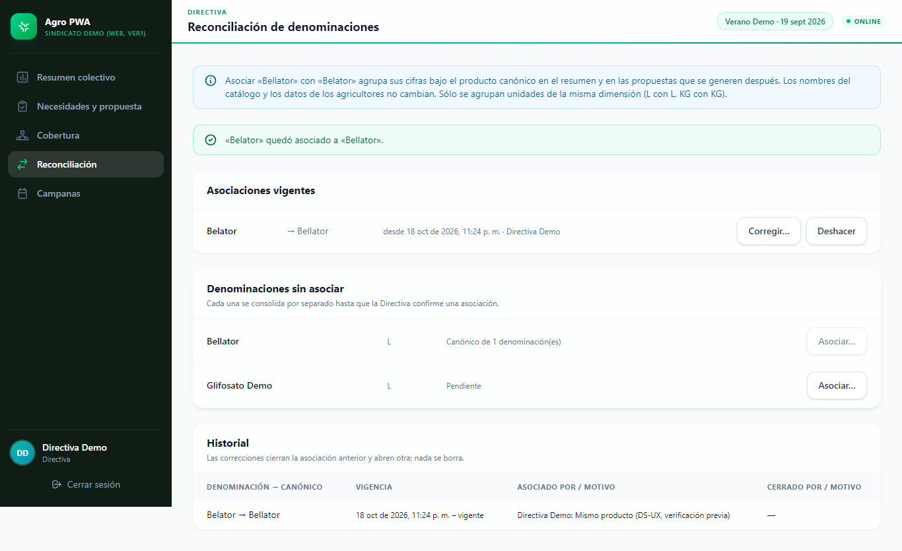
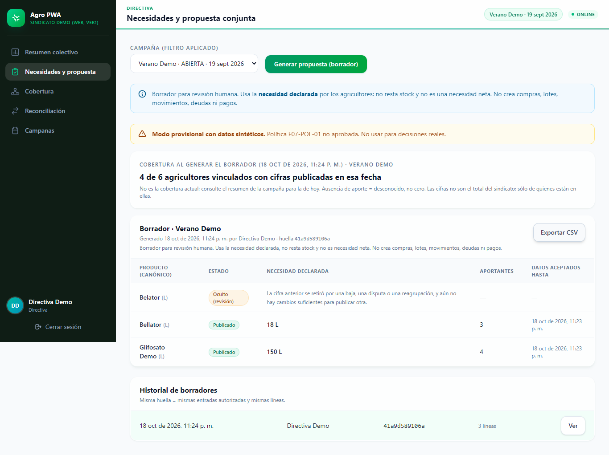
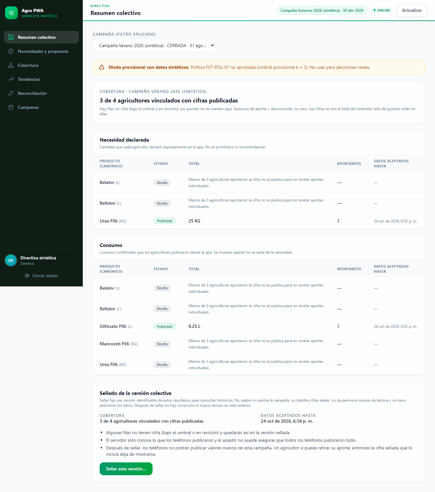
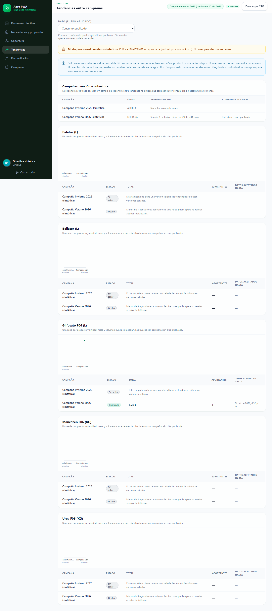
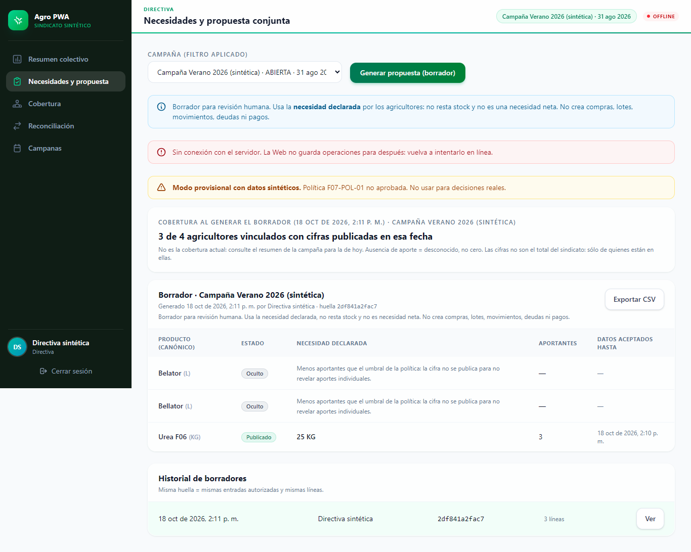

# Manual de usuario de Agrocuentas: app móvil y Web de la Directiva (borrador F11)

> **Documento histórico: no es un manual vigente** (nota del 2026-11-13; los manuales actuales se listan en [README.md](README.md)). Este borrador describe versiones de octubre de 2026 (Mobile `1d77c14` y partes posteriores) y ya no corresponde a la aplicación: la navegación, el CSV y las vistas Web del agricultor que menciona se retiraron o cambiaron. Para la composición final (Mobile `34e9926`, Backend/Web `200fe60`) use [MANUAL_AGRICULTOR.md](MANUAL_AGRICULTOR.md), [MANUAL_WEB_DIRECTIVA.md](MANUAL_WEB_DIRECTIVA.md) y [MANUAL_WEB_ADMINISTRACION.md](MANUAL_WEB_ADMINISTRACION.md). El contenido siguiente no se modificó.

| Campo | Valor |
|---|---|
| Estado | **Borrador revisable de F11** (BE #53). No es un release. GATE-F11 no se evalúa con este documento |
| Fecha de redacción | 2026-10-19 |
| Actualización | 2026-10-24: funciones de F03, RF-13, RF-03, F07 y F08 que ve el usuario (§1.1, §1.2, §2.1, §3, §6, §7, §9.5 y §9.6). 2026-10-27: bloque 2 (D-03, D-04, E-15, D-07, E-12) en §1, §1.1, §2, §3, §4, §11, §12 y §13. 2026-10-28: D-03 con anulaciones demostradas (§2, §2.1, §3 y §11), referencias de la composición probada `fb331c6` y comprobaciones en EMULADOR del bloque 2 (§1.1, §3, §4.1, §4.2, §12 y §13). 2026-10-31: copias previas a restauraciones tras F08-PREV-01 (§7.5, §12 y §13). **2026-11-03: estimación del consumo, F12 (§4.4, §9.4, §9.7, §11, §12 y §13)** |
| Versión descrita | App móvil Mobile `1d77c14`; Central y Web Backend `4bcb1ea`. La redacción del 2026-10-19 describía Mobile `463d3ec` y Backend `2a69fe6` (código `f0b55ee`). **Sólo las partes marcadas como bloque 2 describen el código del bloque 2**: los PR Mobile #156 (D-03, `323f393`; documentación posterior en `7a56656`), #157 (D-04, `b4b548b`), #158 (E-15, `3f70a48`), #159 (D-07, `0ea59aa`) y #160 (E-12, `f32eb97`; la rama incorpora D-07 con el merge `656c645` y documentación hasta `8718e9e`). Su composición probada es Mobile `fb331c6`. Se integraron el 2026-10-28 en Mobile `main` `186f473`, cuyo código es idéntico al de esa composición. Esas partes son: §1 (párrafo *Crear el PIN al terminar*), §1.1 (apartados *Crear el PIN durante la activación* y *Volver a la operación pendiente*, una fila de la tabla y el párrafo *Olvidé el PIN*), §2 (una viñeta), §2.1 (una viñeta), §3 (apartados de la aplicación con fecha pasada y de la transferencia), §4.1, §4.2, una viñeta de §4.3, tres límites de §11, los puntos 8 y 9 de §12 y cuatro filas de §13. **§7.5 describe Mobile `main` `774ae88`** (F08-PREV-01, PR Mobile #173, integrado el 2026-10-31). **§4.4 describe Mobile `main` `5b5b318`**, y **§9.4 (referencia de la estimación) y §9.7 describen Backend y Web `main` `075a511`** (F12, 2026-11-03). **Todo lo demás sigue describiendo Mobile `1d77c14`.** **Limitación declarada:** los cambios de X01 y del bloque 1 (#149, #150–#154) **todavía no están descritos** en este manual; algunos textos y rutas de las partes no actualizadas ya no coinciden con `fb331c6` |
| Manual técnico | [`F11_MANUAL_TECNICO.md`](F11_MANUAL_TECNICO.md) (BE #54): instalación, configuración, respaldos del servidor y recuperación |
| Revisión | Sesión A, el recorrido de usuario. Las decisiones las toma Roderich Rendón |

**Cómo se hizo este borrador:**
- Los textos entre comillas («…») se copiaron del código de esa versión: botones, menús y mensajes.
- No se usó ningún teléfono ni se arrancó ningún servicio.
- Cuando una pantalla o un paso no tiene una prueba fechada en un dispositivo, se marca **[Verificar]**.
- **La versión `463d3ec` se probó en un teléfono el 2026-10-19:** activación, subida y restauración desde la nube, comparación de la copia y liberación de la cola (Backend `docs/evidence/F08_BKP_07_B2_ENSAYO_REAL.md` §2, POCO X5 Pro). Las demás pantallas tienen sus ensayos físicos en versiones anteriores, que se citan en cada sección. Desde `27c4654`, la app sólo cambió los rótulos de las cifras netas, la bitácora del chaco y el CSV.
- **Las funciones añadidas el 2026-10-24** (PIN del titular, «Recuperar acceso», reversión con motivo y PIN, «Operaciones tardías», respaldo cifrado con clave de recuperación y copias previas a restauraciones) se probaron en el POCO X5 Pro el 2026-10-24, en tres rondas (Mobile `docs/evidence/F01_F08_DEVICE_COMPOSICION_2026-10-24.md`). La tercera ronda usó una composición (`8b53ad8`) cuyo código de la app (`lib/`, `android/` y `pubspec.yaml`) es igual al de `1d77c14`. La segunda difiere sólo en el aviso de «Registrar para revisión» (§2.1). Lo que quedó sin probar en el teléfono se marca **[Verificar]**.
- **Sesión DEVICE final del 2026-10-24** (POCO X5 Pro, APK de `1d77c14`; Mobile `docs/evidence/F01_F08_DEVICE_FINAL_2026-10-24.md`, todavía sin integrar en `main`): el aviso de «Registrar para revisión» corregido, la compra tardía sin red, la reversión de una compra sin red, el rechazo `CAMPAIGN_SEALED` y la restauración en una instalación nueva con la copia cifrada desde Backblaze B2. Se citan en cada sección.
- **Bloque 2** (D-03, D-04, E-15, D-07 y E-12): son **decisiones del autor, Roderich Rendón, del 2026-10-27**. La de D-03 se amplió el 2026-10-28 con las anulaciones demostradas, también para las operaciones tardías (decisión del autor del 2026-10-28). Sólo las partes marcadas como bloque 2 están actualizadas (ver la fila *Versión descrita* de la cabecera); el resto del manual sigue en `1d77c14`.
  - Los textos se copiaron del `lib/` de la composición `fb331c6`.
  - Comprobaciones: pruebas en el ordenador (Mobile `docs/evidence/F10_BLOQUE2_*.md`) y un recorrido en **EMULADOR 2026-10-28 (Pixel_8, sin teléfono)**, con datos sintéticos y un solo operador (Mobile `docs/evidence/F10_BLOQUE2_EMULADOR_2026-10-28.md`). Lo que pasó por el emulador se cita así; lo demás sigue con **[Verificar]**. Salvo las anulaciones demostradas de D-03 (APK de `fb331c6`), el recorrido usó la APK de `e5ba07c`, cuyo código de D-04, E-15, D-07 y E-12 es idéntico al de `fb331c6`.
  - **No hubo ninguna prueba en teléfono ni evaluación con personas** para el bloque 2.
  - Estas mejoras no forman parte de los pilotos X01 ni X02.
- **F08-PREV-01 (2026-10-31, §7.5):** los textos se copiaron del `lib/` de Mobile `main` `774ae88`. Comprobado sólo en el ordenador y en la integración continua (Mobile `docs/evidence/F08_PREV_01_VERIFICACION_ROLLBACK_2026-10-31.md`). **No se probó en un emulador ni en un teléfono.**

**Capturas:**
- **App móvil:** todas las capturas de la app que hay en el repositorio Mobile (`artifacts/ui-audit/`) son del 2026-09-05/06, anteriores a la activación, la modalidad, la sincronización, el respaldo en la nube y las cifras netas. **No se usan en este manual.** Hay que tomar capturas nuevas con datos sintéticos **[Verificar]**.
- **Web:** se enlazan capturas vigentes, con datos sintéticos.

**Datos reales:** este manual describe la app y la Web tal como se probaron con **datos sintéticos**. No se ha autorizado su uso con datos reales del sindicato (§11).

---

## Parte I. La app móvil (agricultor)

La app es **su cuaderno**: sus compras, su inventario, sus aplicaciones y sus cuentas se guardan en su teléfono y funcionan **sin Internet**. Al sindicato sólo llegan los totales que usted decide enviar (§6). La Directiva no ve sus datos privados ni sus respaldos.

La barra inferior tiene cinco secciones: «Inicio», «Operaciones», «Inventario», «Personas» y «Cuentas». El botón «Nuevo» abre los registros más usados.

### 1. Activar la app y elegir el titular

La primera vez hay que **activar en línea** con la cuenta que le dio el sindicato. Después la app funciona sin conexión.

1. Abra la app. Si dice «Active la aplicación en línea con su cuenta para empezar a registrar.», pulse «Activar en línea».
2. En «Primera activación», escriba su «Correo» y su «Contraseña» y pulse «Activar». La app muestra los pasos («Verificando credenciales…», «Registrando instalación…», …).
3. Cuando diga «Cuenta activada. Elija el titular para terminar la activación.», se abre «Titular de los datos».

**El titular** es el agricultor dueño de los registros de este teléfono:
- elija una persona que ya exista o pulse «Crear el titular» y escriba su «Nombre»;
- si la persona elegida tiene el rol «Administrador», marque «Confirmo que esta persona es el agricultor titular»;
- un «Tercero» no puede ser titular.

**Modalidad de inventario.** En la misma pantalla:

| Opción | Qué significa (texto de la app) |
|---|---|
| «Compartido» (la opción marcada por defecto: Mobile `lib/presentation/screens/owner_setup_screen.dart:50`) | «Varias personas (familiares o terceros) compran, aplican y transfieren productos; cada una tiene su inventario y su cuenta.» |
| «Propio» | «Sólo el titular compra, aplica y paga. No hay transferencias ni hay que elegir persona en los formularios.» |

Pulse «Confirmar titular».

**Crear el PIN al terminar (bloque 2, E-12).** En una instalación nueva, justo después de «Confirmar titular», la app abre «PIN del titular» y recomienda crear el PIN **sin volver a escribir la contraseña**, porque acaba de confirmarla al activar. Es opcional: puede pulsar «Ahora no». Los pasos y los mensajes están en el primer apartado de §1.1.

**Cambiar la modalidad después:**
- Se hace en Operaciones › «Modo de uso». No borra ni reasigna registros y no necesita conexión.
- De propio a compartido se puede siempre.
- De compartido a propio sólo se puede si nadie más que el titular tiene existencias, planes abiertos o saldos. Si no, la app explica qué falta: «Todavía no se puede pasar a inventario propio. Resuélvalo en modo compartido: …».

**Lo que no se puede hacer:**
- **No hay pantalla para cambiar el titular** una vez elegido.
- **No hay opción de cerrar sesión ni de recuperar la contraseña** en la app. Si olvida la contraseña, consulte al Administrador del sindicato, que la restablece desde la Web (§10). «Recuperar acceso» (§1.2) vuelve a entrar con la cuenta del titular; no cambia ni recupera la contraseña. La única salida de una sesión es «Salir de esta sesión», cuando la sesión del teléfono es de otra cuenta.

**Evidencia:** P1–P13 en el POCO X5 Pro, 2026-10-17 (Mobile `docs/evidence/F03_F04_DEVICE_2026-10-17.md`). Activación temprana: F04-REP-01 en el HONOR, 2026-10-18 (`F04_REPETICION_DEVICE.md`).

#### Avisos de estado de la instalación

| La app dice | Qué significa | ¿Puede registrar? |
|---|---|---|
| «La sesión no está disponible. Los datos locales se conservan y puede seguir registrando; las funciones en línea están en pausa.» | Está sin conexión o la sesión venció | Sí |
| «Datos anteriores sin vincular a una cuenta. …» | Datos de una versión anterior | Sí; para enviar al sindicato debe activar y elegir titular |
| «Estos datos se activaron en otra instalación. Active la aplicación con la misma cuenta para seguir. Los datos se conservan.» | Restauró una copia de otro teléfono | No, hasta activar |
| «La cuenta de esta sesión no corresponde al titular de estos datos. …» | Entró con otra cuenta | No. Los datos no se borran |
| «Se requiere volver a autenticar para las funciones en línea. …» | Hay que volver a entrar: «Volver a autenticar» | Sí, sin conexión |

Cuando la sesión guardada no se puede usar, Inicio o la pantalla de estado ofrecen «Recuperar acceso» o «Salir de esta sesión» (§1.2).

### 1.1 PIN del titular

Tres cosas distintas, que no se sustituyen entre sí:

| Qué | Para qué sirve | Qué **no** hace |
|---|---|---|
| **Contraseña de la cuenta** | Entrar en línea: activar, «Recuperar acceso», configurar el PIN | No autoriza reversiones ni descifra respaldos |
| **PIN del titular** (6 dígitos) | Autorizar en este teléfono, también sin conexión, lo que sólo aprueba el titular: revertir y revisar operaciones tardías | No entra en línea y no descifra respaldos |
| **Clave de recuperación del respaldo** (§7.2) | Descifrar sus copias en la nube | No es la contraseña ni el PIN |

Recuperar una no recupera las otras.

#### Crear el PIN durante la activación (bloque 2, E-12)

Decisión del autor, Roderich Rendón, del 2026-10-27. Textos de Mobile `lib/presentation/screens/owner_credential_screen.dart` y `owner_setup_screen.dart` en `fb331c6`.

**Cuándo aparece:** sólo en una instalación nueva, justo después de activar en línea (§1) y de pulsar «Confirmar titular», y sólo si en este teléfono todavía no hay un PIN de ese titular. La pantalla se llama «PIN del titular» y empieza con «Titular vinculado.» y el aviso de la modalidad, por ejemplo: «Titular vinculado. Usa inventario compartido; puede cambiarlo en Operaciones › Más › Modo de uso.»

**Lo que explica la app:**
- «Le recomendamos crear ahora el PIN del titular. Con él, el titular autoriza en este teléfono, incluso sin conexión, las acciones que sólo él puede aprobar: revertir una operación o revisar una operación tardía.»
- «Acaba de confirmar su cuenta en línea, así que ahora no hace falta volver a escribir la contraseña. Si lo deja para después, tendrá que confirmar la cuenta en línea con su correo y su contraseña.»
- «El PIN no se guarda en el respaldo y no sirve para descifrar copias: la clave de recuperación del respaldo es otra. Tampoco reemplaza la contraseña de su cuenta.»

**Crear el PIN:**
1. «Elija un PIN de 6 dígitos que no sea una secuencia.» Escríbalo en «PIN» y en «Repita el PIN».
2. Pulse «Crear PIN». Este paso no usa la conexión.
3. La app confirma: «PIN del titular creado. Funciona sin conexión.» Pulse «Continuar» para ir a Inicio.

Si los dos PIN no coinciden, la app dice «Los dos PIN no coinciden.» y puede volver a escribirlos.

**«Ahora no»** (o el botón Atrás del teléfono): no se crea ningún PIN y la app va a Inicio con este mensaje: «Puede crear el PIN más tarde en Operaciones › Más › PIN del titular. Entonces se le pedirá confirmar su cuenta en línea.» Más tarde, el PIN se crea como se explica abajo, **con el correo, la contraseña y conexión**.

**Si ya no se puede crear aquí,** la pantalla lo dice y ofrece «Continuar»:

| La app dice | Por qué |
|---|---|
| «Ya no se puede crear el PIN con la confirmación de la activación: pasó el tiempo, salió de la aplicación o cambió la cuenta, la instalación o el titular. Puede crearlo más tarde en Operaciones › Más › PIN del titular, confirmando su cuenta en línea.» | Pasaron más de 10 minutos desde la activación, salió de la app (pantalla apagada o cambio de app) o cambió algo de la cuenta, la instalación o el titular |
| «Ya hay un PIN del titular en este teléfono. Para cambiarlo, confirme su cuenta en línea en Operaciones › Más › PIN del titular.» | El titular ya tiene un PIN aquí. La oferta nunca sirve para cambiarlo ni para restablecerlo |
| «No se pudo guardar el PIN. Puede crearlo más tarde en Operaciones › Más › PIN del titular, confirmando su cuenta en línea.» | Falló el guardado. No queda ningún PIN nuevo |

**No aparece la oferta** si los datos son de una versión anterior y el titular se elige después desde Inicio, ni después de restaurar una copia, de «Recuperar acceso» (§1.2) o de activar con un titular ya vinculado. En esos casos, el PIN se crea con el correo y la contraseña, como siempre.

**La ruta que dice la app.** Los mensajes de la oferta dicen «Operaciones › Más › PIN del titular», que es la ruta de `fb331c6`. Los pasos de abajo («Inicio › «PIN del titular»») describen `1d77c14` y no se han actualizado con X01 (limitación declarada en la cabecera).

**Evidencia:**
- Pruebas en el ordenador: Mobile `docs/evidence/F10_BLOQUE2_E12_PIN_EN_ACTIVACION.md` (2026-10-27).
- **EMULADOR 2026-10-28 (Pixel_8, sin teléfono)**, Mobile `docs/evidence/F10_BLOQUE2_EMULADOR_2026-10-28.md`:
  - E1: la oferta, sin campo de contraseña, y «Crear PIN» con el resultado «PIN del titular creado. Funciona sin conexión.»; el servidor no recibió ninguna petición mientras se creaba el PIN. Después, una reversión sin red autorizada con ese PIN;
  - E2: «Ahora no» entra a Inicio sin PIN; después, configurar el PIN pidió el correo y la contraseña. El mensaje «Puede crear el PIN más tarde…» desapareció antes de poder registrarlo: **[Verificar]** ese texto en pantalla.
- **[Verificar]** el límite de 10 minutos: puede bajar a 5 según la medición E4, que no se puede hacer sin personas.
- **[Verificar]** todo en un teléfono.

#### Configurar el PIN más tarde

**Configurar el PIN** (Inicio › «PIN del titular»):
1. La app explica: «El PIN autoriza en este teléfono, incluso sin conexión, las acciones que sólo puede aprobar el titular: revertir una operación o revisar una operación tardía. No se guarda en el respaldo y no sirve para descifrar copias: la clave de recuperación del respaldo es otra.»
2. «Primero confirme la cuenta del titular en línea.» Escriba el «Correo» y la «Contraseña» de la cuenta del titular y pulse «Confirmar en línea». Hace falta conexión.
3. «Elija un PIN de 6 dígitos que no sea una secuencia.» Escríbalo en «PIN» y en «Repita el PIN», y pulse «Guardar PIN».
4. La app confirma: «PIN del titular configurado. Funciona sin conexión.»

**Cómo se usa:** cuando una acción lo necesita, la app abre un diálogo con lo que hará la acción y el campo «PIN del titular». Pulse «Autorizar», o «Cancelar» para no hacer nada.

**Si algo falla:**

| La app dice | Qué hacer |
|---|---|
| «Esta acción la autoriza sólo el titular con su PIN. Configure el PIN del titular primero.» | Pulse «Configurar PIN» y siga los pasos de arriba. Al volver, la app retoma la operación, sin ejecutarla (ver más abajo el apartado sobre la vuelta a la operación pendiente) |
| «Esta acción la autoriza sólo el titular con su PIN. Para habilitarla, active la aplicación, elija el titular y configure el PIN.» (bloque 2) | No hay titular vinculado. No hay botón «Configurar PIN»: active la app y elija el titular (§1) |
| «PIN incorrecto.» | Vuelva a escribirlo |
| «Demasiados intentos. Espere antes de volver a intentarlo.» | Tras 5 errores seguidos la app hace esperar, cada vez más |
| «El PIN quedó bloqueado. Restablézcalo acreditando al titular en línea.» | Tras 10 errores. Vuelva a «PIN del titular», confirme la cuenta en línea y elija un PIN nuevo |
| «No se pudo acreditar al titular en línea. …» | Revise el correo, la contraseña y la conexión, y vuelva a intentarlo |
| «Para configurar o restablecer el PIN, la instalación debe estar activada con la sesión del titular disponible.» | Active la app o use «Recuperar acceso» (§1.2) |

**Olvidé el PIN:** no hay un botón con ese nombre. Haga lo mismo que para configurarlo: «PIN del titular», «Confirmar en línea» y un PIN nuevo. El PIN anterior deja de valer. **Sin conexión no se puede restablecer.** El bloque 2 no cambia esto: restablecer un PIN olvidado o bloqueado **sigue pidiendo el correo y la contraseña** del titular. La oferta de la activación nunca restablece un PIN que ya existe. Al restablecerlo, las autorizaciones dadas con el PIN anterior dejan de valer, también las del PIN creado al activar.

#### Volver a la operación pendiente (bloque 2, E-12)

Si una acción pide el PIN y todavía no lo tiene (por ejemplo, al revertir una compra o al confirmar una operación tardía), la app ofrece «Configurar PIN». Desde el bloque 2, al terminar **la app vuelve a esa operación**, pero **nunca la ejecuta sola**:

1. Pulse «Configurar PIN» y créelo con el correo y la contraseña (pasos de arriba). Después pulse «Volver».
2. La app comprueba que la operación sigue pendiente y que el titular es el mismo.
3. Vuelve a mostrar la revisión, encabezada por «PIN del titular configurado. Revise la operación y autorícela con su PIN.»
   - En una reversión, el motivo que ya había escrito sigue ahí y se puede cambiar.
   - En una operación tardía, se abre directamente el diálogo del PIN con el mismo encabezado.
4. Escriba el PIN y pulse «Autorizar». Sólo entonces se hace la operación. Con «Cancelar» no se hace nada.

| La app dice | Qué pasó |
|---|---|
| «No se configuró el PIN. La operación no cambió.» | Volvió sin crear el PIN |
| «Esta operación ya no está pendiente: ya fue revertida. No se hizo ningún cambio.» | Mientras configuraba el PIN, la operación cambió. En lugar de «ya fue revertida», puede decir «ya se resolvió» (operación tardía) o «ya no existe» |
| «El titular de estos datos cambió. No se hizo ningún cambio.» | El titular ya no es el mismo |
| «No se pudo comprobar la operación. No se hizo ningún cambio.» | La app no pudo releer la operación. Vuelva a intentarlo desde la lista |

Si cierra la app mientras configura el PIN, la operación no se hace: empiece otra vez desde la lista. Con «Ver la clave» y «Cambiar la clave» del respaldo (§7.2) pasa lo mismo: se vuelve al diálogo del PIN, sin hacer nada antes de «Autorizar».

**Evidencia:**
- Pruebas en el ordenador: casos W1–W8 de Mobile `F10_BLOQUE2_E12_PIN_EN_ACTIVACION.md`.
- **EMULADOR 2026-10-28 (Pixel_8, sin teléfono)**, caso E3: vuelta a la reversión de una compra. Apareció «PIN del titular configurado. Revise la operación y autorícela con su PIN.» con el motivo conservado, la compra no se revirtió sola y se revirtió después de escribir el PIN y pulsar «Autorizar».
- **[Verificar]** la vuelta desde una operación tardía (el emulador no tenía ninguna campaña cerrada; sólo hay pruebas en el ordenador) y desde «Ver la clave» o «Cambiar la clave» del respaldo.
- **[Verificar]** todo en un teléfono.

**El PIN no viaja en los respaldos.** Después de restaurar una copia en otro teléfono hay que configurar un PIN nuevo en ese teléfono.

**Lo que el PIN prueba:** que el titular autorizó la acción en este teléfono. No prueba quién tenía el teléfono en la mano.

### 1.2 Recuperar acceso

Sirve cuando la sesión guardada en el teléfono no se puede usar, por ejemplo porque se dañó o porque restauró una copia en un teléfono nuevo. **Vuelve a entrar con la cuenta del titular de estos datos.** No borra nada: ni los registros, ni los titulares, ni los envíos pendientes, ni los respaldos.

1. Pulse «Recuperar acceso», en Inicio o en la pantalla de estado de la instalación.
2. La app explica, por ejemplo: «Entre con la cuenta del titular de estos datos. Sus datos locales, titulares y pendientes se conservan. Si entra con otra cuenta no se guarda nada.»
3. Escriba el correo y la contraseña de la cuenta del titular y pulse «Recuperar acceso».

**Si entra con otra cuenta,** la app no guarda nada y lo dice: «Esa cuenta no es la vinculada a este teléfono. … No se envió nada ni cambió el titular.» Los datos siguen como estaban.

**Si la sesión del teléfono es de otra cuenta,** la app ofrece «Salir de esta sesión»: «Se cierra la sesión de la cuenta que no es la del titular. Los datos de este teléfono no cambian y no se habilitan para esa cuenta. Después podrá entrar con la cuenta del titular.»

**Recuperar el acceso no envía nada.** Los envíos en «Pausado: restauración» siguen en pausa hasta que usted pulse «Liberar» (§7.3).

**Evidencia:**
- PIN, ver la clave con el PIN y reversión: segunda ronda del 2026-10-24 (casos D3a–D3c, D4 y D6);
- «Recuperar acceso» con la misma cuenta y con otra, tras una pérdida real de la respuesta del servidor: tercera ronda del 2026-10-24 (D1 y D2).

Las dos están en Mobile `F01_F08_DEVICE_COMPOSICION_2026-10-24.md`, en el POCO X5 Pro. Las pruebas en el ordenador están en Mobile `F03_F04_RECUPERAR_ACCESO_RF13_RF03_HOST.md`. **[Verificar]** la espera tras 5 errores y el bloqueo tras 10 en un teléfono: sólo tienen pruebas en el ordenador.

### 2. Campañas y fechas

Cada compra y cada aplicación pertenece a una **campaña**, según su **fecha**.

**Dónde se manejan:** Operaciones › «Administrar datos» › pestaña «Campañas».

**Crear una campaña:**
- Pulse «Agregar campaña», escriba el «Nombre de campaña» y la fecha en «Empieza el».
- Si no hay ninguna activa, queda activa. Si ya hay una activa, queda «Planificada».
- La app explica: «Si la campaña anterior sigue abierta, terminará el día anterior a este inicio; las operaciones desde ese día serán de la campaña nueva, que habrá que activar para registrarlas.»

**Activar una campaña:**
- En el menú de la campaña planificada, pulse «Activar».
- Si hay otra activa, la app pregunta «¿Desea cerrarla y activar …?», con el botón «Cerrar y activar».

**Cerrar una campaña:**
1. En el menú de la campaña activa, pulse «Cerrar».
2. Elija la fecha en «Termina el». Si había un fin previsto, la fecha que confirme lo sustituye.
3. Lea el resumen: compras, aplicaciones, planes pendientes y saldos.
4. Pulse «Cerrar definitivamente».

Al cerrar:
- **una campaña cerrada no se puede volver a activar**; si necesita seguir, cree otra;
- **el inventario físico no se pierde**: sigue en la campaña siguiente.

**Fin previsto sin cerrar:** se fija en Sincronización › «Vincular con el sindicato», menú de la campaña › «Fijar fin previsto…». No cierra la campaña: sólo fija hasta cuándo va.

**Fecha de un registro:**
- Los formularios tienen «Fecha de la compra» o «Fecha de la aplicación», con «Cambiar».
- No se admiten fechas futuras.
- Si la fecha cae fuera de la campaña activa, la app **no registra la operación** y explica por qué. Por ejemplo: «La fecha … corresponde a la campaña cerrada «…». Una operación de un período cerrado requiere revisión y no se registra en otra campaña. No se registró nada.»
- Si la fecha es de una **campaña cerrada**, la app ofrece además registrarla **para revisión** (§2.1).
- **Aplicaciones con fecha pasada (bloque 2, D-03):** aunque la fecha sea de la campaña activa, una aplicación con fecha anterior a hoy **sólo puede usar el producto que la persona tenía ese día y que no se usó después**. Lo comprado o recibido más tarde no cuenta. Una aplicación o una transferencia anulada por error, con una reversión que la app puede emparejar con ella, ya no lo impide (decisión del autor del 2026-10-28). Si no alcanza, la app no registra nada y explica cuánto había (§3, apartado sobre la aplicación con fecha pasada).

**Lo que no se puede hacer:**
- registrar directamente una operación en un período cerrado: sólo para revisión (§2.1);
- mover registros a otra campaña;
- cambiar las fechas de una campaña desde «Catálogos», que sólo permite cambiar el nombre.

Es un límite declarado (D-F04-C1).

### 2.1 Operaciones tardías

Una compra o una aplicación que olvidó registrar y cuya fecha cae en una **campaña cerrada** se registra **para revisión**. Mientras está pendiente no cuenta para nada.

**Registrar para revisión:**
1. Registre la compra o la aplicación con su fecha real.
2. La app muestra «Fecha de una campaña cerrada», con el motivo del rechazo y: «Puede registrar … para revisión: queda pendiente, sin efecto en existencias, costos ni publicaciones, hasta que el titular la confirme o la rechace con su PIN.»
3. Escriba el «Motivo (obligatorio)» y pulse «Registrar para revisión».
4. La app dice: «Guardada para revisión. Confírmela en «Operaciones tardías».» **Todavía no está confirmada**: no hay compra, lote, aplicación ni cambio de inventario.

**Revisar** (Operaciones › «Operaciones tardías»):
- Cada borrador muestra el tipo, la fecha, la campaña, el motivo y su estado: «Pendiente de revisión: sin efectos todavía», «Confirmada por el titular» o «Rechazada».
- **Confirmar** (icono «Confirmar»): la app pide el PIN del titular (§1.1) en «Confirmar operación tardía». Vuelve a comprobar la campaña y las existencias de esa fecha y aplica la operación **una sola vez**, en la campaña de su fecha. El diálogo lo advierte: «Es una corrección privada: el consolidado del sindicato no cambia.» Al terminar, la app dice, por ejemplo: «Confirmada en «Pasada ensayo». Es una corrección privada de una campaña cerrada: el consolidado del sindicato (sellado o no) no se actualiza con ella.»
- **Rechazar** (icono «Rechazar»): con el PIN, en «Rechazar operación tardía». «Rechazada sin efectos.»
- Si no se puede confirmar, el borrador sigue pendiente y explica por qué: «Último intento: las existencias de esa fecha no alcanzan» o «Último intento: la fecha ya no corresponde a esa campaña».
- **Operaciones anuladas por error (bloque 2, D-03; decisión del autor del 2026-10-28):** al comprobar las existencias de esa fecha, la app deja fuera, igual que en una aplicación con fecha pasada, una aplicación o una transferencia revertida cuya reversión puede emparejar con certeza (§3). Lo usado después sigue descontado y el PIN no permite confirmar si las existencias no alcanzan. **[Verificar]** en el emulador y en un teléfono: sólo hay pruebas en el ordenador.

**Período histórico:** si la fecha no está en ninguna campaña, el botón «Período histórico» crea un período cerrado anterior a hoy, sin solaparse con otros: «Es un período local: nunca se publica al sindicato desde él.» Después la operación sigue el mismo recorrido de revisión.

**Lo que no cambia:**
- No se reabre la campaña ni se cambia la campaña activa.
- **Confirmar no envía nada al sindicato.** Si quiere que el consumo de esa campaña cambie en el sindicato, tiene que publicarlo usted (§6), y el sindicato puede rechazarlo si la campaña ya no admite publicaciones o está sellada.

**Evidencia:** segunda ronda del 2026-10-24 (D5a–D5c) en el POCO X5 Pro: registrar, confirmar y rechazar una compra. En esa ronda, la lista de compras anunciaba por error una compra confirmada. Se corrigió en Mobile `967006e`, que ya está en `1d77c14`. En la sesión DEVICE final (Mobile `docs/evidence/F01_F08_DEVICE_FINAL_2026-10-24.md`) se observaron en el teléfono:
- el aviso corregido (caso B2);
- una **compra** tardía registrada y confirmada **sin red**, con un doble toque y sin duplicarse (B3–B4).

**[Verificar]** una **aplicación** tardía en un teléfono.

**Evidencia:** HONOR JDY-LX3P, 2026-10-17/18 (`F04_FECHA_EFECTIVA_DEVICE.md`, `F04_C2_DEVICE.md`) y 2026-10-18 (`F04_REPETICION_DEVICE.md`).

### 3. Compras, aplicaciones, planes y transferencias

| Qué | Dónde | Propio | Compartido |
|---|---|---|---|
| **Compra** | «Nuevo» › «Compra», u Operaciones › «Compras» › «Nueva compra» | Todo es para el titular: «Para el titular: …» | Se reparte entre personas en «Asignaciones» |
| **Aplicación** | «Nuevo» › «Aplicación», u Operaciones › «Aplicaciones» | «Aplica el titular» | Se elige la «Persona» |
| **Plan** | «Nuevo» › «Planificación», u Operaciones › «Planificación» › «Nuevo plan» | Sí | Sí |
| **Transferencia** | «Nuevo» › «Transferencia», u Operaciones › «Transferencias» | **No existe** en modo propio | Sí: origen, productos, destino y «Revisar y confirmar» |

**Compra** («Nueva compra»):
1. Rellene «Proveedor», «Campaña», «Fecha de la compra» y «N.º de factura». Si quiere, añada una foto de la factura con «Cámara» o «Galería».
2. Para cada producto: «Agregar producto», «Producto», «Cantidad comprada», «Moneda» (BOB o USD), el precio y el tipo de cambio.
3. Si ya pagó, marque «Registrar pago total ahora».
4. Pulse «Confirmar compra». La app crea los lotes y suma el inventario.

Si todavía no hay ningún proveedor, el selector dice «No hay opciones disponibles.» y la compra no avanza. Cree antes el proveedor en Catálogos › Proveedores.

En modo compartido, **sólo una persona con rol «Administrador» puede pagar al proveedor**. Un titular creado con «Crear el titular» es «Familiar», no «Administrador».

**Aplicación** («Nueva aplicación»):
- Rellene «Chaco», «Área tratada (ha)» y, para cada producto, la «Dosis (u/ha)» y la «Cantidad real (u)».
- La app muestra lo «Disponible» y el stock que quedará después. Pulse «Confirmar aplicación».
- **Si no hay stock suficiente, no se guarda**: «Revise las cantidades: todos los productos deben tener stock suficiente.»
- Sin campaña activa, la app pide «Active una campaña antes de registrar aplicaciones.»

**Aplicación con fecha pasada (bloque 2, D-03).** Decisión del autor, Roderich Rendón, del 2026-10-27, ampliada el 2026-10-28 para las operaciones anuladas por error.
- Con la fecha de **hoy**, nada cambia.
- Con una fecha **anterior a hoy**, también dentro de la campaña activa, la aplicación sólo puede usar lo que la persona **ya tenía ese día y no se usó después**:
  - cuenta lo comprado o recibido hasta ese mismo día;
  - no cuenta lo comprado o recibido más tarde;
  - no cuenta lo que ya usaron aplicaciones o transferencias posteriores.
- Vale igual para «Aplicar este plan».
- La cifra «Disponible» del formulario es la de hoy. La existencia de la fecha elegida sólo aparece en el mensaje, al confirmar. Si hoy ya no queda nada, el formulario dice «Esta persona no tiene productos en existencia. Registra primero la compra.»

**Si una operación se anuló por error** (decisión del autor del 2026-10-28). A veces una aplicación o una transferencia se registró por error y después se revirtió. Esa operación en realidad no ocurrió, así que **ya no impide registrar con fecha pasada lo que la persona sí tenía**:
- Para calcular lo que había en una fecha pasada, la app deja fuera la operación anulada y su reversión, como si no hubieran existido. Sólo lo hace cuando puede comprobar que esa reversión anula exactamente esa operación: el mismo producto del mismo lote, la misma cantidad y la operación marcada como revertida.
- **Si no lo puede comprobar, no deja fuera nada.** Entonces lo devuelto cuenta desde el día en que se revirtió, no desde antes.
- La reversión de una **compra** no se deja fuera: lo comprado y revertido no vuelve a contar.
- **Nada se borra ni se cambia.** La bitácora y los movimientos del producto siguen mostrando la operación y su reversión con sus fechas reales. Los costos ya registrados no cambian.
- **Lo usado después no vuelve a contar.** Si después de la reversión ya se usó parte de lo devuelto, esa parte sigue descontada. Nunca se puede usar más de lo que queda hoy.
- **El PIN no sirve para pasar por alto la falta de existencias.** Si no alcanza, no se registra, lo autorice quien lo autorice.
- **Lo mismo vale al confirmar una operación tardía** (§2.1).

Ejemplo: una aplicación de 5 L del 20/10 se registró por error y hoy se revirtió con el motivo *Registrada por error*. Ahora se puede registrar una aplicación de 5 L con fecha 19/10, con el mismo costo. Una segunda aplicación el 19/10 ya no encuentra existencias, porque esos 5 L ya se usaron.

Si no alcanza, **no se registra nada** y la app nombra el producto, la fecha y lo que había. Texto de Mobile `lib/data/agro_repository.dart` (`fb331c6`); el final es siempre el mismo:

| La app dice | Cuándo |
|---|---|
| «Bellator: el 15/10/2026 esa persona no tenía este producto; pidió 0,8 L. Una aplicación con fecha pasada sólo puede usar lo que esa persona ya tenía ese día y no se usó después: no cuenta el producto comprado o recibido más tarde. Revise la fecha o la cantidad. No se registró nada.» | Ese día la persona no tenía nada de ese producto |
| «Bellator: el 15/10/2026 esa persona tenía 1 L; de eso quedan 0,3 L sin usar en operaciones posteriores; pidió 0,5 L. Una aplicación con fecha pasada sólo puede usar …» | Ese día lo tenía, pero operaciones posteriores ya usaron una parte. También sale cuando se dejó fuera una operación anulada y parte de lo devuelto ya se usó después; por ejemplo: «Glifosato: el 21/01/2026 esa persona tenía 10 L; de eso quedan 6 L sin usar en operaciones posteriores; pidió 8 L. …» |
| «Bellator: el 15/10/2026 esa persona tenía 1 L; pidió 2 L. …» | Ese día lo tenía y nada posterior lo usó, pero no alcanza |

En el mensaje, «tenía» es lo que había al final de ese día, ya sin las operaciones anuladas por error, y «quedan» es lo que de eso no se usó después. Producto, fechas y cantidades son de ejemplo. Con la fecha de hoy el rechazo sigue siendo «Stock insuficiente para confirmar la aplicación.»

**Qué hacer:** revise la fecha o la cantidad. Si la compra existía, pero se registró con una fecha posterior, la aplicación con fecha anterior no puede usarla.

**Evidencia:**
- Pruebas en el ordenador: Mobile `docs/evidence/F10_BLOQUE2_D03_EXISTENCIA_HISTORICA.md` (2026-10-27 y, para las anulaciones demostradas, §8–§10 del 2026-10-28).
- **EMULADOR 2026-10-28 (Pixel_8, sin teléfono)**, Mobile `docs/evidence/F10_BLOQUE2_EMULADOR_2026-10-28.md`:
  - el rechazo «Glifosato Demo: el 15/10/2026 esa persona no tenía este producto; pidió 1 L. …», sin registrar nada. Se vio con la APK anterior a las anulaciones demostradas, cuyo mensaje es el mismo;
  - con la APK de `fb331c6`, el ejemplo de arriba: la aplicación del 20/10 revertida y la de 5 L del 19/10 aceptada; la bitácora conserva las dos filas con sus fechas, y la segunda aplicación el 19/10 encuentra el formulario sin existencias.
- **[Verificar]** en pantalla las variantes «tenía …; de eso quedan …» y «tenía …; pidió …»: sólo tienen pruebas en el ordenador.
- **[Verificar]** todo en un teléfono.

**Plan:**
- Rellene «Chaco», «Área planificada (ha)» y los productos con su dosis, y pulse «Guardar planificación».
- Cuando aplique, use «Aplicar este plan». Un plan se aplica una sola vez.

**Transferencia: entrega sin deuda (bloque 2, D-07).** Decisión del autor, Roderich Rendón, del 2026-10-27. Sólo existe en modo compartido.
- Una transferencia **entrega producto** de una persona a otra. **No crea ningún cargo ni cobro**, ni a un familiar ni a un tercero, tampoco a un tercero al que se le cobra al asignarle compras.
- Antes de guardar, «Confirmar transferencia» muestra «De: …» y «A: …» y, justo debajo, en negrita: «Esta transferencia entrega producto a [persona], pero no genera una deuda.» Después: «Esta transferencia no registra ningún cargo ni cobro a [persona]. El costo del producto entregado sólo es de referencia, no un precio de venta.» Luego vienen los productos. Pulse «Confirmar», o «Revisar» para volver sin guardar.
- El costo que se muestra es el de compra del producto (FIFO), **sólo de referencia**: no es un precio de venta.
- Si quien recibe paga por lo que aplica, el cargo llega cuando aplique ese producto, como cualquier aplicación. La transferencia en sí no le carga nada.
- No hay forma de vender, prestar ni cobrar una entrega.

**Cómo se ve en el historial** (textos de Mobile `lib/domain/labels.dart`, `transfer_form_screen.dart`, `transfers_screen.dart` e `inventory_detail_screen.dart` en `fb331c6`):

| Dónde | La app dice |
|---|---|
| «Nueva transferencia», fila de producto | «… disponibles · N lote(s) · costo de referencia …» |
| «Transferencias», subtítulo | «Entregas de producto de una persona a otra. No generan deuda; el costo es sólo de referencia.» |
| «Transferencias», cada fila | La fecha y los productos y, en otra línea, «Entrega sin deuda» |
| «Transferencias», al abrir una fila | «… producto(s) · … lote(s) · costo de referencia …» y «Es el costo de compra del producto entregado, no un precio de venta. La entrega no genera deuda.» |
| «¿Revertir esta transferencia?» | «Costo …, sólo de referencia: la transferencia no generó deuda.» y «El stock volverá a la persona de origen y ninguna cuenta cambia. Esta acción no se puede deshacer.» |
| Detalle de un producto, «Movimientos» | La ayuda dice «Lo que explica el saldo: compras, aplicaciones, pases (entregas sin deuda) y reversiones, del más reciente al más antiguo.» «Pase a …» y «Recibido de …» llevan «· entrega sin deuda» tras la fecha y la persona; «Pase revertido: …» lleva «· sin deuda» |

Ninguna cuenta cambia al transferir ni al revertir una transferencia: Cuentas e Inicio no muestran nada que cobrar por ellas.

**Evidencia:**
- Pruebas en el ordenador, con un familiar y con un tercero que paga por compra: Mobile `docs/evidence/F10_BLOQUE2_D07_TRANSFERENCIA_SIN_DEUDA.md` (2026-10-27).
- **EMULADOR 2026-10-28 (Pixel_8, sin teléfono)**: una transferencia del titular a un familiar mostró las dos frases del aviso antes de confirmar y la lista dijo «Entrega sin deuda». No se creó ningún asiento de cuenta.
- **[Verificar]** en pantalla el detalle de la transferencia, el diálogo de reversión y los movimientos del producto, y el caso del tercero: sólo hay pruebas en el ordenador.
- **[Verificar]** todo en un teléfono.

**Corregir un error:** no se edita ni se borra. Se **revierte**: «Revertir compra», «¿Revertir esta aplicación?», «¿Revertir esta transferencia?». La reversión no se puede deshacer, y lo revertido deja de contar en las cifras netas.

**Quién revierte:** sólo el titular, también en modo compartido.
1. La app muestra lo que hará la reversión y pide el «Motivo (obligatorio)».
2. Después pide el PIN del titular (§1.1): «Confirme con el PIN del titular. Motivo: …».
3. La operación revertida muestra quién la autorizó, por ejemplo «Revertida · Autorizada por el titular con el PIN de este teléfono · <motivo>».

Si se restauró una copia de otro teléfono o se cambió el PIN después, dice «con un PIN que ya no está configurado en este teléfono (anterior o de otra instalación)». Las reversiones anteriores a esta versión dicen «Actor no registrado». **Sin PIN configurado no se puede revertir**; el resto de la app funciona igual.

**Evidencia de la reversión:**
- compra revertida con motivo y PIN, también tras reabrir la app: segunda ronda del 2026-10-24 (D4a y D4b);
- reversión de una **compra sin red**, con motivo y PIN, con el actor registrado y sin publicar nada: sesión DEVICE final, Mobile `docs/evidence/F01_F08_DEVICE_FINAL_2026-10-24.md` (A1–A3).

**[Verificar]** la reversión de una aplicación y de una transferencia en un teléfono.

**Voz (F09):** la app muestra «Registrar por voz» en Operaciones y un micrófono («Dictar con voz») en los formularios de compra, aplicación y plan. **El reconocimiento de voz no está validado**: en el ensayo físico quedó `NOT_MEASURED`, y F09 sigue pendiente. Este manual **no describe su uso**. Registre siempre con los formularios.

**Evidencia:**
- compra sin conexión, aplicación y necesidad, y después «Sincronizar ahora»: preflight DS-UX en el POCO, 2026-10-19 (`F10_PREFLIGHT_DSUX.md`);
- modalidades propia y compartida: `F03_F04_DEVICE_2026-10-17.md`;
- en las tarjetas de usabilidad T1, T2 y T6 (`docs/evaluation/usabilidad/03_tarjetas_movil_T1-T6.md`) **no hay todavía sesiones con personas**.

### 4. Inventario, cifras netas, cuentas y reportes

**Inventario:**
- La lista muestra, por producto, «Físico … · comprometido …» y el saldo proyectado.
- El detalle de un producto muestra:

| Cifra | Qué es |
|---|---|
| «Comprado neto» | Lo comprado, sin contar lo revertido |
| «Consumido neto» | Lo aplicado, sin contar lo revertido |
| «Físico» | Lo que debería haber: comprado neto menos consumido neto |
| «Comprometido» y «Libre proyectado» | Lo reservado en planes y lo que quedaría libre |

En modo compartido aparece «Distribución por persona». La «Asignación neta» de cada persona es «lo comprado para esta persona, más lo que recibió y menos lo que entregó por transferencias», y restando su consumido queda su físico. **La parte de una persona no es el total**: el total es la línea «Físico» del producto.

#### 4.1 Cuentas (bloque 2: D-04 y E-15)

Esta parte describe la composición Mobile `fb331c6`. D-04 y E-15 son **decisiones del autor, Roderich Rendón, del 2026-10-27**; el detalle está en Mobile `docs/architecture/D04_E15_CUENTAS_IMPUTACION_Y_COSTO_PROPIO.md`. Los textos se copiaron de Mobile `lib/domain/account_texts.dart`, `lib/presentation/screens/settlements_screen.dart`, `lib/presentation/widgets/account_statement_view.dart`, `lib/presentation/screens/dashboard_screen.dart` y `lib/domain/reports/report_composer.dart`. En los textos, «X» es un importe, por ejemplo «81,00 Bs».

**Cuentas** («Liquidación y cuentas»):
- Cargos, pagos, adelantos y saldos por persona, sin borrar el historial.
- Arriba, «Filtrar por campaña»: empieza en la campaña activa; «Todas las campañas» las junta.
- En el menú de una persona: «Ver detalle cronológico», «Exportar estado de cuenta», «Registrar pago» y «Registrar adelanto».
- Los pagos al proveedor se registran desde Compras.
- En modo propio, los pagos son sólo del titular. A las demás personas el menú les muestra «Inventario propio: pagos sólo del titular».
- **El titular no está en esta lista:** tiene su propia tarjeta, «Consumo y costos propios» (§4.2).

**Pagos y adelantos sin elegir campaña.**
- No hace falta elegir campaña para pagar. La campaña del filtro sólo indica **dónde se registra** el pago; no decide qué deuda cancela.
- El diálogo «Registrar pago» o «Registrar adelanto» muestra:
  - el nombre de la persona;
  - dónde se registra: «Se registra en: Invierno 2026», o «Se registra sin campaña» si el filtro está en «Todas las campañas». Si el período de esa campaña ya terminó: «Se registra en: Verano 2026 (cerrada). En el estado cronológico aparecerá por su fecha, …» (con la fecha de hoy);
  - el saldo de la persona: «Saldo neto · todas las campañas: debe X», «Saldo neto · todas las campañas: a favor X» o «Saldo neto · todas las campañas: al día»;
  - «Se aplica primero a la deuda más antigua, de cualquier campaña.»
- Escriba el «Importe BOB» y pulse «Registrar». La app dice qué deuda canceló, por ejemplo: «Pago de 50,00 Bs registrado a Familiar Demo. Imputado: Verano 2026 50,00 Bs.» Si sobra dinero, añade «Sin imputar: X (queda a favor).»
- Pago y adelanto funcionan igual.

**Imputación a la deuda más antigua.**
- Cada pago nuevo cancela primero el cargo más antiguo que siga pendiente, de cualquier campaña: por su día y, el mismo día, por orden de registro.
- Un pago **no** se resta entero en todas las campañas: se reparte entre los cargos que cancela.
- No cancela cargos revertidos: un cargo revertido ya no es deuda.
- Las imputaciones guardadas antes no cambian, aunque no sigan este orden.

**Ejemplo** (Familiar Demo; Verano 2026 cerrada, Invierno 2026 activa):
- Debe 81 Bs de Verano (15/03) y 40 Bs de Invierno (10/08).
- Paga 50 Bs el 20/10, sin elegir campaña.
- El pago va a la deuda más antigua: **Verano 31, Invierno 40, total 71.**

| Dónde | Qué muestra |
|---|---|
| Cuentas, «Todas las campañas» | «Cargos 121,00 Bs · pagos aplicados 50,00 Bs», «Deuda pendiente 71,00 Bs · a favor (no aplicado a deuda) 0,00 Bs» y, a la derecha, «Saldo neto · todas las campañas» 71,00 Bs |
| Cuentas, filtro Verano 2026 | «Cargos de Verano 2026 81,00 Bs · pagos aplicados 50,00 Bs», «Saldo neto · todas las campañas 71,00 Bs» y, a la derecha, «Deuda pendiente por origen · Verano 2026» 31,00 Bs |
| Cuentas, filtro Invierno 2026 | «Cargos de Invierno 2026 40,00 Bs · pagos aplicados 0,00 Bs», «Saldo neto · todas las campañas 71,00 Bs» y «Deuda pendiente por origen · Invierno 2026» 40,00 Bs |
| Detalle, «Deuda pendiente por origen (a hoy)» | «Verano 2026: cargos 81,00 Bs · pagos aplicados 50,00 Bs · pendiente 31,00 Bs», «Invierno 2026: cargos 40,00 Bs · pagos aplicados 0,00 Bs · pendiente 40,00 Bs», «Deuda pendiente total 71,00 Bs» |
| Detalle, cronológico de Invierno 2026 | «Saldo al inicio del período (01/07/2026) 81,00 Bs»; el cargo de 40 (acumulado 121,00); el pago de 50, «registrado sin campaña», con «Imputado: Verano 2026 50,00 Bs» (acumulado 71,00); «Saldo a hoy 71,00 Bs» |
| Inicio | «Familias por cobrar» 71,00 Bs |
| Resumen de campaña | «Deuda pendiente por origen»: Verano 2026 31,00 Bs; Invierno 2026 40,00 Bs |

Antes del bloque 2, con el filtro de Invierno, la app restaba el pago entero de Invierno y mostraba 10,00 Bs a favor, aunque esa campaña seguía debiendo 40,00 Bs.

**Dos cálculos distintos, con rótulos distintos.** No se suman ni se comparan entre sí:

| | «Deuda pendiente por origen» | «Estado de cuenta cronológico» |
|---|---|---|
| Responde a | ¿Cuánto falta pagar **hoy** de lo que se cargó en esa campaña? | ¿Cómo cambió el saldo **durante el período** de esa campaña? |
| Qué cuenta | Los cargos de esa campaña, sus reversiones y los pagos imputados a ellos | Todos los movimientos **con fecha** dentro del período, sean de la campaña que sean o sin campaña |
| Saldo inicial | No tiene | Sí: lo acumulado antes del inicio del período |
| Rótulos | «Deuda pendiente por origen (a hoy)», «Deuda pendiente por origen · Invierno 2026», «Pendiente a hoy X» | «Estado de cuenta cronológico · período de Invierno 2026 (01/07/2026 – hoy)», «Saldo al inicio del período (01/07/2026)», «Saldo al cierre del período (30/06/2026)» o «Saldo a hoy» |

En el cronológico manda la **fecha** del movimiento: un pago registrado en una campaña cerrada aparece en el período que corresponde a su fecha. Una operación tardía confirmada (§2.1) puede cambiar después el «Saldo al cierre del período» de su campaña. **La app no lo advierte con una leyenda.**

**Crédito a favor.** Lo que no cancela ninguna deuda queda «a favor (no aplicado a deuda)», **sin campaña**:
- lo que sobra de un pago;
- un adelanto hecho cuando no había deudas;
- lo que se había imputado a un cargo que después se revirtió.

El crédito a favor **no se aplica solo** a cargos que lleguen después. Por eso una persona puede tener a la vez deuda por origen y crédito a favor: por ejemplo, «Deuda pendiente por origen · Invierno 2026» 300,00 Bs con saldo neto 0,00 Bs. Sólo un pago nuevo cancela deudas.

En el cronológico, cada pago o adelanto dice qué pasó con él:

| La app dice | Qué significa |
|---|---|
| «Imputado: Verano 2026 81,00 Bs · Invierno 2026 19,00 Bs» | Qué deudas canceló, por campaña de origen |
| «sin imputar X (queda a favor, sin campaña)» | Lo que sobró de ese pago |
| «Sin imputación registrada: X (queda a favor, sin campaña)» | No canceló ninguna deuda. También aparece en pagos antiguos sin imputación guardada: la app no inventa una |
| «Imputado a un cargo revertido (Verano 2026, 15/03/2026): X. Queda a favor.» | Canceló un cargo que después se revirtió |
| «Crédito sin cargo de origen registrado: X (queda a favor, sin campaña)» | Un ajuste a favor sin cargo de origen |

Un cargo dice «Pendiente a hoy X», «Pagado» o «Revertido el …», y su reversión, «Revierte el cargo del …».

**Qué ve en cada pantalla:**

| Pantalla | Qué muestra |
|---|---|
| **Lista**, «Todas las campañas» | «Cargos X · revertidos X · pagos aplicados X» («revertidos» sólo si hay), «Deuda pendiente X · a favor (no aplicado a deuda) X» y, a la derecha, «Saldo neto · todas las campañas» con su importe. Sin cargos: «Sin cargos.» |
| **Lista**, una campaña | «Cargos de [campaña] X · revertidos X · pagos aplicados X», «Saldo neto · todas las campañas X», «A favor (no aplicado a deuda) X (sin campaña)» si hay crédito y, a la derecha, «Deuda pendiente por origen · [campaña]» con su importe |
| **Detalle** («Ver detalle cronológico»), título «Estado de cuenta · [persona]» | Primero «Deuda pendiente por origen (a hoy)»: una línea por campaña, «Deuda pendiente total X», «A favor (no aplicado a deuda) X» con su composición («pagos sin imputar X · liberado por reversión X · otros ajustes X», sólo lo que no es cero) y «Saldo neto · todas las campañas X». Después, el estado cronológico, fila por fila con su «Acumulado». Sin nada: «Sin movimientos.» |
| **Exportación** («Exportar estado de cuenta», que abre Reportes › «Estado de cuenta») | Columnas: Fecha, Concepto, Chaco, Campaña del asiento, Cargo (Bs), Crédito (Bs), Imputación y Acumulado (Bs). Con una campaña: «Saldo al inicio del período (Bs)», «Total de cargos (Bs)», «Total de créditos (Bs)», «Saldo al cierre del período (Bs)» o «Saldo a hoy (Bs)», «Deuda pendiente por origen · [campaña] (Bs)», «A favor (no aplicado a deuda) (Bs)» y «Saldo neto · todas las campañas (Bs)». Con «Todas las campañas», en lugar de la deuda de una campaña, una fila «Deuda pendiente por origen · [campaña] (Bs)» por campaña y «Deuda pendiente total (Bs)». Ya no existe «Saldo final» |
| **Inicio** | «Familias por cobrar» y «Terceros por cobrar» suman lo que **debe** cada persona: el crédito de una no se resta de lo que debe otra. Si alguien tiene crédito, debajo aparece «A favor de familias: X» o «A favor de terceros: X». «Pagos recibidos» y «Principales saldos» no incluyen al titular |
| **Resumen de campaña** (Reportes, y el resumen al cerrar una campaña) | «Deuda pendiente por origen» de esa campaña, sin el titular. Antes decía «Saldo por cobrar» |

**Lo que no hace:**
- no se puede revertir un pago ni un adelanto de cuenta;
- no reparte por su cuenta un crédito a favor entre deudas posteriores;
- no cambia ni borra imputaciones guardadas, ni corrige datos antiguos.

**Evidencia:**
- Pruebas en el ordenador, con el ejemplo de arriba: Mobile `docs/evidence/F10_BLOQUE2_D04_IMPUTACION.md` (2026-10-27).
- **EMULADOR 2026-10-28 (Pixel_8, sin teléfono)**, con otros datos sintéticos:
  - la lista filtrada por campaña con «Deuda pendiente por origen · …»;
  - un pago con «Todas las campañas»: el diálogo dijo «Se registra sin campaña» y «Se aplica primero a la deuda más antigua, de cualquier campaña.», y el mensaje fue «Pago de 10,00 Bs registrado a Familiar Demo. Imputado: Verano Demo 10,00 Bs.». El pago quedó sin campaña y con su imputación;
  - Inicio: «Familias por cobrar» sin el titular y «Pagos recibidos» con el pago.
- **[Verificar]** el detalle («Deuda pendiente por origen (a hoy)» y el estado cronológico), los textos del crédito a favor y el ejemplo Verano 81 / Invierno 40 / pago 50 en pantalla.
- **[Verificar]** la exportación CSV y PDF: no se comprobó en el emulador.
- **[Verificar]** todo en un teléfono.

#### 4.2 Consumo y costos propios del titular (bloque 2, E-15)

**El titular no es deudor de sí mismo.** No aparece en la lista de Cuentas, ni en «Familias por cobrar», «Pagos recibidos» o «Principales saldos» de Inicio, ni en el resumen de campaña. Sus movimientos no se borran: se muestran aparte.

**Tarjeta «Consumo y costos propios»**, encima de la lista de Cuentas, con el nombre del titular:

| Línea | Ejemplo | Qué es |
|---|---|---|
| Consumo | «Consumo aplicado (costo FIFO) · todas las campañas 81,00 Bs» (o el nombre de la campaña filtrada) | El costo de lo que el titular aplicó, sin las aplicaciones revertidas. Se calcula desde las aplicaciones, con cualquier forma de cobro: no desaparece aunque no se le anote ningún cargo. Lo que entregó por transferencia no cuenta |
| Aplicaciones | «1 aplicación vigente · 1 revertida (81,00 Bs, no cuenta)» | Cuántas aplicaciones cuentan y cuántas se revirtieron. Sin ninguna: «Sin aplicaciones vigentes» |
| Asientos | «Asientos en su cuenta · todas las campañas (no son deuda): cargos anotados 81,00 Bs · créditos por reversión 0,00 Bs · pagos y ajustes registrados 0,00 Bs» | Lo anotado en su cuenta, como registro. Con una campaña dice «· período de Invierno 2026 (01/07/2026 – hoy)». Sin asientos: «Sin asientos en su cuenta · todas las campañas.» |

**Menú de la tarjeta:** «Ver movimientos propios», «Exportar movimientos propios», «Registrar pago» y «Registrar adelanto». El pago del titular se registra aparte y **no es un cobro**; su diálogo dice «Pago propio: se registra aparte y no es un cobro ni una deuda.» y no habla de deuda más antigua.

**«Movimientos propios · [titular]»:**
- «Consumo aplicado (costo FIFO)»: una línea por campaña (por ejemplo, «Invierno 2026: 81,00 Bs (1 aplicación)»), las «Aplicaciones revertidas: …» y «Consumo aplicado · todas las campañas X».
- «Asientos de su cuenta (registro, no deuda)»: los movimientos por fecha, **sin «Acumulado»**, sin «Pendiente a hoy» y sin «Pagado». Un cargo revertido dice «Revertido el …». Lo que no se imputó dice «Sin imputar: X».

**«Exportar movimientos propios»** abre Reportes y genera «Movimientos propios del titular»: columnas Fecha, Concepto, Chaco, Campaña del asiento, Cargo (Bs) y Crédito (Bs); totales «Consumo aplicado, costo FIFO (Bs)», «Cargos anotados (Bs)», «Créditos por reversión (Bs)» y «Pagos y ajustes registrados (Bs)».

**En otras pantallas:**
- **Personas:** la fila del titular dice «… · titular · …» y «Consumo propio X», no un saldo. Su detalle dice «… · titular · consumo propio X» y «Consumo aplicado (costo FIFO) · todas las campañas». Si una persona fue titular antes, su detalle muestra además «Consumo propio mientras fue titular».
- **Formulario de aplicación:** para el titular, «Costo propio: X (queda anotado en la cuenta de [titular])» o «Costo propio: X». Para otra persona a la que se cobra al asignar compras: «Esta aplicación no genera cargo a [persona]: su política cobra al asignar compras.»
- **Modo propio** con sólo el titular: la lista dice «En inventario propio no hay cuentas por cobrar.» y la tarjeta del titular se muestra igual.
- Familiares y terceros conservan sus reglas de cobro.

**Evidencia:**
- Pruebas en el ordenador: Mobile `docs/evidence/F10_BLOQUE2_E15_CONSUMO_PROPIO.md` (2026-10-27).
- **EMULADOR 2026-10-28 (Pixel_8, sin teléfono)**:
  - el formulario de una aplicación del titular dijo «Costo propio: 45,00 Bs (queda anotado en la cuenta de Titular)»;
  - Cuentas mostró la tarjeta «Consumo y costos propios» con «Consumo aplicado (costo FIFO) · …» y la línea de asientos «(no son deuda)»;
  - Inicio no sumó al titular en «Familias por cobrar».
- **[Verificar]** «Movimientos propios», el pago propio, Personas y el modo propio: sólo hay pruebas en el ordenador.
- **[Verificar]** la exportación «Movimientos propios del titular»: no se comprobó en el emulador.
- **[Verificar]** todo en un teléfono.

#### 4.3 Reportes

En Operaciones › «Reportes»:
- Tipos: «Inventario», «Costo por producto», «Costo por chaco», «Resumen de campaña» y «Estado de cuenta».
- Desde el bloque 2, el «Resumen de campaña» muestra la «Deuda pendiente por origen» y el «Estado de cuenta» tiene las columnas y los totales de §4.1. El del titular se genera como «Movimientos propios del titular» (§4.2).
- Formatos: «CSV» para hoja de cálculo y «PDF» para imprimir.
- **El archivo no va cifrado.** La app avisa y pide «Exportar igualmente».
- El archivo se guarda en el teléfono, en la carpeta que indica el mensaje «Reporte guardado», dentro de `reportes/`.
- No hay botón para compartirlo.
- El reporte de inventario muestra físico, comprometido, proyectado y valor, pero **no** las columnas netas.

**Evidencia del inventario y de los reportes:**
- **Cifras netas:** hay pruebas en host (MOB #140, `76eea02`). Se vieron en pantalla en el POCO durante la preparación del piloto (2026-10-19), pero **sin evidencia versionada** **[Verificar]**.
- **Reportes:** capturas de la serie EV2, del 2026-09, anteriores a esta versión **[Verificar]**.

#### 4.4 Estimación del consumo (F12, 2026-11-03; Mobile `main` `5b5b318`)

En «Inventario», la tarjeta «Estimación del consumo» abre una **referencia** del consumo de cada producto para la próxima campaña comparable. La calcula el sindicato con cifras ya publicadas y selladas. **No es su necesidad ni una compra:** «Es una referencia: no se suma a su necesidad declarada, no cambia su …». La app solo consulta: no calcula nada.

**Consultar con conexión:**
1. Elija la «Campaña objetivo».
2. Pulse «Consultar con conexión». Por cada producto verá:
   - la estimación, con la fecha de su ejecución («Generada el …»);
   - el período objetivo y la temporada con que se compara;
   - la vigencia.
3. **Si un producto dice «Datos insuficientes»** (u otro motivo) y no muestra cifra, el sindicato no tiene campañas comparables suficientes. La app **nunca** pone un cero en su lugar.

**Vigencia.** «Vigente» quiere decir que es la última estimación y que sus fuentes no cambiaron. Una estimación puede estar «Desactualizada» (cambiaron las cifras o las campañas que la sustentan) o ser «No utilizable» (no tiene cifra). Si una cifra usada dejó de publicarse, no se muestra.

**Usarla sin conexión:**
1. Con conexión, pulse «Descargar copia para consultar sin conexión». Verá «Copia guardada en este teléfono.».
2. Sin conexión, la sección «Copia descargada en este teléfono» muestra la copia con:
   - la fecha de descarga;
   - la «Vigencia al descargar»;
   - «Vigencia actual: desconocida sin conexión»;
   - el aviso de que **puede estar desactualizada**. Sin conexión, la app no sabe si el sindicato cambió las cifras, la política o su acceso.
3. Sin copia descargada, verá «Sin copia descargada…» y ninguna cifra.

**Quién puede leer la copia.** Solo con la instalación activada y la sesión del **titular vigente**, de la misma cuenta y el mismo sindicato que la descargaron.
- La copia se retira al cerrar la sesión, al cambiar de titular o cuando el sindicato rechaza la consulta: acceso retirado, otra campaña o política.
- La copia pertenece a **la sesión, no a la persona**: quien use el teléfono con esa sesión puede verla. La app no pide un PIN extra para esto.
- **Sin conexión no se conocen revocaciones:** si el sindicato le retira el acceso mientras está sin conexión, la copia sigue visible hasta la siguiente consulta con conexión, el cierre de sesión o el cambio de titular.

**Respaldos.** La copia **no entra en su respaldo privado** (§7). Al restaurar un respaldo, la estimación aparece como «Sin copia descargada» y hay que volver a descargarla.

**Caso excepcional del almacenamiento.** Si el teléfono no logra guardar la retirada de una copia ni en la base de la app ni en su almacenamiento seguro (los dos a la vez):
- mientras la app siga abierta, no muestra la copia;
- tras cerrarla y reabrirla sin conexión, la copia anterior podría volver a verse para la misma cuenta, hasta la siguiente consulta con conexión.

Es una limitación aceptada para el alcance académico.

**Comprobado** (Mobile `docs/evidence/F12_EST_07_MOB_ESTIMACION_2026-11-02.md`):
- en el ordenador;
- en el **POCO X5 Pro** contra un Central de ensayo con datos sintéticos: consulta, descarga, lectura en modo avión tras reabrir, «Datos insuficientes» y retirada por rechazos reales;
- con un servidor simulado para el respaldo y la restauración.

En el teléfono **no** se probaron el cierre de sesión ni el cambio de titular (solo en el ordenador). **No se usó emulador.**

### 5. Necesidad declarada

Es **lo que usted pide al sindicato para una campaña**. No cambia su inventario y no es una compra.

1. Vaya a Planificación › «Necesidad declarada al sindicato», o a Sincronización › «Necesidades declaradas».
2. Pulse «Declarar», elija el «Producto» y escriba la «Cantidad total». «Cero es una declaración válida.»
3. Pulse «Continuar» y después «Declarar».

**Cómo funciona:**
- Funciona **sin conexión**: queda «Pendiente» hasta que se envíe.
- Para cambiarla, use «Cambiar cantidad…». Para retirarla, «Anular». Para ver lo anterior, «Historial».
- Antes, sus productos tienen que estar **vinculados** con los del sindicato: Sincronización › «Vincular con el sindicato». Nada se vincula por el nombre: usted elige el equivalente.

### 6. Enviar al sindicato: consumo, acceso y sincronización

**Qué se envía:** sólo **totales propios del titular**, nunca sus compras, precios, cuentas ni fotos:
- la necesidad declarada;
- el **consumo total** por campaña y producto, cuando usted lo publica.

**Publicar el consumo** (Sincronización › «Consumo para el sindicato»):
- La app calcula los totales de sus aplicaciones confirmadas y no revertidas.
- Pulse «Publicar consumo al sindicato» y confirme.
- Cada total **sustituye** al anterior; no se suma.
- No se incluye el consumo de familiares ni de terceros.

**Enviar** (Inicio › «Sincronización con el sindicato»):
- **Cuándo envía:**
  - cuando usted pulsa «Sincronizar ahora»;
  - **y también sola**, cada minuto, mientras la app está abierta y el acceso en línea está verificado. El acceso verificado dura 10 minutos.
- **Con la app cerrada o en segundo plano no envía nada.**
- Una acción en línea que verifica el acceso, como «Verificar acceso en línea» o subir un respaldo a la nube, **puede disparar el envío de lo que ya estaba pendiente**. En el ensayo del 2026-10-19, la app envió una necesidad pendiente justo después de subir un respaldo (ensayo B2 §2, fila «Desviación»).
- Si el acceso no está verificado, primero lo comprueba en línea. Si falla: «Verifique el acceso en línea para enviar. Sus datos siguen guardados.»
- Resultado: «Aceptados: n. Conflictos: n. Rechazados: n.» o «No hay envíos pendientes.»

**Estados de cada envío:**

| Estado | Qué significa |
|---|---|
| «Pendiente» | Todavía no se envió |
| «Pendiente (sin confirmar)» | Se intentó enviar, pero no llegó la confirmación. Se reenvía con **el mismo contenido** y el sindicato no lo duplica |
| «Sincronizado» | El sindicato lo recibió |
| «Conflicto» | Hay que decidir: la app ofrece «Resolver conflicto…» o «Enviar mi total actual» |
| «Rechazado» / «Rechazado (no admitido)» | El sindicato no lo admite. La fila puede mostrar un código técnico |
| «Pausado: autorización», «Pausado: otro titular», «Pausado: versión» | Detenido hasta resolver la causa |
| «Pausado: restauración» | Llegó con un respaldo restaurado (§7.3) y espera que usted lo libere |

**Campaña sellada o que ya no admite publicaciones.** Si el sindicato ya no acepta datos de esa campaña, el envío queda «Rechazado» y la fila lo explica:

| La fila dice | Qué significa |
|---|---|
| «Requiere intervención: Esta campaña está sellada en el sindicato: el histórico colectivo sellado no se actualiza con correcciones posteriores. Su registro privado se conserva.» | La Directiva selló la versión colectiva de esa campaña (§9.5) |
| «Requiere intervención: La campaña ya no admite publicaciones en el sindicato. Su registro privado se conserva.» | La campaña está cerrada en el sindicato |

En los dos casos:
- **sus datos en el teléfono no cambian;**
- la app no reintenta, ni ahora ni al volver a abrirla;
- no envía el dato a otra campaña.

**Evidencia:** el rechazo `CAMPAIGN_SEALED` se observó en el teléfono, con el texto literal de la tabla, en la sesión DEVICE final (Mobile `docs/evidence/F01_F08_DEVICE_FINAL_2026-10-24.md`, C3–C5). Pruebas en el ordenador: Mobile `caca66c`. El sellado está desactivado en el servidor salvo que se active expresamente (§9.5).

**Pregunta T5, «¿Ya llegó su necesidad al sindicato?»:** sí, cuando su fila dice «Sincronizado».

**Evidencia:**
- `F05_MOBILE_SYNC_DEVICE.md` (2026-10-15);
- `F05_SYNC_06_DEVICE_F10.md` (2026-10-16);
- `F06_D4_DEVICE.md`, publicación del consumo (2026-10-16);
- `F10_PREFLIGHT_DSUX.md` (2026-10-19).

Todos se hicieron en el POCO X5 Pro.

### 7. Respaldos

Hay dos tipos. Los dos están en Cuentas › icono de carpeta («Copias de seguridad»).

#### 7.1 Respaldo en el teléfono

**Crear un respaldo:** «Exportar respaldo» guarda un archivo `agroquimicos_backup_….agrobackup`, con la base de datos y las fotos de las facturas, en la carpeta que indica el mensaje. Si falta alguna foto, la app avisa y guarda todo lo demás.

**Dónde queda el archivo:** en la carpeta de descargas propia de la app (`Android/data/<paquete>/files/Download`), no en las Descargas compartidas del teléfono. **Si desinstala la app o borra sus datos, el archivo exportado se borra con ellos.** Cópielo fuera del teléfono, por ejemplo con un cable a un ordenador: la app no tiene botón para compartirlo. **[Verificar]** en un teléfono: se dedujo del código (`backup_service.dart`, `getDownloadsDirectory`) y del complemento `path_provider_android`.

**Restaurar un respaldo:**
1. Pulse «Restaurar respaldo» y elija la copia.
2. La app **comprueba la copia antes de preguntar**:
   - si está dañada (SHA-256), no la restaura;
   - si es de otro titular: «Esta copia pertenece a otro titular … No se restauró; sus datos actuales se conservan.»
3. Confirme «Restaurar». **Todos los datos actuales se reemplazan.** La app guarda antes una copia de los datos actuales por si necesita volver atrás (§7.5).

**Lo que no hace:**
- no hay botón para compartir el archivo;
- no hay respaldo automático;
- **el archivo no va cifrado.** Quien tenga el archivo puede leer sus datos. Guárdelo como guardaría un cuaderno.

**El respaldo de Google y el paso a un teléfono nuevo no traen sus datos.** La app excluye su base de datos, sus archivos y sus claves del respaldo automático de Android y de la transferencia entre teléfonos. **Si desinstala la app, borra sus datos o cambia de teléfono sin un respaldo propio, pierde los datos.** Hace falta una exportación guardada fuera del teléfono, o una copia en la nube junto con su clave de recuperación anotada (§7.2).

#### 7.2 Respaldo en la nube

Es una **copia privada y cifrada de su cuenta** en el servidor del sindicato: «Copia privada y cifrada de sus datos. No se comparte con el sindicato.» Necesita conexión y acceso verificado. Sólo la cuenta del titular puede usarla.

**Se cifra en el teléfono, antes de salir,** con su **clave de recuperación**. «El servidor sólo recibe la copia cifrada: nadie más puede leerla, tampoco la Directiva. No se publica ningún dato al sindicato.»

##### Clave de recuperación

Es la llave de sus copias en la nube. **Es distinta de su contraseña y de su PIN.**

**Crearla** («Respaldo en la nube» › tarjeta «Clave de recuperación» › «Crear la clave»). Antes de crearla, la tarjeta dice: «Antes de subir un respaldo hay que crear su clave de recuperación y anotarla fuera del teléfono.»
1. La app muestra la clave en 14 grupos numerados.
2. «Anótela en papel, tal como aparece, y guárdela fuera del teléfono. No le haga una foto ni la copie en mensajes.»
3. Marque «La anoté en papel y la guardo fuera del teléfono.»
4. «Escriba la clave completa tal como la anotó. Así se comprueba que la tiene fuera del teléfono antes de depender de ella.» Escríbala y pulse «Confirmar la clave».
5. La app dice: «Clave de recuperación confirmada. Ya puede subir respaldos cifrados.»

Mientras no la confirme, **no se sube nada**: «Falta confirmar la clave de recuperación que se le mostró. Hasta entonces no se sube nada.» Si se equivocó al anotarla, «Volver a ver la clave» la muestra otra vez. «Descartar esta clave y no subir respaldos» la abandona sin usarla.

**Verla o cambiarla después** (tarjeta «Clave de recuperación»):
- **«Ver la clave»** pide el PIN del titular (§1.1). «Compruebe que coincide con la que tiene anotada.»
- **«Cambiar la clave»** también pide el PIN. Se crea y se confirma una clave nueva como arriba, o se pulsa «Cancelar el cambio (se mantiene la clave actual)».
- **Conserve también la clave anterior:** «las copias que ya subió siguen necesitándola hasta que el servidor las sustituya por copias nuevas.» Cada copia de la lista indica «cifrada con su clave actual» o «cifrada con una clave anterior (consérvela)».

**Si la pierde:** «Recuperar la cuenta o el PIN no recupera esta clave. Si pierde el teléfono y también la clave, sus copias cifradas no se podrán recuperar.» Nadie puede recuperarla por usted: ni la Directiva, ni el administrador del servidor, ni el proveedor. Si todavía tiene el teléfono, use «Ver la clave» y anótela de nuevo.

**Pantalla protegida:**
- Mientras la clave está en pantalla, la app impide las capturas y las grabaciones de pantalla (FLAG_SECURE).
- **No la oculta de los servicios de accesibilidad** que usted haya autorizado en Ajustes: TalkBack, por ejemplo, puede leerla en voz alta. Es así a propósito, para que quien usa TalkBack pueda anotarla.
- Tampoco protege frente a una cámara que apunte a la pantalla.

| Acción | Cómo | Resultado |
|---|---|---|
| Subir | «Respaldo en la nube» › «Subir respaldo» › «Subir» | «Respaldo cifrado subido y confirmado por el servidor (N KB).» La copia se prepara en una carpeta privada de la app y se borra al terminar: la subida no deja un respaldo en el teléfono. Para tener uno, use «Exportar respaldo» (§7.1) |
| Ver | «Ver copias en el servidor» | «Copia del dd/mm/aaaa hh:mm» y, debajo, «<tamaño> · esquema N · <protección>». La protección es una de estas: «cifrada con su clave actual»; «cifrada con una clave anterior (consérvela)»; «cifrada; pedirá la clave de recuperación con que se subió», para una copia subida desde otro teléfono o antes de reinstalar; «SIN CIFRAR (formato anterior)», para una copia subida con una versión anterior de la app; o «formato desconocido» |
| Restaurar | Icono «Restaurar» en una copia | §7.3 |
| Eliminar | Icono «Eliminar del servidor» | «Copia eliminada del servidor.» Las copias del teléfono no se tocan |

**Cuántas copias guarda el servidor:**
- El servidor conserva **las 5 copias verificadas más recientes** de cada agricultor.
- Al subir la sexta, se retira la más antigua, y sólo después de comprobar la nueva.
- Ninguna copia caduca por antigüedad, y el servidor nunca retira por su cuenta la última copia.
- Es la decisión técnica para la entrega académica, no un plazo institucional.
- **La app no lo menciona.**

**Si la respuesta no llega:** si la conexión se corta al final de una subida, la app consulta la lista. Si el servidor ya tiene la misma copia, dice: «La respuesta no llegó, pero el servidor ya tiene esta copia (mismo SHA-256): no hace falta volver a subirla.»

#### 7.3 Restaurar desde la nube y la cola de envíos

1. Pulse «Restaurar» en la copia. La app la **descarga, la descifra y la comprueba (SHA-256, tamaño, titular) antes de preguntar**.
2. Si este teléfono no tiene la clave con que se subió, la pide: «Esta copia está cifrada con una clave que este teléfono no tiene. Escriba la clave de recuperación que anotó. Sus datos actuales no cambian hasta que confirme la restauración.»
3. Lea el aviso «¿Restaurar esta copia?»: dice que la copia está «descifrada y verificada» y que «TODOS los datos actuales se reemplazarán. Se guarda una copia de los datos actuales en este teléfono. Los envíos al sindicato que traiga la copia quedarán pausados hasta que usted los libere en Sincronización.»
4. Pulse «Restaurar». Si cancela, nada cambia. Al terminar: «Copia restaurada (n fotografía(s)). Se guardó una copia de los datos anteriores en este teléfono.»

**Clave equivocada:** «La clave de recuperación no corresponde a esta copia. Sus datos actuales se conservan.» No se restaura nada y el teléfono queda como estaba.

**En un teléfono nuevo** necesita dos cosas: **la cuenta del titular** y **la clave de recuperación anotada**.
1. Instale la app y actívela con la cuenta del titular (§1).
2. **Restaure antes de crear una clave nueva.** Vaya a «Respaldo en la nube» › «Ver copias en el servidor». Sus copias aparecen como «cifrada; pedirá la clave de recuperación con que se subió». Pulse «Restaurar» en la copia.
3. Escriba la clave anotada cuando la app la pida, y confirme.
4. Configure un PIN nuevo en este teléfono (§1.1): el PIN no viaja en la copia.

**Por qué importa el orden:**
- Si el teléfono no tiene ninguna clave, la que escribe al restaurar queda como **su clave**, y las próximas subidas la usan: no hace falta crear otra.
- Si crea y confirma una clave nueva **antes** de restaurar, la que escribe queda sólo como clave anterior, para descifrar, y las subidas siguientes usan la nueva. Entonces tendrá que conservar anotadas **las dos**.

**Evidencia del teléfono nuevo:** en la sesión DEVICE final (Mobile `docs/evidence/F01_F08_DEVICE_FINAL_2026-10-24.md`, D3–D5) se probó en una **instalación nueva del mismo modelo** (POCO X5 Pro), no en otro teléfono:
- la copia, cifrada por el teléfono, venía de Backblaze B2 real;
- se restauró con la clave escrita, tras el diálogo «Esta copia está cifrada con una clave que este teléfono no tiene. Escriba la clave de recuperación que anotó.»;
- después hubo que configurar el PIN de nuevo;
- una reversión que venía en la copia muestra «… con un PIN que ya no está configurado en este teléfono (anterior o de otra instalación) …».

Antes se habían probado por separado la restauración con la clave guardada en el mismo teléfono, la clave equivocada en una instalación limpia y la cancelación.

**[Verificar]** el recorrido en **otro modelo** de teléfono.

**Restaurar no envía nada al sindicato.** Lo que estaba sin confirmar en la copia pasa a «Pausado: restauración». Lo que ya estaba «Sincronizado» sigue igual.

**Para liberar:**
1. Vaya a Sincronización › «Envíos pausados por una restauración» › «Liberar».
2. La app pide confirmar «Liberar envíos restaurados». Se envían con **el mismo contenido**, y sólo si la cuenta en sesión es la del titular.

Si el sindicato ya los había recibido, no se duplican.

**Un respaldo no es una sincronización:**
- la copia no se publica ni se comparte con el sindicato;
- pero subirla verifica el acceso en línea, y con el acceso verificado la app **puede enviar lo que ya estaba pendiente en la cola** (§6).

Si quiere que algo pendiente no salga todavía, no use funciones en línea hasta decidirlo. Una vez restaurada una copia, lo que esta traiga sin confirmar no sale hasta que usted pulse «Liberar».

**Evidencia:**
- Restauración en instalación limpia, sin publicar, y liberación con un solo envío, con copias del formato anterior, **sin cifrar**:
  - contra el almacenamiento de disco, 2026-10-16 (`F08_MOBILE_RESTORE.md` §5);
  - contra Backblaze B2, 2026-10-19 (Backend `docs/evidence/F08_BKP_07_B2_ENSAYO_REAL.md` §2).
- Copias alteradas, ajenas o dañadas rechazadas, y vuelta atrás si algo falla: `F10_RESTORE_DEVICE.md` (2026-10-16).
- Una copia **cifrada** por el teléfono, subida a Backblaze B2 real y restaurada en una instalación nueva con la clave escrita: sesión DEVICE final, Mobile `docs/evidence/F01_F08_DEVICE_FINAL_2026-10-24.md` (D3–D5).
- Respaldo cifrado, 2026-10-24 (Mobile `F01_F08_DEVICE_COMPOSICION_2026-10-24.md`):
  - crear y confirmar la clave;
  - la pantalla protegida;
  - subir la copia cifrada;
  - restaurar con la clave del teléfono, con una clave equivocada y cancelar (D6, D7a–D7d y D8, contra el disco de un servidor de pruebas);
  - la pausa tras restaurar y la liberación con un solo envío (D7e, tercera ronda).

Todos se hicieron en el POCO X5 Pro.

#### 7.4 Mensajes de error de los respaldos en la nube

| Mensaje | Qué hacer |
|---|---|
| «La sesión venció. Verifique su acceso en línea y vuelva a intentarlo.» | Inicio › «Verificar acceso en línea» |
| «Esta cuenta no tiene acceso a respaldos privados en el servidor.» | Sólo la cuenta de agricultor titular tiene respaldos |
| «Esa copia no existe o no pertenece a esta cuenta.» | Actualice la lista |
| «El respaldo supera el tamaño que admite el servidor.» | Avise al sindicato. El tamaño máximo lo fija el servidor |
| «La copia no llegó íntegra (la comprobación SHA-256 falló). No se usó y sus datos actuales se conservan.» | Vuelva a intentarlo |
| «El servicio de respaldos no está disponible ahora.» | Vuelva a intentarlo más tarde. **También aparece si ya hay otra subida suya en curso**, por ejemplo desde otro intento que no terminó |
| «No hay conexión con el servidor. No se completó la operación.» | Conéctese y repita |
| «La clave de recuperación no corresponde a esta copia. Sus datos actuales se conservan.» | Revise la clave anotada. Si cambió la clave, esta copia puede necesitar la anterior |
| «La copia no supera la comprobación del cifrado: está alterada o incompleta. No se usó y sus datos actuales se conservan.» | Use otra copia |
| «La copia usa un formato de cifrado que esta aplicación no conoce. Actualice la aplicación.» | Actualice la app |
| La tarjeta «Clave de recuperación» indica que el llavero de claves no se puede leer, con el botón «Empezar un llavero nuevo» | Antes de pulsarlo, tenga a mano su clave anotada. El aviso «¿Empezar un llavero nuevo?» explica que las claves que tenía se pierden, que para restaurar copias antiguas tendrá que escribir su clave de recuperación anotada y que sus copias del servidor no cambian |
| «No se pudo guardar la copia en el teléfono (¿falta espacio?). …» | Libere espacio |

La app tiene además el mensaje «Ya tiene el máximo de copias en el servidor. Elimine una antes de subir otra.», pero **el servidor ya no envía esa respuesta**: desde la retención de 5 copias, una subida con 5 copias retira la más antigua. **[Verificar]** si conviene retirar ese texto en una versión futura de la app. Hoy no cambia nada.

**En los ensayos del servidor** (respaldos en la nube, contra Backblaze B2 y con datos sintéticos):
- una subida cortada a mitad **no hace perder ninguna copia anterior**;
- una segunda subida simultánea se rechaza.

Fuente: ensayo B2 del 2026-10-19, §1.

#### 7.5 Copias previas a restauraciones (`.previo`, F08-PREV-01)

Antes de restaurar una copia, del teléfono o de la nube, la app guarda **una copia de los datos que había** en una carpeta privada del teléfono (archivos `….previo-…`). Sirve para volver atrás si la restauración falla.

**Dónde se ven:** «Respaldo en la nube» › «Copias previas a restauraciones».

**Cuánto duran:** «Se guardan en este teléfono. Se conservan hasta dos, siete días, cuando se abre esta sección o se restaura otra copia; no hay limpieza con la aplicación cerrada. La de una restauración sin resolver, o cuya recuperación no se confirmó, no se borra.»

| Estado | Qué significa |
|---|---|
| «restauración terminada» | La restauración salió bien |
| «restauración deshecha» | Algo falló, la app volvió a los datos anteriores y comprobó que son los que había antes de restaurar. También aparece así una copia que estaba sin resolver o «Recuperación sin confirmar» después de que usted pulsara «Mis datos están bien»: en ese caso lo confirmó usted, no la app |
| «en uso por una restauración» | Hay una restauración en marcha |
| «RESTAURACIÓN SIN RESOLVER: copia protegida; bloquea otra restauración» | Una restauración se cortó, o falló y la app no pudo confirmar que volvió a los datos anteriores. La copia no se borra y **no se puede restaurar otra** hasta que usted decida |
| «Recuperación sin confirmar: copia protegida» | Usted eligió seguir con los datos actuales sin confirmar que estén bien. Ya puede restaurar otra copia, pero esta no se borra |

**Si una restauración falla y la app no puede confirmar la recuperación**, avisa: «No pudimos confirmar que sus datos anteriores se recuperaron correctamente. Conservamos la copia de seguridad. Antes de restaurar otro respaldo, elija qué hacer en «Copias previas a restauraciones».»
- Si no había datos que copiar, el aviso no incluye «Conservamos la copia de seguridad».
- Si lo que falla es el propio intento de deshacer la restauración, el aviso puede ser otro, pero la copia queda igual sin resolver.
- El aviso aparece aunque usted haya salido de la pantalla. Hay una prueba de esto sólo para la restauración desde la nube.
- La app **no** afirma que sus datos estén bien: eso lo decide usted después de revisarlos.

**Si intenta restaurar otra copia antes de decidir**, la app no lo hace: «Una restauración anterior no terminó o no pudimos confirmar que sus datos anteriores se recuperaron correctamente. Si se guardó una copia de sus datos de entonces, sigue protegida. Antes de restaurar otro respaldo, elija qué hacer en «Copias previas a restauraciones». No se cambiaron sus datos.»

**Decidir qué hacer con una restauración sin resolver:** pulse «Decidir» en la copia. La app abre «Restauración sin resolver», explica si quedó o no una copia de los datos de entonces y ofrece tres botones:

| Botón | Qué hace | Qué pasa con la copia |
|---|---|---|
| «Cancelar» (o tocar fuera del aviso) | Nada | Sigue protegida y sigue bloqueando otra restauración |
| «Seguir con los actuales» | Le permite restaurar otro respaldo. **No confirma que sus datos estén bien** | Queda «Recuperación sin confirmar»: sigue protegida y no se borra |
| «Mis datos están bien» | Confirma que revisó sus datos y están bien. Antes pide una segunda confirmación | Deja de estar protegida y puede retirarse en la próxima limpieza |

**Seguir no es confirmar:**
- **«Seguir con los actuales»** sirve cuando necesita restaurar otro respaldo, pero todavía no ha revisado sus datos o no está seguro de que estén completos. La copia de antes se guarda por si la necesita.
- **«Mis datos están bien»** es afirmar que los revisó. La app pregunta «¿Sus datos actuales están bien?»: «Hágalo sólo después de revisarlos. La copia de los datos de antes de la restauración del … dejará de estar protegida y puede retirarse en la próxima limpieza (se conservan como máximo dos, durante siete días).» Si no quedó copia en el teléfono, en lugar de «La copia de los datos de antes…» dice «La entrada de la restauración del …, sin copia en este teléfono,». Si cancela, nada cambia.

**Confirmar más tarde:** una copia «Recuperación sin confirmar» tiene su propio botón «Mis datos están bien», que abre la misma confirmación.

**Excepción a la limpieza normal:**
- La limpieza (hasta dos copias, siete días) sólo retira copias terminadas, deshechas o cuya recuperación usted confirmó.
- Las copias sin resolver y las «Recuperación sin confirmar» **no se retiran por antigüedad ni por el límite de dos**.
- Por eso pueden acumularse y ocupar espacio en el teléfono. Para que se retiren, pulse «Mis datos están bien» cuando haya revisado sus datos.

**Qué comprueba la app tras deshacer una restauración:**
- que la base de datos sea la misma que había antes de restaurar (SHA-256), sin cambios pendientes de aplicar distintos de los que ya había;
- que las fotografías recuperadas coincidan con la copia que guardó al empezar. Si antes no había carpeta de fotografías, no la trata como una carpeta vacía.

Si algo no coincide, o no puede comprobarlo, no la da por recuperada. **Límite:** la copia de las fotografías no se compara con las fotografías originales; sólo se compara lo recuperado con esa copia.

**Otros casos:**
- **«El registro de copias no se puede leer»:** la app no borra ninguna copia ni restaura nada hasta que pulse «Apartar». «Apartarlo no borra copias: quedan como «antiguas» y sólo se borran una a una si usted lo pide.»
- **«Copia sin registro»:** una copia que no figura en el registro, de una versión anterior de la app o de un registro apartado. Sólo se borra si usted lo pide.

Las copias previas **no** van cifradas, no se suben a la nube y no salen del teléfono con el respaldo de Google.

**Evidencia:**
- La copia previa tras una restauración, en el POCO X5 Pro el 2026-10-24 (D8).
- La comprobación del estado recuperado, el aviso y los botones «Decidir», «Seguir con los actuales» y «Mis datos están bien»: sólo en el ordenador y en la integración continua (Mobile `docs/evidence/F08_PREV_01_VERIFICACION_ROLLBACK_2026-10-31.md`, PR Mobile #173). **No se probaron en un emulador ni en un teléfono.**
- **[Verificar]** en un teléfono: la restauración sin resolver, los tres botones, el aviso y la limpieza a los siete días (Mobile `F08_RESPALDO_CIFRADO_HOST.md` y la evidencia de F08-PREV-01).

---

## Parte II. La Web de la Directiva

**Quién la usa:** la Web es para la **Directiva** y el **Administrador** (el presidente con funciones de Directiva, ADR-003).

**Qué ve un agricultor:** si entra, ve sólo el aviso «Esta Web es para la Directiva y el Administrador» y «Cerrar sesión». Sus datos se registran en la app.

**Lo que la Web no hace:** no registra operaciones, no guarda nada para después sin conexión y no compra nada.

### 8. Entrar

1. Abra la dirección de la Web, escriba «Correo electrónico» y «Contraseña» y pulse «Ingresar».
2. Se abre «Resumen colectivo». El menú tiene:
   - «Resumen colectivo»;
   - «Necesidades y propuesta»;
   - «Cobertura»;
   - «Tendencias» (§9.6);
   - «Reconciliación»;
   - «Campanas» (así, sin ñ, en esta versión);
   - y, sólo para el Administrador, «Usuarios».

**Mensajes al entrar:**
- «Email o contraseña incorrectos. Verifica tus datos.»
- «Demasiados intentos. Espera un momento antes de intentar nuevamente.» (hay un máximo de 5 intentos por minuto)
- «Error de conexión. Revisa tu acceso a internet.»

**Sesión:**
- Si la sesión vence, la Web vuelve a la pantalla de entrada **sin mostrar ningún mensaje**.
- No hay «¿Olvidó su contraseña?»: el Administrador la restablece en «Usuarios» (§10).

**Rótulos antiguos:** la pantalla de entrada y la barra lateral todavía dicen «Agro PWA» y muestran rótulos antiguos («Inventario en tiempo real», «Modo offline»…). Es un detalle de presentación conocido (`F07_WEB_01.md`) y **no** describe lo que hace la Web.

### 9. Cifras colectivas

> **Política provisional.** Las cifras colectivas se publican según la propuesta **F07-POL-01**, que **no está aprobada** para datos reales:
> - el umbral provisional es **k = 3**: hacen falta al menos 3 agricultores para mostrar una cifra;
> - la aprobación depende del autor, de la Directiva del Sindicato 19 de Agosto y del tutor (#107);
> - GATE-F07 sigue **Pending**.
>
> Mientras tanto, las cifras sólo se muestran en entornos de prueba con **datos sintéticos**, con el aviso amarillo «**Modo provisional con datos sintéticos.** Política F07-POL-01 no aprobada (umbral provisional k = 3). No usar para decisiones reales.». En una instalación de producción, la Web muestra sólo el aviso azul «Política de divulgación pendiente (F07-POL-01). Mientras no se apruebe, el servidor no publica cifras colectivas. …», sin tablas.
>
> Fuente: `docs/architecture/F07_AGGREGATE_DISCLOSURE_POLICY.md`; `F07_POL_01_REVISION_INSTITUCIONAL.md`.

#### 9.1 Resumen colectivo

**Elegir la campaña:** en «Campaña (filtro aplicado)».

**Las dos tablas, siempre separadas:**
- **«Necesidad declarada»**: «Cantidad que cada agricultor declaró expresamente en la app. No es pronóstico ni recomendación.»
- **«Consumo»**: «Consumo confirmado que los agricultores publicaron desde la app. Se muestra aparte: no se resta de la necesidad.»

**Columnas:** «Producto (canónico)», «Estado», «Total», «Aportantes» y «Datos aceptados hasta». No hay totales entre productos.

**Estados de una fila:**

| Estado | Por qué |
|---|---|
| «Publicado» | La cifra se muestra |
| «Oculto» | «Menos de 3 agricultores aportaron: la cifra no se publica para no revelar aportes individuales.» Nunca se muestra cero ni el número de aportantes |
| «Oculto (revisión)» | La cifra anterior se retiró por una baja, una disputa o una reagrupación |
| «Política pendiente» | Sin política aprobada no se muestran cifras |
| «Fuera de rango», «Retirado», «Sustituido» | Casos poco frecuentes. El motivo aparece en la celda |

*Captura sintética del 2026-10-19 sobre el código `cab433d` (`F10_DSUX_CENTRAL_VERIFICACION.md`). Desde `4bcb1ea`, la misma página muestra además el bloque de sellado (§9.5).*

**Versión sellada:** si la campaña tiene una versión sellada (§9.5), el resumen muestra esa versión y no la vuelve a calcular. Arriba aparece «Versión sellada», con «Versión N · sellada el … por …» y la fecha hasta la que el servidor había aceptado datos. Las cifras y la cobertura son las del momento del sellado.

Si un agricultor retira su aporte después del sellado, la fila pasa a «Retirado tras sellar»: «Un aportante retiró su aporte después del sellado: la cifra sellada ya no se muestra. El dato sellado no cambió.»

#### 9.2 Cobertura

**Qué dice la línea de cobertura:** «N de M agricultores vinculados con cifras publicadas». Siempre añade: «Ausencia de aporte = desconocido, no cero. Las cifras no son el total del sindicato: sólo de quienes están en ellas.»

**Pregunta W2, «¿Esa cifra incluye a todos los socios?»:** no. Sólo incluye a los que aparecen en la cobertura.

**La página «Cobertura»** muestra sólo el conteo. Por decisión de alcance **no** muestra qué agricultores aportaron ni cuándo sincronizaron.

#### 9.3 Reconciliación de nombres de producto

Sirve cuando dos nombres son el mismo producto, por ejemplo «Bellator» y «Belator».

**Asociar:**
1. Vaya a «Reconciliación» › «Denominaciones sin asociar» y pulse «Asociar…» en la fila.
2. Elija el «Producto canónico». Sólo se ofrecen productos de la misma unidad.
3. Escriba el «Motivo».
4. Marque «Confirmo que … son el mismo producto…» y pulse «Confirmar asociación».

**Efecto:**
- Las cifras se agrupan bajo el producto canónico en el resumen y en las propuestas nuevas.
- **Los nombres originales y los datos de los agricultores no cambian.**
- No hay sugerencias automáticas.

**Corregir o deshacer:**
- En «Asociaciones vigentes», use «Corregir…» o «Deshacer», siempre con motivo.
- Todo queda en «Historial»: nada se borra.

#### 9.4 Propuesta de compra conjunta y Excel

1. Vaya a «Necesidades y propuesta» y pulse «Generar propuesta (borrador)».
2. El borrador muestra:
   - la campaña, la fecha y el autor;
   - una **huella**: el mismo resultado con los mismos datos da la misma huella;
   - las líneas con la «Necesidad declarada»;
   - la cobertura en la fecha del borrador.
3. Para descargarlo, pulse «Descargar Excel». El archivo se llama `propuesta-<referencia>.xlsx`. Desde el 2026-11-12 (decisión del autor) Excel es la única exportación: el CSV se retiró y sus columnas quedaron en el libro (`docs/architecture/WEB_EXCEL_UNICO_2026-11-12.md`).

**Pregunta W5, «¿Generar ese borrador compra los productos?»: no.** El borrador es «para revisión humana. Usa la necesidad declarada por los agricultores: no resta stock y no es una necesidad neta. No crea compras, lotes, movimientos, deudas ni pagos.» No hay ninguna acción para convertirlo en compra.

**Columna «Estimación del consumo (referencia)» (F12-EST-08, 2026-11-03; Backend y Web `main` `075a511`).** A la derecha de las líneas, cada producto muestra:
- la estimación del consumo para la misma campaña y unidad;
- su vigencia;
- «Ejecución del … · anterior al borrador» o «posterior al borrador», según cuándo se calculó.

Es **otra cifra**: no se suma a la necesidad declarada, no es la cantidad a pedir y no cambia las líneas, los totales ni la huella del borrador. Detalle en §9.7.
- **Sin cifra:**
  - «Sin estimación»: ninguna ejecución incluye ese producto;
  - «Datos insuficientes», con su motivo;
  - «Cifra retirada»: una cifra usada dejó de publicarse;
  - con la política pendiente: «Sin cifra: la política de divulgación no está aprobada».

  Nunca aparece un cero en su lugar.
- **Fila con la necesidad oculta** (decisión del autor del 2026-11-03). La necesidad sigue oculta. Si la estimación de ese producto está permitida, la celda lo dice antes de la cifra: «La necesidad de esta fila no está divulgada. Lo que sigue es la estimación del consumo: no la sustituye ni se suma a la propuesta.». El prototipo W3 del documento dibuja «—» en esa fila; la diferencia es deliberada.
- **Un borrador antiguo** muestra la estimación vigente hoy, marcada como «posterior al borrador» si se calculó después.
- **«Descargar Excel»** (desde el 2026-11-12, en lugar de «Exportar CSV») vuelve a pedir al servidor, al pulsarlo, el borrador y la **referencia fijada** en él (E3), nunca la estimación más reciente. La portada identifica el borrador y la versión, la fecha y el estado de la referencia; la hoja «Consumo estimado» lleva cada línea con su estado, su vigencia y el alcance de cada cifra. Una cifra restringida o retirada no aparece, y no hay diferencias ni porcentajes mientras el servidor no declare comparables las cifras. Sin referencia fijada, el libro lo dice y no lleva ninguna estimación. En una fila oculta, la necesidad queda vacía; nunca lleva la estimación ni un cero.

**Más detalles:**
- Cada vez que genera, se añade un borrador nuevo al «Historial de borradores». No se sobrescribe ninguno.
- Con la política pendiente, no se genera ningún borrador con cifras: «La política de divulgación no está aprobada: no se genera ni se guarda ninguna propuesta con cifras.»

#### 9.5 Sellado de la versión colectiva

**Qué es sellar:** «Sellar fija una versión identificable de estos resultados para consultas históricas. No reabre ni cambia la campaña, no habilita cifras reales, no da permisos nuevos de lectura y no hace anónimos los datos. Después de sellar no hay corrección ni nueva versión en este sistema.» **Cerrar una campaña (§10) y sellarla son pasos distintos.**

**Quién y cuándo:**
- Lo hace una persona de la Directiva o el Administrador, cada uno por sí solo.
- Sólo se sella una campaña **cerrada**.
- El panel está en «Resumen colectivo», debajo de las tablas, con el título «Sellado de la versión colectiva».

**El sellado está desactivado por defecto.** Mientras lo esté, el panel dice «Todavía no se puede sellar.» y da el motivo. Los motivos posibles son:

| Motivo | Qué significa |
|---|---|
| «El sellado está desactivado en este servidor hasta que la app móvil en uso sepa tratar una campaña sellada.» | Quien opera el servidor no lo ha activado |
| «La política de divulgación no está aprobada: no se sella una versión sin cifras autorizadas.» | Sin política no hay cifras que sellar (§9) |
| «Sólo se sella una campaña cerrada. Cerrar y sellar son pasos distintos.» | Cierre antes la campaña |

**Sellar,** cuando el panel lo permite:
1. Revise lo que se va a sellar: la «Cobertura», la fecha de «Datos aceptados hasta» y los avisos. Por ejemplo:
   - «Algunas filas no tienen cifra (bajo el umbral o en revisión) y quedarán así en la versión sellada.»;
   - «El servidor sólo conoce lo que los teléfonos publicaron y él aceptó: no puede asegurar que todos los teléfonos publicaron todo.»;
   - «Después de sellar, los teléfonos no podrán publicar valores nuevos de esta campaña. Un agricultor sí puede retirar su aporte; entonces la cifra sellada que lo incluía deja de mostrarse.»
2. Pulse «Sellar esta versión…».
3. En «Confirmar el sellado», marque «Revisé la cobertura y los avisos, y entiendo que la versión sellada no se corrige ni se reabre.» y pulse «Sellar».
4. Si los datos cambiaron desde la revisión, no se sella nada: «Los datos cambiaron después de su revisión: no se selló nada. Revise de nuevo y confirme.»

**Después de sellar:**
- El resumen muestra la versión sellada (§9.1) y el panel desaparece.
- Un agricultor que intente publicar un valor nuevo de esa campaña recibe en la app el aviso de §6.
- Sus correcciones privadas en el teléfono, como una operación tardía (§2.1), no cambian la versión sellada.

*Captura sintética del 2026-10-24, en un entorno de prueba desechable con el sellado activado (`F07_SELLADO_HISTORICO.md` §7).*

#### 9.6 Tendencias entre campañas

Menú «Tendencias». Compara **sólo versiones selladas**, producto por producto. La página lo advierte:
- «Sólo versiones selladas, celda por celda.»
- «No suma, resta ni promedia entre campañas, productos, unidades o tipos.»
- «Una ausencia o una cifra oculta no es cero.»
- «Un cambio de cobertura no prueba un cambio del consumo de cada agricultor.»
- «Sin pronósticos ni recomendaciones.»

**Cómo se lee:**
- **«Dato (filtro aplicado)»:** elija «Necesidad declarada» o «Consumo publicado». Se muestran por separado.
- **«Campañas, versión y cobertura»:** cada campaña, con «Versión N, sellada el …» o «Sin sellar: no aporta cifras», y su «Cobertura al sellar».
- **Una tarjeta por producto:** una fila por campaña, con «Estado», «Total», «Aportantes» y «Datos aceptados hasta». No hay totales.
- **Los huecos son huecos, no ceros:**

| Estado | Por qué no hay cifra |
|---|---|
| «Sin sellar» | «Esta campaña no tiene una versión sellada: las tendencias sólo usan versiones selladas.» |
| «Sin dato» | «La versión sellada de esta campaña no tiene datos de este producto y unidad. No significa cero.» |
| «Oculto», «Oculto (revisión)», «Retirado tras sellar» | Los mismos motivos que en el resumen (§9.1) |

- **El gráfico** de cada producto sólo dibuja las campañas con cifra publicada y dice cuántas son: «…: n de m campañas con cifra publicada; las demás son huecos, no ceros.»
- **«Descargar Excel»** guarda `tendencias-necesidad-declarada.xlsx` o `tendencias-consumo-publicado.xlsx`, con los mismos estados, el aviso y una hoja «Campañas». Desde el 2026-11-12 sustituye al CSV.

Mientras el sellado esté desactivado no hay versiones selladas, así que la página no muestra cifras: «Sin series selladas. Ninguna versión sellada tiene datos de este tipo. Eso no significa cero.»

*Captura sintética del 2026-10-24, en el mismo entorno de prueba.*

**Evidencia de la Parte II:**
- `F10_DSUX_CENTRAL_VERIFICACION.md` (2026-10-19, 48/48);
- `F10_COMPATIBILIDAD_WEB_S2.md` (2026-10-18; Chrome y Edge; W1–W5 CUMPLE);
- `F07_WEB.md` (2026-10-16);
- sellado y tendencias: `F07_SELLADO_HISTORICO.md` §7, recorrido de la Web contra la API (2026-10-24, 48/48, Chrome, datos sintéticos). **[Verificar]** sellado y tendencias en el entorno del piloto: la verificación DS-UX sobre `4bcb1ea` (`F10_DSUX_CENTRAL_VERIFICACION_4BCB1EA.md`, todavía sin integrar en `main`) se hizo con el sellado desactivado, sin versiones selladas.

Sólo hay pruebas automatizadas: las tareas W1–W5 de `docs/evaluation/usabilidad/04_tarjetas_web_W1-W5.md` **no tienen todavía sesiones con personas**.

#### 9.7 Estimación del consumo (F12, 2026-11-03; Backend y Web `main` `075a511`)

La estimación del consumo es una **referencia exploratoria** para la próxima campaña comparable. El sindicato la calcula con las cifras de consumo **ya publicadas y selladas** de campañas anteriores de la misma temporada.
- No es una necesidad, no es una propuesta y no se suma a ninguna de las dos.
- No crea compras ni movimientos.
- No se aprueba resultado por resultado: la decisión sigue siendo de las personas, en la propuesta (§9.4).

**Generar.**
1. En el menú, «Estimación del consumo».
2. Elija la campaña objetivo, planificada o abierta.
3. Si quiere, marque «Productos (opcional)». Sin marcar, se estiman los productos con consumo publicado en la temporada.
4. Pulse «Generar estimación». La solicitud queda **en cola**: el servidor la calcula aparte y el «Estado del trabajo» pasa de «En cola» a «Procesándose» y a «Terminado» (o «No se ejecutó», con el motivo). Si la consulta automática se detiene, use «Consultar estado ahora».

**Leer los resultados.** Por producto:
- «Resultado»;
- «Estimación SES»;
- «Línea base naive»;
- α;
- «Campañas observadas», con lo publicado en cada una;
- «Cobertura»;
- «Vigencia»;
- «Ejecución».

**Qué es cada cifra:**
- **SES (suavizamiento exponencial simple):** promedia las campañas anteriores dando más peso a las recientes. El peso es α, entre 0 y 1, y el servidor lo elige con esas mismas campañas.
- **Naive:** repite la última cifra publicada. Es la línea base que cualquier método debería superar.
- **El SES puede no superar al naive.** En la evaluación sintética de F12-EST-09, el naive tuvo menor error en tres de los cinco conjuntos evaluables (S2, S3 y S4). Ninguna de las dos cifras demuestra precisión con campañas reales.

**Sin datos suficientes.** Con menos de tres campañas comparables consecutivas con consumo comprobado, o si la campaña anterior no tiene consumo comprobado, el resultado dice «Datos insuficientes», con su motivo, y **no muestra cifra**. Una campaña oculta o sin registro **no cuenta como cero**. **«Consecutivas» se cuenta sobre las campañas registradas en el sistema:** si una campaña de la temporada nunca se registró, el sistema no lo detecta. Se supone que el catálogo de campañas está completo.

**Vigencia** (se evalúa cada vez que consulta):

| Vigencia | Qué significa |
|---|---|
| «Vigente» | Ninguna ejecución posterior la reemplaza y sus fuentes no cambiaron |
| «Sustituido» | Una ejecución calculada posterior la reemplaza |
| «Desactualizado» | Cambiaron las cifras, las campañas, las asociaciones o la clasificación que la sustentan. Si una cifra usada dejó de publicarse, la estimación **no se muestra** («Cifra retirada») |
| «No utilizable» | La ejecución falló o el producto no tiene cifra |

**Ejecuciones anteriores.** La sección lista todas las ejecuciones, incluidas las fallidas, de la más reciente a la más antigua, con «Ver detalle» y «Cargar más». Ninguna se modifica ni se borra.

**Exportar.** «Descargar Excel» guarda en un libro la consulta tal como la responde el servidor al pulsarlo (desde el 2026-11-12 sustituye a «Exportar CSV de la consulta»). No es una copia para consultar sin conexión.

**Copia sin conexión en este navegador.**
1. Con conexión, pulse «Descargar copia para consultar sin conexión».
2. Sin conexión, la pantalla muestra la copia con su fecha, la «Vigencia al descargar», la «Vigencia actual» como «Desconocida sin conexión» y el aviso «Puede estar desactualizada.».
3. Tras recargar sin conexión, la página de inicio de sesión ofrece «Hay una estimación descargada en este navegador. Consultarla sin conexión».
4. Generar, actualizar y exportar requieren conexión.

**Quién puede leer la copia:**
- Solo la sesión con rol de Directiva o Administrador que la descargó, en ese navegador.
- La copia se retira al cerrar la sesión, al entrar con otra cuenta u otro sindicato, o cuando el servidor rechaza la consulta: un 404 retira la copia de esa campaña.
- Pertenece a **la sesión del navegador, no a la persona**.
- **Sin conexión no se conocen revocaciones.**

**Quién ve qué:**
- **Directiva y Administrador:** generan y consultan con el perfil institucional (SES, naive, cobertura y serie).
- **Agricultor:** en la app consulta solo la estimación, sin naive, cobertura ni serie (§4.4). La Web no es su cliente.
- **Con la política de divulgación pendiente** no se genera ni se muestra ninguna cifra.

**Comprobado:**
- en el ordenador, con PostgreSQL desechable;
- con recorridos de navegador (Edge sin interfaz) contra el servidor real con datos sintéticos: Backend `docs/evidence/F12_EST_06_WEB_2026-11-02.md`, `F12_EST_07_WEB_2026-11-02.md` y `F12_EST_08_REFERENCIA_PROPUESTA_2026-11-03.md`.

**Límites:**
- Solo con datos sintéticos.
- No se ha evaluado la precisión con campañas reales ni hay ahorro demostrado.
- La política de divulgación es provisional y no está aprobada.

### 10. Campañas y usuarios en la Web

**«Campanas»** (Directiva y Administrador):
- Acciones: «Nueva campana», «Editar», «Abrir» y «Cerrar», con motivo.
- Al cerrar, la Web avisa: «Al cerrar la campana se bloquearan operaciones normales asociadas a este periodo.»
- No hay acción para cancelar ni borrar una campaña.

**«Usuarios»** (sólo el Administrador):
- «Nuevo usuario», con rol Agricultor, Directiva o Administrador. Para crear otro Administrador hay que marcar una confirmación.
- «Editar». El correo no se puede cambiar.
- «Contraseña», para restablecerla.
- «Desactivar». Un usuario desactivado no puede entrar. Nadie puede desactivar su propia cuenta.

**Mensajes de error frecuentes en la Web:**

| Mensaje | Qué significa |
|---|---|
| «Sin conexión con el servidor. La Web no guarda operaciones para después: vuelva a intentarlo en línea.» | Sin red. No se guardó nada |
| «Su rol no tiene acceso a la información colectiva.» | La cuenta no es de Directiva ni de Administrador |
| «No existe o no pertenece a su organización.» | Referencia equivocada o de otro sindicato |
| «Los datos cambiaron mientras tanto. Recargue la página y vuelva a intentarlo.» | Otra persona cambió algo a la vez |
| «Datos no válidos: revise la confirmación y el motivo.» | Falta la casilla o el motivo |

---

## Parte III. Límites que debe conocer

### 11. Lo que todavía no está disponible

- **Datos reales:**
  - las cifras colectivas reales no están autorizadas (§9);
  - los respaldos en la nube están cerrados en un servidor de producción hasta cumplir las condiciones del modelo de amenazas (manual técnico, §7.3);
  - no existe ningún despliegue productivo.
- **Voz (F09):** pendiente. No usar como forma de registro validada.
- **En la app:**
  - cambiar el titular;
  - cerrar sesión;
  - recuperar la contraseña;
  - reabrir una campaña cerrada;
  - mover registros de campaña;
  - editar o borrar compras y aplicaciones (sólo se revierten);
  - compartir reportes o respaldos desde la app;
  - respaldos automáticos;
  - envío en segundo plano;
  - cifrado de los reportes, de la exportación local («Exportar respaldo») y de las copias previas a restauraciones (sólo se cifra el respaldo en la nube);
  - recuperar la clave de recuperación del respaldo si se pierde (§7.2);
  - restablecer el PIN sin conexión (§1.1);
  - vender, prestar o cobrar una entrega hecha por transferencia (§3, bloque 2);
  - revertir un pago o un adelanto de cuenta, o aplicar sin un pago nuevo un crédito a favor a deudas posteriores (§4.1, bloque 2);
  - usar, en una aplicación con fecha pasada o en una operación tardía, lo devuelto por una reversión que la app **no puede emparejar con certeza** con su operación, o por la reversión de una compra: eso cuenta desde el día en que se revirtió (§3, bloque 2). Desde la decisión del autor del 2026-10-28, una aplicación o una transferencia anulada por error, con su reversión emparejada, ya no lo impide; lo usado después sigue descontado y el PIN no permite superar las existencias.
- **En la Web:**
  - detalle por agricultor;
  - estado de sincronización de cada agricultor;
  - necesidad neta;
  - ejecutar compras o pagos;
  - CSV (desde el 2026-11-12 la Web sólo exporta en Excel);
  - «¿Olvidó su contraseña?».
- **Privacidad de los respaldos en la nube:**
  - Desde esta versión, la app los cifra en el teléfono con la clave de recuperación antes de subirlos (§7.2). El servidor y el proveedor guardan la copia cifrada y no tienen la clave.
  - **Las copias subidas con una versión anterior** aparecen como «SIN CIFRAR (formato anterior)». De ellas sigue valiendo lo que decía la redacción anterior: el proveedor las cifra en reposo, pero quien opera el servidor podría leerlas (manual técnico, §5.2). Puede eliminarlas con «Eliminar del servidor» después de subir una copia cifrada.
  - El cifrado protege el contenido, **no lo hace anónimo**. El servidor sabe de qué cuenta es cada copia, cuándo se subió, cuánto ocupa, la versión de su esquema y un identificador no secreto de la clave, con el que puede saber si dos copias usan la misma clave.
- **La clave en pantalla y la accesibilidad:** mientras se muestra la clave de recuperación no se pueden hacer capturas ni grabaciones de pantalla, pero los servicios de accesibilidad autorizados, como TalkBack, sí pueden leerla (§7.2).
- **Estimación del consumo (F12, §4.4, §9.4 y §9.7):**
  - solo con datos sintéticos, sin precisión demostrada con campañas reales ni ahorro;
  - en la evaluación sintética, el naive superó al SES en tres de los cinco conjuntos evaluables;
  - la política de divulgación es provisional;
  - el primer resultado con datos reales exigiría tres campañas consecutivas selladas después de la migración de F12;
  - la copia sin conexión pertenece a la sesión, no a la persona; sin conexión no se conocen revocaciones; en el teléfono hay un caso excepcional de almacenamiento (§4.4);
  - la estimación no se prueba en un emulador;
  - en el teléfono no se probaron el cierre de sesión ni el cambio de titular.
- **Sellado y tendencias (Web):** el sellado está desactivado por defecto. Mientras lo esté, no hay versiones selladas ni tendencias con cifras (§9.5 y §9.6).
- **Equipos probados:**
  - app: POCO X5 Pro (Android 12) y HONOR JDY-LX3P (Android 16);
  - Web: Chrome y Edge.
- **Letra grande en pantallas pequeñas:** con la fuente del sistema aumentada en el HONOR (720 px, configuración A4-F), la compatibilidad está registrada como **NO CUMPLE**, por textos cortados (MOB #129). La corrección está integrada, pero falta repetir la medición en ese equipo (`F10_CONTRASTE_81_Y_VALIDATION.md`, fila 48-1, en BE #153).

### 12. Lo que hay que verificar antes de cerrar este manual

1. Capturas nuevas de la app con datos sintéticos: activación, titular, modalidad, Sincronización, Respaldo en la nube, detalle de inventario con cifras netas y Reportes.
2. Las cifras netas en un teléfono: tienen prueba en host. Se vieron en pantalla en la preparación del piloto, pero falta la evidencia versionada.
3. Que los textos citados de la app coincidan en pantalla con la versión que se entregue. Si la APK final no es `1d77c14`, o la Web no es `4bcb1ea`, hay que releer este manual. Las partes del bloque 2 citan la composición probada `fb331c6` (PR Mobile #156–#160): están integrados en Mobile `main` `186f473`. §7.5 cita Mobile `main` `774ae88` (F08-PREV-01). Faltan todavía los cambios de X01 y del bloque 1.
4. Las marcas **[Verificar]** del 2026-10-24:
   - espera y bloqueo del PIN;
   - aplicación tardía;
   - reversión de una aplicación y de una transferencia;
   - restauración en otro modelo de teléfono;
   - restauración sin terminar;
   - (2026-10-31) restauración sin resolver, «Seguir con los actuales» y «Mis datos están bien» (F08-PREV-01, sólo en el ordenador y en la integración continua);
   - dónde queda la exportación local y que se borra al desinstalar;
   - sellado y tendencias en el entorno del piloto.
5. Capturas nuevas de las pantallas «PIN del titular», «Recuperar acceso», «Operaciones tardías» y «Clave de recuperación». **No** se puede capturar la clave: la pantalla está protegida. Para esa pantalla basta una descripción, sin la clave.
6. Las sesiones de usabilidad T1–T6 y W1–W5 (#47, MOB #37): sus resultados pueden pedir cambios de redacción.
7. La relectura del recorrido de usuario por la sesión A, y de las partes F03/F04 (§1.1, §1.2, §2.1 y §3) y F08 (§7) del 2026-10-24 por las sesiones A y C.
8. Las marcas **[Verificar]** del bloque 2 que quedan después del EMULADOR 2026-10-28 (Pixel_8, sin teléfono). **Todo el bloque 2 sigue sin comprobarse en un teléfono.** En el emulador faltan:
   - D-03: en pantalla, las variantes «tenía …; de eso quedan …» y «tenía …; pidió …», y la operación tardía con una operación anulada por error;
   - D-04: el detalle, los textos del crédito a favor, el ejemplo Verano 81 / Invierno 40 / pago 50 y la exportación CSV y PDF;
   - E-15: «Movimientos propios», el pago propio, Personas, el modo propio y su exportación;
   - D-07: el detalle de la transferencia, el diálogo de reversión, los movimientos del producto y el caso del tercero;
   - E-12: el mensaje de «Ahora no», la vuelta desde una operación tardía y desde la clave del respaldo (F08), y la medición E4, que decide si el límite baja de 10 a 5 minutos y necesita personas.
   - Las familias de rechazo de sincronización tampoco se recorrieron en el emulador del bloque 2; las de §6 conservan sus evidencias anteriores.
9. Capturas nuevas, con datos sintéticos, de la oferta del PIN, la tarjeta «Consumo y costos propios», el detalle de cuenta y «Confirmar transferencia».
10. (2026-11-03, F12) Capturas de la app de «Estimación del consumo» con y sin copia; la del POCO es de la evidencia de Mobile y no se reproduce aquí. Releer §4.4, §9.4 y §9.7 si la APK o la Web que se entreguen no son Mobile `5b5b318` y Backend `075a511`.

### 13. Trazabilidad

| Sección | Contrato o decisión | Evidencia |
|---|---|---|
| 1. Activación y modalidad | ADR-001; `F02_IAM_DESIGN.md` | Mobile `F03_F04_DEVICE_2026-10-17.md`, `F04_ACTIVACION_TITULAR_MODO.md`, `F04_REPETICION_DEVICE.md` |
| 1.1–1.2. PIN del titular y «Recuperar acceso» | Mobile `docs/architecture/F03_RECUPERACION_IDENTIDAD_LOCAL.md` | Mobile `F01_F08_DEVICE_COMPOSICION_2026-10-24.md` (D1–D3, D6); `F03_F04_RECUPERAR_ACCESO_RF13_RF03_HOST.md` |
| 2. Campañas y fechas | `F04_GATE_DECISION_PROPUESTA.md` (D-F04-C1) | `F04_FECHA_EFECTIVA_DEVICE.md`, `F04_C2_DEVICE.md` |
| 2.1 y 3. Operaciones tardías (RF-03) y reversión con motivo y PIN (RF-13) | Mobile `docs/architecture/F04_RF13_RF03_ACTOR_Y_TARDIAS.md` | Mobile `F01_F08_DEVICE_COMPOSICION_2026-10-24.md` (D4, D5) y `F01_F08_DEVICE_FINAL_2026-10-24.md` (A1–A3, B2–B4); `F03_F04_RECUPERAR_ACCESO_RF13_RF03_HOST.md` |
| 3–4. Registro, inventario y cuentas | ADR-001 | `F10_PREFLIGHT_DSUX.md`; Mobile `REC_CONCILIACION_2026-10-19.md` en `b0d169b` (cifras netas, host) |
| 5–6. Necesidad, consumo y sincronización | `F05_SYNC_V1_PUSH_ACK_CONTRACT.md`; `F06_COLLECTIVE_PROJECTION_CONTRACT.md`; `F07_SEALED_HISTORY_CONTRACT.md` §7 (`CAMPAIGN_SEALED`) | `F05_MOBILE_SYNC_DEVICE.md`, `F05_SYNC_06_DEVICE_F10.md`, `F06_D4_DEVICE.md`; `CAMPAIGN_SEALED`: Mobile `caca66c` (ordenador) y `F01_F08_DEVICE_FINAL_2026-10-24.md` (teléfono, C3–C5) |
| 7. Respaldos | `F08_BACKUP_THREAT_MODEL.md`; `F08_BKP_06_RETENCION.md`; Mobile `docs/adr/F08-ADR-003-respaldo-cifrado-y-previo.md` | `F08_MOBILE_RESTORE.md`, `F10_RESTORE_DEVICE.md`; Backend `F08_BKP_07_B2_ENSAYO_REAL.md`; Mobile `F08_RESPALDO_CIFRADO_HOST.md` y `F01_F08_DEVICE_COMPOSICION_2026-10-24.md` (D6–D9) y `F01_F08_DEVICE_FINAL_2026-10-24.md` (D3–D5); Mobile `F08_PREV_01_VERIFICACION_ROLLBACK_2026-10-31.md` (HOST y CI) |
| 8–10. Web de la Directiva | ADR-003; `F07_AGGREGATE_DISCLOSURE_POLICY.md` (propuesta); `AUTHORIZATION_MATRIX_VIGENTE.md` | `F07_WEB.md`, `F07_WEB_01.md`, `F10_COMPATIBILIDAD_WEB_S2.md`, `F10_DSUX_CENTRAL_VERIFICACION.md` |
| 4.4. Estimación del consumo en la app (F12-EST-07-MOB; CU-21, RF-40, RN-30, DAT-20) | Backend `F12_EST_01_ESTIMATION_CONTRACT.md` §9 y `F12_EST_07_COPIA_MOBILE.md` | Mobile `F12_EST_07_MOB_ESTIMACION_2026-11-02.md` (HOST, DEVICE real y simulado) |
| 9.4 y 9.7. Estimación en la Web y referencia en la propuesta (F12-EST-06, 07-WEB y 08; CU-20, CU-21, RF-23, RF-35 a RF-40, RN-29) | `F12_EST_01_ESTIMATION_CONTRACT.md` §4, §7.1, §8 y §9 | `F12_EST_06_WEB_2026-11-02.md`, `F12_EST_07_WEB_2026-11-02.md`, `F12_EST_08_REFERENCIA_PROPUESTA_2026-11-03.md`; índice `F12_EST_10_INDICE_EVIDENCIA_2026-11-03.md` |
| 9.5–9.6. Sellado y tendencias | `F07_SEALED_HISTORY_CONTRACT.md`; F06 §7.2 (`R_COLLECTIVE_HISTORY`) | `F07_SELLADO_HISTORICO.md` (§7, recorrido Web 48/48) |
| 1 y 1.1. PIN en la activación y vuelta a la operación pendiente (bloque 2, E-12; RF-01, RF-13, RF-03, CU-01, RNF-04) | Decisión del autor del 2026-10-27; Mobile `docs/architecture/F03_RECUPERACION_IDENTIDAD_LOCAL.md` §4 bis | Mobile `F10_BLOQUE2_E12_PIN_EN_ACTIVACION.md` (ordenador); `F10_BLOQUE2_EMULADOR_2026-10-28.md` (EMULADOR, E1–E3) |
| 2, 2.1 y 3. Aplicación con fecha pasada y operaciones anuladas por error (bloque 2, D-03; RF-03, RF-13, CU-09) | Decisiones del autor del 2026-10-27 y del 2026-10-28 (anulaciones demostradas, también en las operaciones tardías); Mobile `F04_RF13_RF03_ACTOR_Y_TARDIAS.md` §2.3 y §2.6; `docs/15_BUSINESS_RULES.md` (precisión de la regla de stock suficiente) | Mobile `F10_BLOQUE2_D03_EXISTENCIA_HISTORICA.md` (ordenador, §8–§10 para las anulaciones demostradas); `F10_BLOQUE2_EMULADOR_2026-10-28.md` (EMULADOR) |
| 3. Transferencia sin deuda (bloque 2, D-07; RF-11, CU-08) | Decisión del autor del 2026-10-27; Mobile `docs/15_BUSINESS_RULES.md` (regla de transferencias sin efecto contable) | Mobile `F10_BLOQUE2_D07_TRANSFERENCIA_SIN_DEUDA.md` (ordenador); `F10_BLOQUE2_EMULADOR_2026-10-28.md` (EMULADOR) |
| 4.1–4.3. Cuentas: imputación entre campañas y consumo propio del titular (bloque 2, D-04 y E-15; RF-03, RF-06/CU-05, RF-12/CU-09, RF-13/CU-17, DAT) | Decisiones del autor del 2026-10-27; Mobile `docs/architecture/D04_E15_CUENTAS_IMPUTACION_Y_COSTO_PROPIO.md` | Mobile `F10_BLOQUE2_D04_IMPUTACION.md` y `F10_BLOQUE2_E15_CONSUMO_PROPIO.md` (ordenador); `F10_BLOQUE2_EMULADOR_2026-10-28.md` (EMULADOR) |
