# Manual del agricultor: aplicación móvil Agrocuentas

| Campo | Valor |
|---|---|
| Estado | **Manual actual** del agricultor (composición final de cierre). **No es una distribución**: no hay API desplegada ni APK distribuible. La release de `main` sale **sin firmar** y la candidata de evaluación OE5 es una compilación de prueba firmada con la clave de depuración, no una distribución (ver el [manual técnico](MANUAL_TECNICO_INSTALACION.md)) |
| Fecha de redacción | 2026-11-13 |
| Versión descrita | Mobile `main` `34e9926` (código `aeeb4f0`), esquema SQLite 20, contrato del agricultor 4. API de Backend/Web `main` `200fe60` (código `0946d9f`) |
| Revisión | 2026-11-14: textos, rutas y reglas comprobados contra el código de Mobile `65e1004` (su `lib/` sólo difiere del de `34e9926` en la evidencia de voz, apartado 12) y de Backend/Web `af449ba` |
| Cómo se obtuvieron los textos | Los textos entre comillas («…») se copiaron de `lib/` en `aeeb4f0` y se volvieron a buscar en `lib/` de `65e1004`. Donde la app dice algo que no coincide con la navegación actual, se indica en el apartado 20 |
| Sustituye a | [`F11_MANUAL_USUARIO.md`](F11_MANUAL_USUARIO.md) (borrador F11, versiones de octubre de 2026), que se conserva como documento histórico |
| Manuales relacionados | [Directiva](MANUAL_WEB_DIRECTIVA.md) · [Administración](MANUAL_WEB_ADMINISTRACION.md) · [Técnico](MANUAL_TECNICO_INSTALACION.md) · [Índice](README.md) |

## Cómo leer este manual

**Qué está verificado.** Cada apartado termina con una línea *Verificación* que usa estas categorías:

| Marca | Significado |
|---|---|
| **Emulador (cierre)** | Recorrido del 2026-11-13 sobre `aeeb4f0` en el emulador `Cierre_Pixel8` (Android 16, x86_64), con la API real aislada y datos sintéticos (`docs/evidence/CIERRE/mobile/recorrido.md`) |
| **Emulador (anterior)** | Recorrido en emulador de una versión muy cercana, con su commit. Las pantallas descritas no cambiaron después, salvo lo que se indica |
| **Pruebas** | Sólo pruebas automatizadas (suite completa de `aeeb4f0`: 3202 pasan, 3 omitidas, 0 fallan). No se vio en una pantalla real |
| **Sin verificar** | Descrito a partir del código; nadie lo recorrió en esta versión |

**Lo que no se hizo con esta versión:** ninguna prueba en un **teléfono físico**, ninguna prueba de voz con **audio real** y ninguna sesión con agricultores. Todas las cifras de los ejemplos y de las capturas son **sintéticas**. La aceptación visual del autor no está registrada.

**Capturas.** Sólo se usan capturas existentes de la composición final o de una muy cercana; cada una lleva su archivo, fecha, versión y entorno. Las capturas `M…` están en este repositorio (`docs/evidence/CIERRE/mobile/` y `docs/evidence/E4/mobile/`). Las del modo individual y del rediseño están en el repositorio Mobile, `Roderich1/AppMovilAgroquimico`, en el commit `34e9926`, y se enlazan. Cuando un apartado no tiene captura actual, se dice.

---

## 1. La aplicación y sus dos modos

Agrocuentas es **su cuaderno de agroquímicos**. Las compras, el almacén, las aplicaciones, los planes y las cuentas se guardan en su teléfono y funcionan **sin Internet**. Al sindicato sólo llegan los **totales** que usted decide enviar (apartado 13) y, si participa, su pedido en una compra conjunta (apartado 14). La Directiva no ve sus registros privados ni sus respaldos.

La app tiene dos modos de uso. Se elige al activar y se puede cambiar después sin perder nada (apartado 17):

| Modo | Texto de la app | Para quién |
|---|---|---|
| **Modo individual** | «Solo el titular compra, aplica y paga. No hay transferencias ni hay que elegir persona en los formularios. El sindicato y los proveedores funcionan igual.» | Un agricultor que lleva sus propios productos |
| **Modo con varias personas** | «Familiares o terceros compran, aplican y transfieren. Cada persona tiene su inventario y su cuenta.» | Una familia o un grupo que comparte el almacén |

### 1.1 Barra inferior

| Modo con varias personas | Modo individual |
|---|---|
| «Inicio» · «Actividad» · «Almacén» · «Personas» · «Sindicato» | «Inicio» · «Actividad» · «Almacén» · «Chacos» · «Sindicato» |

En el modo individual, «Chacos» ocupa el lugar de «Personas».

### 1.2 El botón «Registrar»

El botón flotante «Registrar» abre la hoja «Registrar». En Inicio no aparece: ahí están los botones «Registrar compra» y «Registrar aplicación».

| Entrada | Modo individual | Modo con varias personas |
|---|---|---|
| «Compra», «Aplicación», «Plan de aplicación» | Sí | Sí |
| Pago | «Pago a un proveedor» | «Pago», «En Cuentas» (Personas › Cuentas) |
| «Transferencia» | No existe | Sí |
| Voz | Sólo la nota «Compra, aplicación y plan se pueden completar por voz dentro de su formulario.» | «Completar por voz» («Compra, aplicación o plan con el panel de voz») |

### 1.3 «Ajustes y datos»

Se abre con el engranaje de Inicio (tooltip «Ajustes y datos»).

| Modo con varias personas | Modo individual |
|---|---|
| **Datos:** «Personas, chacos, productos y proveedores», «Campañas», «Operaciones tardías» | Tarjeta oscura «Modo de uso» · «Modo individual» · «Titular: …» |
| **Seguridad:** «Acceso en línea», «PIN del titular» («Autoriza reversiones en este teléfono»), «Respaldos» («En la nube y en este teléfono») | **Datos:** «Chacos, productos y proveedores», «Campañas», «Reportes» («Excel o PDF»), «Operaciones tardías» |
| **Uso:** «Modo de uso», «Registrar por voz», «Licencias» | **Cuenta y seguridad:** «Cuenta y titular» («Activada»), «PIN del titular», «Respaldos»; después «Licencias» |

**No hay una pantalla de Ayuda.** La app no la tiene, y este manual no la describe.

Captura: [`e34_ajustes_I50.png`](https://github.com/Roderich1/AppMovilAgroquimico/blob/34e9926/docs/evidence/rediseno-individual/2026-11-13/emulador/e34_ajustes_I50.png) (repositorio Mobile; Ajustes en modo individual; 2026-11-13; Mobile `b8248fb`, APK «AC IND», emulador `RDM_Pixel8`; datos sintéticos).

*Verificación:* Emulador (cierre) para la barra de los dos modos (M5); Emulador (anterior, `b8248fb`) para Ajustes en modo individual; Pruebas para Ajustes con varias personas.

---

## 2. Activar la aplicación, elegir el titular y el modo

La primera vez hay que **activar en línea** con la cuenta que le dio el sindicato. Después la app funciona sin conexión.

1. Abra la app. Si dice «Active la aplicación en línea con su cuenta para empezar a registrar.», pulse «Activar en línea».
2. En «Primera activación», escriba su «Correo» y su «Contraseña» y pulse «Activar». La app muestra los pasos («Verificando credenciales…», «Registrando instalación…», «Guardando sesión de forma segura…»).
3. Al terminar se abre «Titular de los datos»: «Elija la persona que es el agricultor dueño de estos registros. Sólo se vincula con su cuenta del sindicato; no se cambia el rol de ninguna persona.»
   - elija una persona que ya exista o «Crear el titular» y escriba su «Nombre»;
   - si la persona elegida figura como «Administrador de pagos (rol de estos registros, no del sindicato)», marque «Confirmo que esta persona es el agricultor titular».
4. En **«Modo de uso»** elija «Modo con varias personas» (marcado por defecto) o «Modo individual». La app explica: «Podrá cambiarlo después en Ajustes y datos › Modo de uso, sin perder registros y sin conexión.»
5. Pulse «Confirmar titular».

*Captura `e03c_alta_individual.png` (repositorio Mobile): «Titular de los datos» con «Modo individual» elegido. 2026-11-13; Mobile `b8248fb` (APK «AC IND», emulador `RDM_Pixel8`); datos sintéticos (titular «Rosa Vargas»).*

**El PIN del titular.** En una instalación nueva, justo después, la app abre «PIN del titular» y recomienda crearlo sin volver a escribir la contraseña: «Elija un PIN de 6 dígitos que no sea una secuencia.», «PIN», «Repita el PIN» y «Crear PIN». Puede pulsar **«Ahora no»**; entonces la app dice «Puede crear el PIN más tarde en Ajustes y datos › PIN del titular. Entonces se le pedirá confirmar su cuenta en línea.»

El PIN autoriza en este teléfono, también sin conexión, lo que sólo aprueba el titular: revertir una operación, revisar una operación tardía, cambiar los avisos de un producto y ver o cambiar la clave de los respaldos. **No** es la contraseña ni la clave de recuperación de los respaldos, y no viaja en los respaldos.

**Si la sesión deja de servir** (por ejemplo, tras restaurar una copia en otro teléfono), Inicio o Ajustes › «Acceso en línea» / «Cuenta y titular» ofrecen «Recuperar acceso»: «Entre con la cuenta del titular de estos datos. Sus datos locales, titulares y pendientes se conservan. Si entra con otra cuenta no se guarda nada.»

**Lo que no se puede hacer en la app:** cambiar el titular una vez elegido, recuperar la contraseña (la restablece la Administración en la Web) ni cerrar sesión, salvo «Salir de esta sesión» cuando la sesión es de otra cuenta.

*Verificación:* Emulador (anterior): activación, titular en modo individual y «Ahora no» con `b8248fb` (2026-11-13, capturas `e01`–`e04` del repositorio Mobile) y activación con la app anterior `507efc8` en el recorrido de cierre (M1). La activación con `aeeb4f0` no se recorrió: la instalación del cierre se **actualizó** desde `507efc8` (apartado 18). Sin teléfono físico.

---

## 3. Campañas

Cada compra, aplicación y plan pertenece a una **campaña** según su fecha. Sin una campaña activa no se puede registrar.

- **Dónde:** toque la campaña en la parte superior de Inicio (o «Sin campaña activa»), o Ajustes y datos › «Campañas».
- **Crear:** «Agregar campaña» → «Nueva campaña», «Nombre de campaña», «Empieza el» y «Guardar». La campaña nueva queda **«Planificada»**.
- **Activar:** menú de la campaña › «Activar». Si otra está activa, la app pregunta «Está activa {X}. ¿Desea cerrarla y activar {Y}?» con «Cerrar y activar».
- **Cerrar:** menú › «Cerrar» › «Cerrar definitivamente». Una campaña cerrada no se puede volver a activar desde la app.

La app explica al crear: «Las compras y aplicaciones se ubican en la campaña por su fecha. Si la campaña anterior sigue abierta, terminará el día anterior a este inicio; las operaciones desde ese día serán de la campaña nueva, que habrá que activar para registrarlas.»

Una operación con fecha de una campaña cerrada se registra **para revisión** y se confirma con el PIN en Ajustes y datos › «Operaciones tardías»; mientras está pendiente no cuenta para nada.

*Verificación:* Emulador (cierre): campaña local creada y activa (M1). Operaciones tardías: Pruebas en esta versión (su recorrido en teléfono es de octubre, en versiones anteriores; ver el manual histórico).

---

## 4. Inicio

| | Modo con varias personas | Modo individual |
|---|---|---|
| Cabecera | «Campaña activa: {nombre}» | «{nombre}» de la campaña |
| Cifra grande | «Por cobrar» («Familias …», «Terceros …» o «Sin saldos por cobrar») | «Costo de productos aplicados · {campaña}» |
| Otras cifras | «Compras», «Pagado a proveedores», «Pagos recibidos» | «Compras · {campaña}», «Debe a proveedores · todas las campañas» |
| Accesos | «Registrar compra», «Registrar aplicación», «Ver cuánto queda», «Sindicato» | «Registrar compra», «Registrar aplicación», «Planes», «Ver cuánto queda», «Sindicato» |
| Pendientes | «Para atender» (vencimientos, poca existencia, compras con saldo; o «Nada pendiente por ahora») y «Principales saldos» | «Avisos» (sólo si hay alguno): «Vencimientos y existencias · {n} aviso(s)», «{n} compra(s) pendiente(s) de pago» |

**Primeros pasos (modo individual).** Si la campaña no tiene registros, Inicio muestra «Para empezar»: «Agregue su primer chaco», «Registre una compra», «Registre una aplicación», y aclara «No se muestran cifras en cero: sin registros no hay nada que sumar.»

**Avisos del sindicato (los dos modos), arriba de todo:**
- «Nueva convocatoria: {nombre} · cierra el {fecha}» (y « (y {n} más)»): abre la convocatoria;
- «Revise quién puede ver su participación en una compra conjunta» / «… en {n} compras conjuntas»: abre Compras conjuntas (apartado 14).

El aviso de revisión aparece **después de consultar las convocatorias** (Sindicato › «Actualizar» o la sincronización), no al abrir por primera vez una app recién actualizada (observación O2 del cierre).

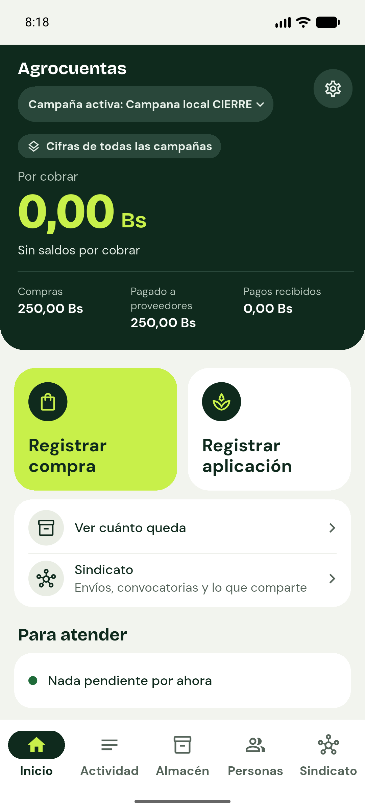 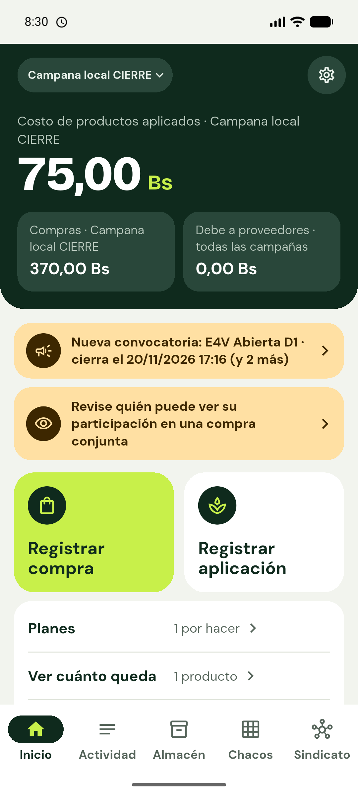

*Capturas `M2_01_inicio_tras_actualizar.png` (varias personas) y `M5_09_inicio_individual.png` (individual, con el aviso de revisión). 2026-11-13; Mobile `aeeb4f0` (APK `.cierre`); emulador `Cierre_Pixel8`; API real aislada; datos sintéticos.*

*Verificación:* Emulador (cierre), los dos modos. «Para empezar»: Emulador (anterior, `b8248fb`, captura `e07_inicio_vacio_I02.png` del repositorio Mobile).

---

## 5. Registrar una compra

**Dónde:** «Registrar» › «Compra», o Inicio › «Registrar compra».

**Paso 1, «¿Qué compró?»**
1. «Proveedor» (o «Crear proveedor») y «Fecha de la compra».
2. «Añadir producto» abre la hoja «Producto 1»: «Producto» (o «Crear producto»), «Cantidad comprada», «Precio por {unidad}», moneda «BOB» o «USD» (con «TC Bs/USD») y «Subtotal».
   - «Vencimiento (opcional)»: si lo indica, el almacén avisará antes de que venza (apartado 8).
   - «Más datos del envase» › «Lote del fabricante (opcional)»: «Tal como figura en el envase. Si no tiene, déjelo vacío.»
   - **Sólo con varias personas:** «¿Para quién es?» › «Una persona» o «Repartir entre varias».
   - «Listo» cierra la hoja; «Añadir otro» abre la siguiente.
3. Pulse «Continuar».

**Paso 2, «Revise y confirme»**
1. Revise los productos y el total. En modo individual la cabecera dice «… · entra a su almacén».
2. «¿Ya pagó al proveedor?»: «Sí, pagué todo» (con «¿Cómo pagó?»: «Efectivo», «Transferencia» o «Sin indicar», y «Fecha del pago») o «Todavía no».
   - Modo individual, «Todavía no»: «Esta compra quedará por pagar: {Bs} con {proveedor}. Podrá pagarlo después desde Registrar › Pago a un proveedor.»
3. Opcional: «Factura, notas y campaña (opcional)», con «N.º de factura» y foto de la factura («Cámara» o «Galería»).
4. Pulse «Confirmar compra». Un doble toque no duplica la compra.

La compra **se guarda sin conexión** y sigue ahí al cerrar y reabrir la app. **No se envía al sindicato:** sólo se comparten totales de necesidad y de consumo (apartado 13).

**Sin campaña activa** el formulario se abre, pero al confirmar avisa de que no hay una campaña activa. Active la campaña desde Inicio (toque la campaña) o en Ajustes y datos › «Campañas». En esta versión el aviso remite a una pantalla que no existe (apartado 20).

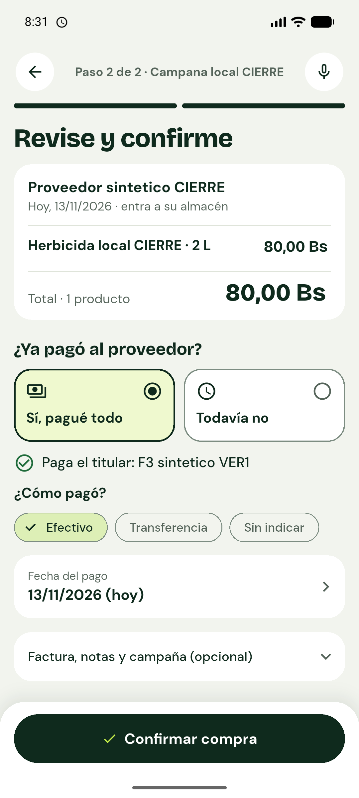 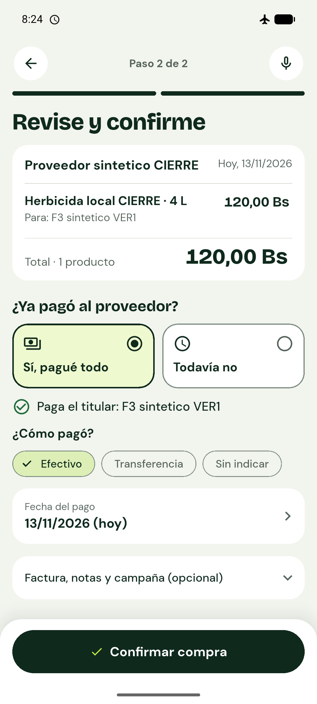

*Capturas `M5_10_compra_individual.png` (revisión en modo individual: «entra a su almacén») y `M4_01_compra_sin_conexion.png` (varias personas, en modo avión). 2026-11-13; Mobile `aeeb4f0`; emulador `Cierre_Pixel8`; datos sintéticos.*

*Verificación:* Emulador (cierre): compra en los dos modos, sin conexión y tras cerrar y reabrir la app (M4, M5). Hoja de producto con teclado y letra ampliada: Emulador (anterior, `b8248fb`) y arnés de capturas.

---

## 6. Registrar una aplicación

**Dónde:** «Registrar» › «Aplicación», Inicio › «Registrar aplicación», o «Aplicar» en un plan. Sin campaña activa, Inicio dice «Active una campaña antes de registrar aplicaciones: toque la campaña arriba en Inicio.»

1. **«¿Dónde aplicó?»:** con varias personas, primero «¿De quién son los productos?» (el responsable del chaco). Después «Chaco» (o «Crear chaco»), «Fecha» y la superficie («Superficie tratada» en modo individual, «Área tratada» con varias personas), que se toma del chaco y puede cambiarse.
2. **«¿Qué aplicó?»:** «Añadir producto» › «Producto» (con lo «Disponible»), «Cantidad usada» › «Agregar a la mezcla». Puede abrir «Dosis y costo» para anotar la dosis.
3. **«Revise y confirme»:** cada línea dice «Tiene {q} · le quedarán {q}» y se muestra el «Costo estimado». En modo individual: «SALE DE SU ALMACÉN» y «Se suma a los costos de {chaco} en esta campaña. No es una deuda. Queda anotado como consumo propio.» Pulse «Confirmar aplicación».

**Si no alcanza el producto, no se guarda nada:** «No alcanza el {producto}: hay {q} y escribió {q}. Baje la cantidad o registre primero la compra.» El producto sale del almacén por lotes, primero los más antiguos.

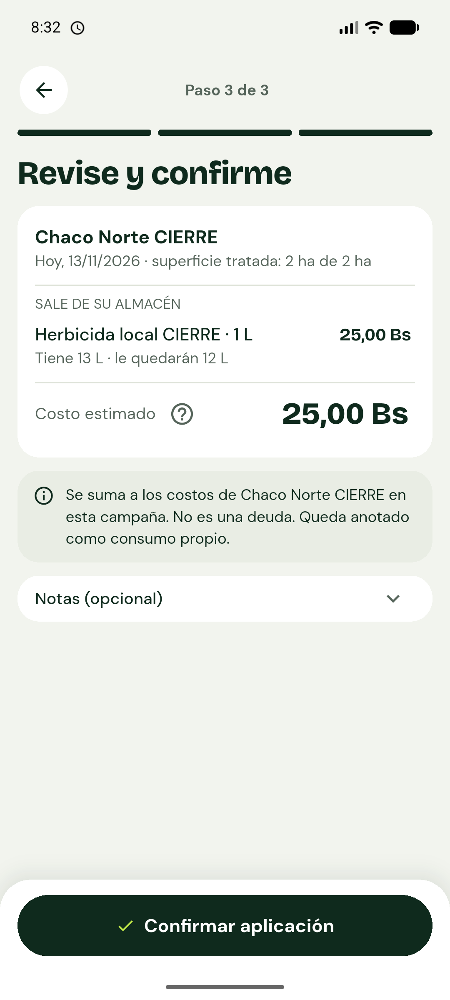

*Captura `M5_11_aplicacion_individual.png`: revisión de una aplicación en modo individual (1 L, 25,00 Bs). 2026-11-13; Mobile `aeeb4f0`; emulador `Cierre_Pixel8`; datos sintéticos.*

*Verificación:* Emulador (cierre) en modo individual (M5). Con varias personas, la aplicación del cierre se hizo con la app anterior `507efc8` (M1); en `aeeb4f0`, Pruebas.

---

## 7. Planificar una aplicación

**Dónde:** «Registrar» › «Plan de aplicación»; la lista está en Actividad › «Planes» › «Planificación» y, en modo individual, en Inicio › «Planes».

1. «¿Qué piensa aplicar?»: «Chaco», «Fecha prevista (opcional)», la superficie («Superficie prevista» o «Área planificada») y los productos con su dosis por hectárea.
2. La app compara con el almacén: «Tiene {q} · alcanza», «Tiene {q} · faltan {q}» (o «Cubierto · hay {q}», «Falta comprar {q} · hay {q}»).
3. «Revise el plan» › «Guardar plan».

**Un plan es una previsión:** «Un plan no descuenta existencias ni registra una deuda. El producto sale del almacén cuando registre la aplicación.» Para aplicarlo, pulse «Aplicar este plan» (o «Aplicar» en Actividad); un plan se aplica una sola vez.

**Escriba la dosis con coma decimal** («1,5»). Con punto («1.5») el plan no la lee y la cantidad queda en 0 («Necesita 0 L» con varias personas; en modo individual la columna se llama «Cantidad prevista»). Observación O1 del cierre, vista con la app anterior `507efc8`. En `65e1004` sigue igual: la app usa el convenio boliviano (el punto separa miles), así que «1.5» no es un número válido y el plan lo cuenta como 0 sin avisar.

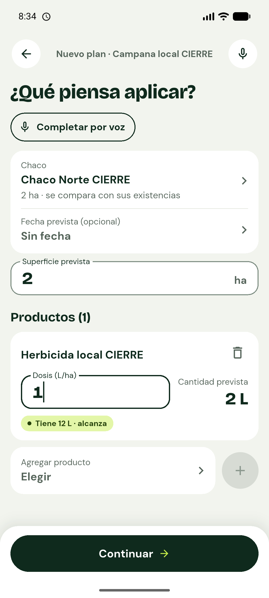

*Captura `M5_12_plan_individual.png`: «Tiene 12 L · alcanza». 2026-11-13; Mobile `aeeb4f0`; emulador `Cierre_Pixel8`; datos sintéticos.*

*Verificación:* Emulador (cierre) en modo individual (M5); con varias personas sólo con la app anterior (M1) y Pruebas.

---

## 8. Almacén y avisos de vencimiento y de existencias

**Almacén** muestra cada producto con su «Existencia», su «Valor», lo «Previsto en planes {q} · quedarían {q}» (o «faltarían») y sus avisos («Lote vencido», «vence(n) hoy», «vence(n) en {n} días», «Queda poco»). En modo individual hay filtros «Todos», «Por vencer» y «Con planes»; con varias personas, además, «Poco por responsable». El detalle de un producto muestra los planes pendientes, los «Movimientos recientes» y, en «Más datos», los «Lotes».

**Avisos de inventario** (Almacén › «Todos los avisos», o desde Inicio): «Lotes vencidos», «Lotes que vencen hoy», «Lotes próximos a vencer», «Existencia baja» (con varias personas, también «Existencia baja por responsable») y «Lotes sin fecha de vencimiento». La app aclara: «Se calculan en este teléfono, también sin internet. No cambian sus existencias ni impiden registrar operaciones.» Si la fecha del teléfono parece incorrecta, pide «Revise la fecha del teléfono».

**Configurar los avisos de un producto:** Almacén › producto › «Avisos de este producto» › «Configurar avisos»:
- «Nivel mínimo»: «Vacío: sin aviso de existencia baja. 0: avisa sólo cuando se acaba.»
- «Avisar antes del vencimiento» (días): «De 0 a 365 días. Vacío: 30 días (valor inicial).»
- «Al guardar se pide el PIN del titular, una vez para los dos datos.»

**Estimación del consumo** (Almacén › «Estimación del consumo», «Referencia; no cambia el inventario.»): con «Consultar con conexión» muestra la estimación que calcula el sindicato para la «Campaña objetivo», y «Descargar copia para consultar sin conexión» la guarda en el teléfono. «Es una referencia: no se suma a su necesidad declarada, no cambia su inventario y no crea compras.» Si el sindicato no tiene activada la publicación, dice «La política de divulgación todavía no permite consultar la estimación.» *Verificación:* Pruebas; no se recorrió en el emulador del cierre. Sin captura actual.

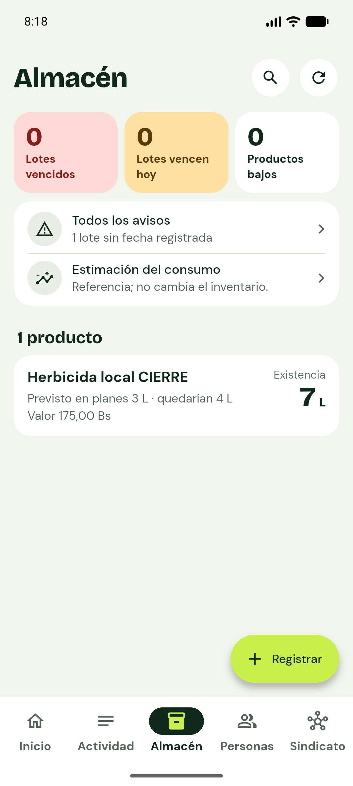 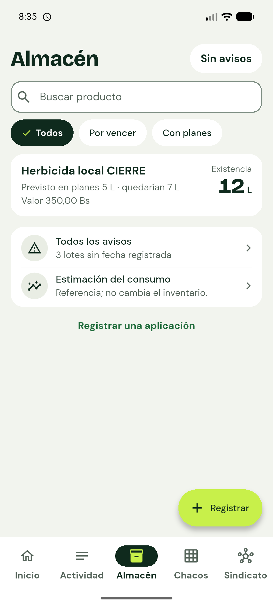

*Capturas `M2_03_almacen.png` (varias personas) y `M5_18_almacen_individual.png` (individual: 12 L, 350,00 Bs, previsto 5 L). 2026-11-13; Mobile `aeeb4f0`; emulador `Cierre_Pixel8`; datos sintéticos.*

Pantalla de avisos y diálogo de configuración: [`b6_avisos_inventario.png`](https://github.com/Roderich1/AppMovilAgroquimico/blob/34e9926/docs/evidence/rediseno-movil/2026-11-12/ronda2/B/despues/b6_avisos_inventario.png) y [`b4_dialogo_avisos.png`](https://github.com/Roderich1/AppMovilAgroquimico/blob/34e9926/docs/evidence/rediseno-movil/2026-11-12/ronda2/B/despues/b4_dialogo_avisos.png) (repositorio Mobile; 2026-11-12; segunda ronda del rediseño móvil; **arnés de capturas** de las pruebas, no emulador; datos sintéticos).

*Verificación:* Almacén: Emulador (cierre). Avisos: Pruebas y arnés de capturas del 2026-11-12; en el emulador del cierre no había lotes por vencer. Los avisos se probaron en un teléfono (POCO X5 Pro, `22101320G`) el 2026-11-01 con una versión anterior al rediseño.

---

## 9. Actividad, proveedores y correcciones

**Actividad** reúne compras, aplicaciones, planes y (con varias personas) transferencias, con filtros «Todo · Compras · Aplicaciones · Planes» y el buscador. Cada filtro enlaza su lista completa («Lista de compras», «Lista de aplicaciones», «Planificación», «Lista de transferencias»). El icono «Reportes» abre los reportes (apartado 11).

**Proveedores (modo individual).** La franja «Proveedores y saldos» de Actividad (o «Registrar» › «Pago a un proveedor») abre «Proveedores»: «Debe a proveedores · todas las campañas», cada compra con saldo y el botón **«Pagar»**. El diálogo «Pago al proveedor» pide «Importe BOB» («Máximo …»), «¿Cómo pagó?» y «Fecha del pago»; «Registrar» lo guarda («Pago al proveedor registrado.»). Pagar a un proveedor no es un cobro a una persona.

**Con varias personas** el pago al proveedor se registra desde la lista o el detalle de la compra («Registrar pago al proveedor»), y los cobros y pagos de las personas en Personas › «Cuentas».

**Corregir un error.** Nada se edita ni se borra: se **revierte** («Revertir compra», «Revertir aplicación»). La app pide el «Motivo (obligatorio)» y después el PIN del titular («Confirme con el PIN del titular. Motivo: …»). Sin PIN configurado: «Esta acción la autoriza sólo el titular con su PIN. Configure el PIN del titular primero.» La reversión no se puede deshacer.

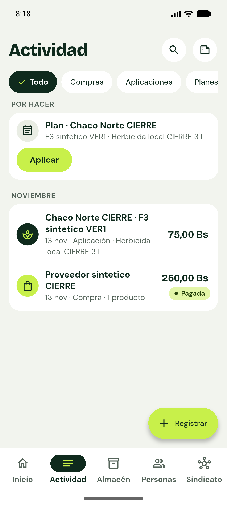 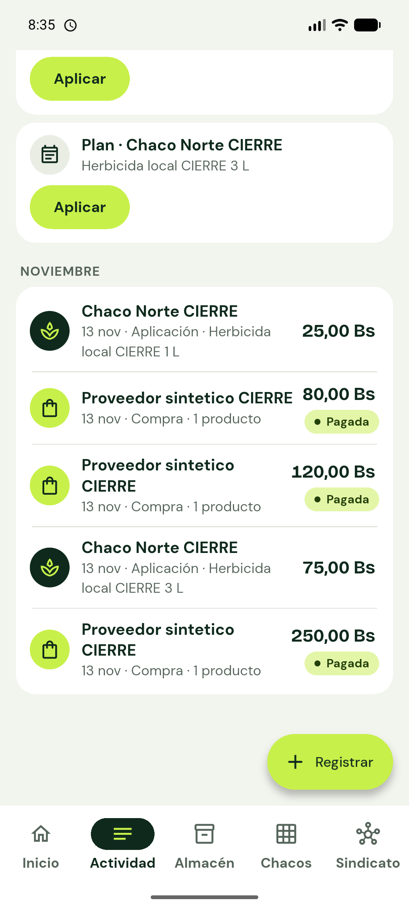

*Capturas `M2_02_actividad.png` y `M5_14_actividad_individual_todo.png`. 2026-11-13; Mobile `aeeb4f0`; emulador `Cierre_Pixel8`; datos sintéticos.* Proveedores y pago: [`e17_proveedores_I05.png`](https://github.com/Roderich1/AppMovilAgroquimico/blob/34e9926/docs/evidence/rediseno-individual/2026-11-13/emulador/e17_proveedores_I05.png) y [`e18b_pago_1000.png`](https://github.com/Roderich1/AppMovilAgroquimico/blob/34e9926/docs/evidence/rediseno-individual/2026-11-13/emulador/e18b_pago_1000.png) (repositorio Mobile; 2026-11-13; Mobile `b8248fb`; emulador `RDM_Pixel8`; datos sintéticos).

*Verificación:* Actividad: Emulador (cierre). Proveedores y pago parcial: Emulador (anterior, `b8248fb`). Reversión con motivo y PIN: Pruebas en esta versión; en teléfono sólo en octubre, con versiones anteriores.

---

## 10. Chacos y costos

### 10.1 Modo individual: pestaña «Chacos»

- Sin chacos: «Agregue su primer chaco» › «Agregar chaco» (nombre y superficie).
- Cada chaco muestra su costo y el «Costo por hectárea». Si no hay aplicaciones o falta la superficie, dice **«No disponible»**.
- El detalle muestra «Superficie del chaco», «Costo aplicado», «Por ha del chaco ({ha})», los planes por hacer, las aplicaciones y los «Productos utilizados». Desde él: **«Ver todos los costos»**.
- **«Costos»:** pestañas «Chacos» · «Productos» · «Campañas», con «Costo de productos aplicados · {alcance}» («No incluye compras ni lo que sigue en el almacén.») y «Exportar en Excel o PDF» (apartado 11). El menú de campaña permite elegir una o «Todas las campañas».
- **La superficie de un chaco no se puede cambiar** en la app («La superficie no se puede cambiar en la app.»); sólo el nombre o archivarlo. Es una mejora pendiente (decisión B del autor).

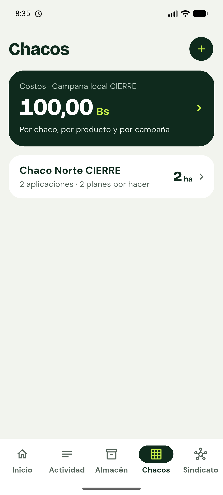 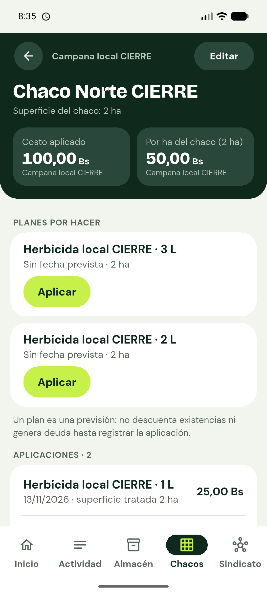 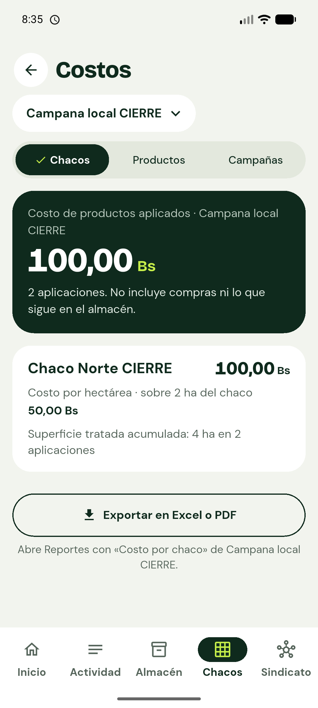

*Capturas `M5_15_chacos.png`, `M5_16_chaco_detalle.png` («Costo aplicado 100,00 Bs», «Por ha del chaco (2 ha) 50,00 Bs») y `M5_17_costos.png`. 2026-11-13; Mobile `aeeb4f0`; emulador `Cierre_Pixel8`; datos sintéticos.*

### 10.2 Modo con varias personas

Los chacos y los costos están en **Personas**: el selector «Cuentas» · «Costos» y «Filtrar por campaña». «Costos» muestra «Costo por chaco y hectárea» y «Costo consumido por producto», con «Exportar · Excel o PDF». Tocar un chaco abre su «Bitácora». Cada persona tiene las pestañas «Resumen», «Chacos», «Aplicaciones», «Inventario» y «Cuenta».

*Verificación:* modo individual: Emulador (cierre) (M5). Personas › Costos: Pruebas y arnés de capturas del rediseño (2026-11-12); no se recorrió en el emulador del cierre.

---

## 11. Reportes en Excel y PDF

**Dónde:** Actividad › icono «Reportes» (los dos modos); en modo individual también Ajustes y datos › «Reportes» y Chacos › «Costos» › «Exportar en Excel o PDF»; con varias personas, Personas › «Costos» o «Cuentas».

**«¿Qué quiere exportar?»**

| Reporte | Texto de la app |
|---|---|
| «Inventario» | «Stock físico, comprometido y proyectado, con su valor.» |
| «Costo por producto» | «Cantidad y costo consumidos por producto.» |
| «Costo por chaco» | «Costo total y por hectárea de cada chaco.» |
| «Resumen de campaña» | «Compras, aplicaciones, planes y cuentas de una campaña.» |
| «Estado de cuenta» | «Movimientos de una persona con su saldo acumulado.» |

1. Elija la «Campaña» (o «Todas las campañas»; «Resumen de campaña» exige una) y, para el estado de cuenta, la «Persona».
2. «Formato»: «Excel» («Para abrir en Excel u otra hoja de cálculo.») o «PDF» («Para imprimir o archivar.»).
3. Pulse «Exportar Excel» o «Exportar PDF». La app advierte «El archivo no va cifrado» y pide «Exportar igualmente».
4. Resultado: «Reporte guardado», con el nombre del archivo y la «Carpeta:». **No hay botón de compartir:** el archivo queda en la carpeta de la app; si lo comparte, lo hace usted.

**No existe exportación CSV.** Se retiró el 2026-11-12.

**Ámbito de cada archivo.** El archivo lleva una línea por filtro («Campaña: …»; en «Inventario», «Alcance: Inventario global»).
- **Modo individual:** «Costo por chaco» y «Costo por producto» exportan exactamente lo que muestra la pantalla «Costos», con la línea «Chacos: Sólo los del titular (modo individual)» o «Aplicaciones: Sólo en chacos del titular (modo individual)». No se recalcula nada: se suman los costos guardados.
- **Limitación aceptada por el autor:** en modo individual, «Resumen de campaña» incluye también las aplicaciones en chacos de terceros (si quedaron de cuando se usó el modo con varias personas), y **ni la pantalla ni el archivo lo advierten**. Un chaco sin aplicaciones sale con 0,00 en el archivo, donde la pantalla dice «Sin aplicaciones».
- **Modo con varias personas:** sin línea de ámbito; comportamiento anterior.

Captura cercana: [`f08_reportes_excel.png`](https://github.com/Roderich1/AppMovilAgroquimico/blob/34e9926/docs/evidence/rediseno-movil/2026-11-12/integracion/f08_reportes_excel.png) (repositorio Mobile; 2026-11-12; Mobile `6b397c9`, rediseño móvil; emulador; datos sintéticos). Es **anterior** a la corrección del ámbito de las exportaciones (`efd661d`); la pantalla de selección no cambió. No hay captura de la composición final.

*Verificación:* Pruebas (incluida la línea de ámbito). No se exportó ningún archivo en el emulador del cierre.

---

## 12. Completar por voz

La voz **prepara** los datos en el mismo formulario de compra, aplicación o plan. **Nada se guarda solo:** usted revisa y confirma con el botón del formulario.

**Dónde:** dentro de cada formulario, el botón «Completar por voz» o el micrófono de la barra superior. Con varias personas, también «Registrar» › «Completar por voz» y Ajustes y datos › «Registrar por voz».

| Estado | Lo que muestra la app |
|---|---|
| Preparado | «Completar por voz», «Micrófono apagado», un ejemplo («Diga, por ejemplo …») y «Hablar» |
| Primera vez | Android pide el permiso del micrófono |
| Escuchando | Hoja oscura «Escuchando» con la guía, «Cancelar» y «Terminar» |
| Procesando | «Procesando tu voz» · «Los datos aparecerán en el formulario para que los revise.» · «Lo que ya escribió a mano se conserva.» |
| Resultado | Los campos dictados llevan «Por voz» y hay que revisarlos («Usar lo dictado», «Mantener», «Descartar lo dictado»); «Dictar más» y «Deshacer último dictado» |

**Guía por formulario:**
- Compra, modo individual: «Diga producto, cantidad y precio» (ejemplo: «Doce litros de herbicida a ciento dieciocho, de Agroinsumos»).
- Compra, varias personas: «Diga producto, cantidad, precio y para quién» (ejemplo: «…, para Rosa»). Un nombre dictado no crea personas.
- Aplicación: «Diga chaco, superficie, producto y cantidad».
- Plan: «Diga chaco, superficie, producto y dosis».

**Alternativa manual, siempre disponible:**
- «Cancelar» → «Dictado cancelado: el formulario no cambió.»
- Si no se entendió nada → «No cambió el formulario: no se reconoció nada que completar.»
- Sin permiso → «Sin permiso de micrófono no se puede dictar. Puede volver a intentarlo o completar el formulario a mano.»
- Si la APK no trae los modelos de voz → «La voz no está disponible en este teléfono. Complete el formulario a mano.» (la APK de `main` no los trae; ver el manual técnico).
- Con campos dictados sin revisar, el formulario no deja continuar: «Hay N campos dictados por revisar.»

**Evidencia de dictado: sólo en la compilación de evaluación.** La app normal no guarda nada de lo dictado ni muestra ninguna pantalla de permiso. Sólo una compilación de evaluación (`AGRO_VOICE_EVIDENCE=true`, manual técnico) añade en la pantalla «Registrar por voz» (Ajustes y datos o «Registrar» › «Completar por voz», con varias personas) la entrada «Evaluación de la voz» («Permiso para guardar lo dictado»), con «Acepto», «Retirar el permiso» y «Borrar lo guardado». Sin ese permiso dice «Permiso: no dado. No se guarda nada.» Con él, se guarda en el teléfono el texto reconocido, lo que propuso la voz y lo que usted confirmó o corrigió; **nunca audio**. No se envía al sindicato ni va en los respaldos. Guardar esta evidencia no mide la precisión del reconocimiento: esa evaluación (OE5) no se ha hecho.

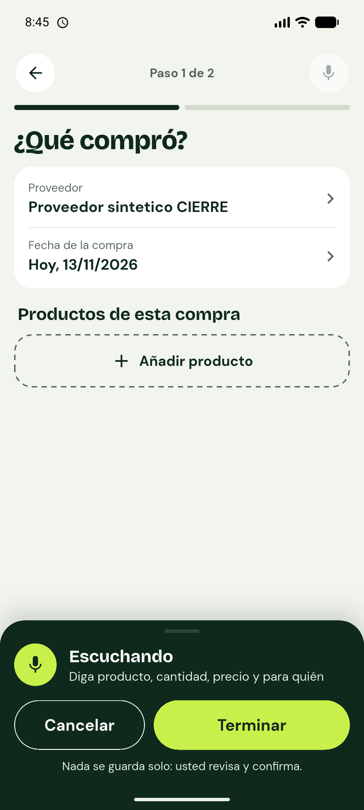 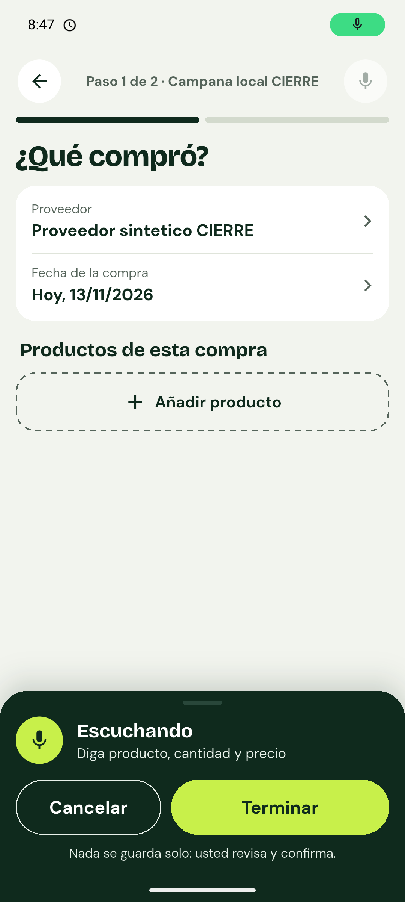 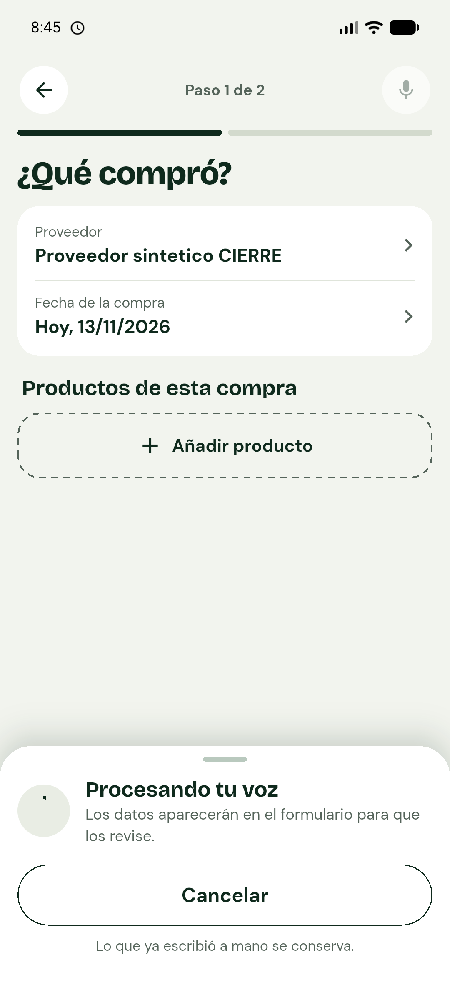

*Capturas `M6_13_escuchando_varias.png`, `M6_18_escuchando_individual.png` y `M6_15_procesando_varias.png`. 2026-11-13; Mobile `aeeb4f0` con los modelos de voz empaquetados (APK `final-voz`, sólo de revisión); emulador `Cierre_Pixel8`; sin audio real. Otras del mismo recorrido: `M6_12_permiso_microfono.png`, `M6_14_cancelado_varias.png`, `M6_16_resultado_sin_cambios_varias.png`, `M6_02_voz_no_disponible_varias.png` (APK sin modelos).*

*Verificación:* Emulador (cierre) para los estados, la cancelación, el permiso y el aviso sin modelos; la base no recibió ninguna escritura. **No verificado:** el reconocimiento y el relleno de campos con voz real (el micrófono del emulador sólo captó silencio), ni la precisión. «Resultado» y la revisión de campos dictados: sólo Pruebas con un motor falso. La voz se usó en un teléfono (POCO) en noviembre con versiones anteriores al panel actual.

---

## 13. Sindicato: envíos, necesidad declarada y consumo

**Sindicato** muestra arriba «Envíos al sindicato» («Nada por enviar» o «{n} envíos pendientes»), «Necesidad declarada y consumo», «Última confirmación: …», y los botones «Enviar pendientes», «Actualizar» y «Ver estado de los envíos».

- **Qué se envía:** «Necesidad declarada y consumo: se envían sólo sus totales. Convocatorias e identificación de productos muestran su estado en su propia pantalla.» Las compras, aplicaciones y cuentas **no** se envían.
- **«Lo que comparte»:** «Necesidad declarada» («Lo que solicita para la campaña»; no cambia su inventario), «Consumo» («Totales de lo que usted aplicó»; sólo se envía si usted lo confirma, y sólo el del titular) y «Productos y campañas» («Sus equivalentes en el sindicato»).
- **«Envíos»** (estado): «Historial de envíos», con estados como «Pendiente», «Sincronizado», «Rechazado» o «Pausado: restauración». Los envíos que llegan con un respaldo restaurado quedan pausados hasta pulsar «Liberar» (apartado 16).

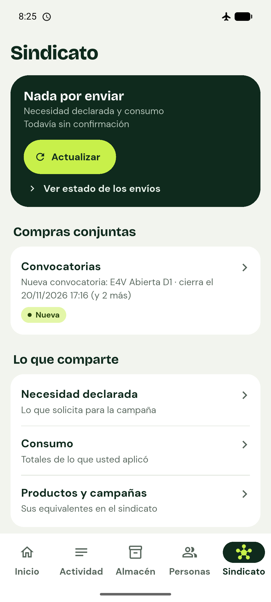 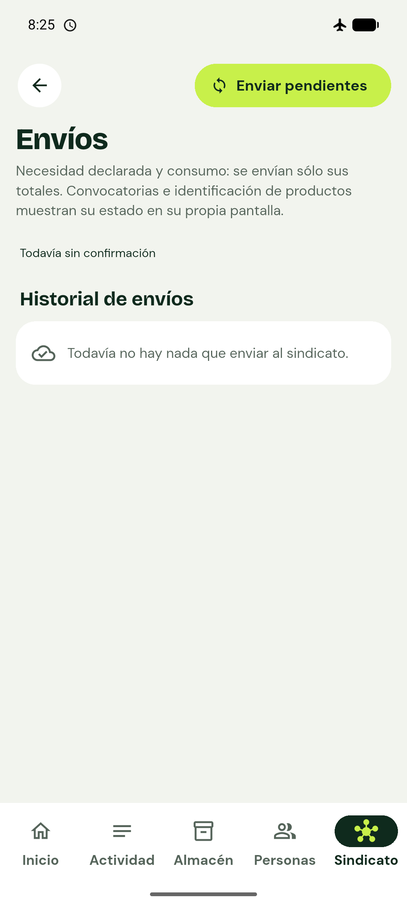

*Capturas `M4_05_sindicato_sin_conexion.png` y `M4_06_estado_envios.png` («Todavía no hay nada que enviar al sindicato.»). 2026-11-13; Mobile `aeeb4f0`; emulador `Cierre_Pixel8`; datos sintéticos.*

*Verificación:* Emulador (cierre) para la pantalla y el estado vacío. El envío de necesidad y consumo en esta versión: Pruebas (en el cierre no se creó ninguno).

---

## 14. Compras conjuntas

Una **convocatoria** es una compra conjunta que organiza el sindicato. Participar **no es una compra ni genera una deuda**: «la persona responsable coordina la compra y la entrega».

**Dónde:** Sindicato › «Compras conjuntas» › «Convocatorias», o el aviso de Inicio. «Actualizar» consulta al sindicato; lo guardado se ve también sin conexión.

### 14.1 Participar

1. Abra una convocatoria «Abierta» › «Ver y participar» › «Participar».
2. En «Cantidades que solicita» escriba lo que pide («Deje vacío lo que no pide.») › «Continuar».
3. La primera vez aparece **«Antes de confirmar»** con el texto **CONV-4**:
   > «Las personas de Administración habilitadas de su sindicato podrán ver su nombre y las cantidades que solicita para coordinar esta compra conjunta y su entrega. La Directiva podrá consultar los totales por producto, sin el detalle identificado de su participación. Los totales pueden mostrarse aunque participe una sola persona. Esta participación no genera una deuda.»

   y la ayuda «Aunque el total no muestre nombres, con pocas participaciones podría deducirse cuánto solicitó una persona.» Marque «Entiendo y acepto» y pulse «Confirmar participación».
4. La app dice «Guardada en el teléfono: pendiente de envío al sindicato.» Puede «Modificar» o «Retirar participación» mientras siga abierta.

### 14.2 «Quién ve sus datos» y «Revisar quién puede ver mi participación»

El detalle explica quién ve su participación:
- con CONV-4: «La Administración habilitada de su sindicato puede ver su nombre y sus cantidades. La Directiva sólo ve los totales por producto, sin su nombre.»
- si se registró con un **texto anterior**: «Su participación se registró con un texto anterior. Con las reglas actuales, nadie de la Directiva ni de la Administración ve su nombre ni sus cantidades hasta que usted revise quién puede ver su participación. …», con el botón **«Revisar quién puede ver mi participación»**. Muestra el texto CONV-4, la casilla «Entiendo y acepto este texto para mi participación en esta convocatoria.» y «Sus cantidades no cambian.»; «Autorizar» sólo se habilita al marcarla.
- tras retirar la autorización: «Usted retiró la autorización: nadie de la Directiva ni de la Administración ve su nombre ni sus cantidades. Sus cantidades siguen contando en los totales por producto, que se muestran sin nombres.»

**«Retirar la autorización»** conserva la participación: «La Administración dejará de ver su nombre y sus cantidades cuando el sindicato reciba esta decisión; lo que ya se haya visto no se puede retirar.» con la casilla «Quiero retirar la autorización y conservar mi participación.»

Una convocatoria **cerrada** se puede revisar sin reabrirla; una **cancelada**, no («Convocatoria cancelada: ya no admite cambios.»).

### 14.3 Nada rige hasta el acuse del sindicato

Toda decisión se guarda primero en el teléfono:
- «Pendiente de envío: autorizar a la Administración a ver su nombre y sus cantidades. Hasta que el sindicato la reciba, **no está aplicada** y rige lo que se indica arriba.» con «Enviar ahora»;
- al recibirla el sindicato: «Su última decisión sobre quién ve sus datos **está aplicada** en el sindicato.»

En el sindicato, autorizar con CONV-4 deja su participación con el alcance `ADMINISTRATION` (la Administración ve su nombre y sus cantidades) y retirar la autorización, con `TOTALS_ONLY` (sólo cuenta en los totales). Ninguno de los dos cambia nada hasta el acuse: mientras la decisión esté pendiente de envío, rige la anterior.

Con conexión y la sesión verificada, el envío es automático; si no, pulse «Enviar ahora». **Si la sesión caducó**, la app dice que no se envió y que sigue guardado («Lo pendiente no se envió y sigue guardado en el teléfono.») y ofrece «Volver a autenticar»; después vuelva a la convocatoria y pulse «Enviar ahora». Nada se muestra como aplicado antes del acuse.

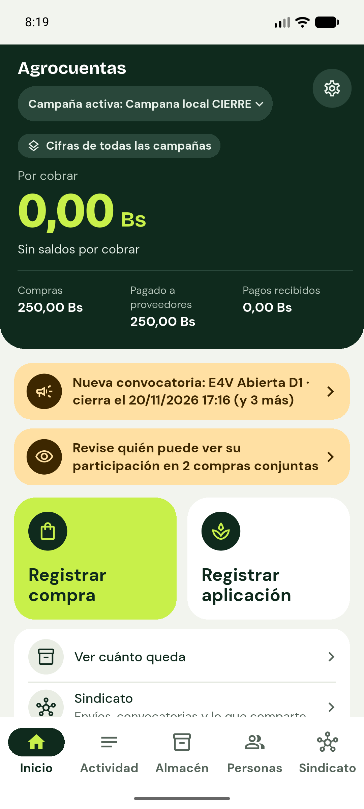 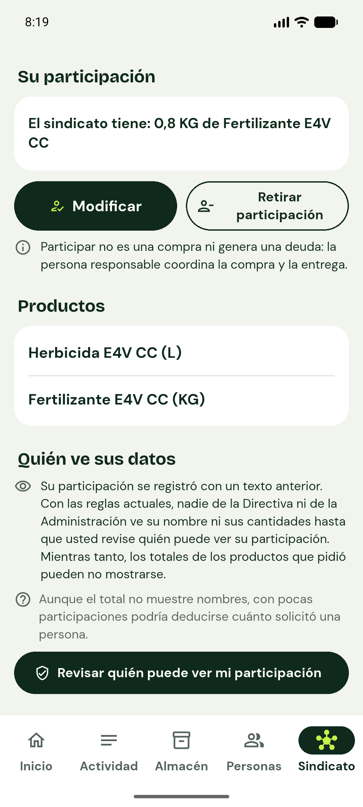 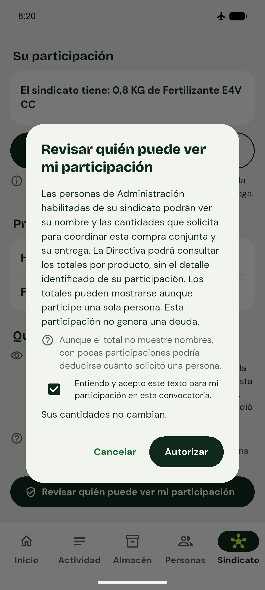 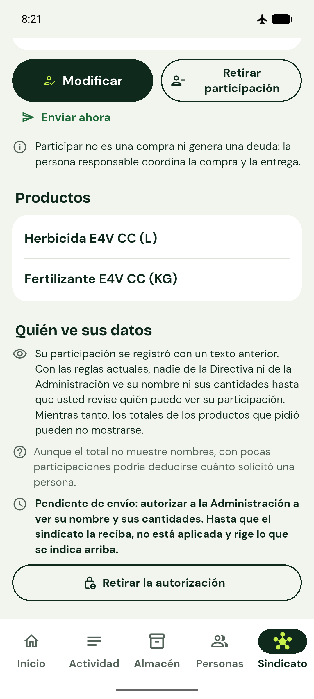 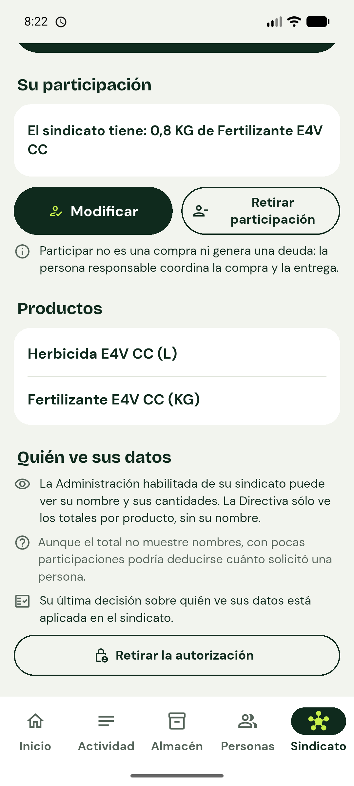

*Capturas `M3_01_inicio_aviso.png`, `M3_04_CC_quien_ve.png`, `M3_06_conv4_marcada.png`, `M3_07_pendiente_sin_conexion.png` y `M3_08_aplicada.png`. 2026-11-13; Mobile `aeeb4f0`; emulador `Cierre_Pixel8` con la API real aislada (convocatoria sintética «CC»); datos sintéticos.* Retirar la autorización y convocatoria cerrada: `../evidence/E4/mobile/11_retirar_autorizacion_dialogo.png`, `12_autorizacion_retirada.png`, `18_CB_cerrada_revisada.png` (2026-11-13; Mobile `08bb6f7`, entrega E4 anterior a la integración; emulador `Pixel_8`; datos sintéticos).

*Verificación:* Emulador (cierre): aviso, revisión CONV-4, pendiente sin conexión, envío automático al reconectar y lectura de la Administración por la API (M3, M7). Retirada, cerrada y envíos atrasados: Emulador (anterior, E4). La sesión caducada (decisión E del autor): Pruebas.

---

## 15. Identificar un producto con foto

Sirve para que el sindicato diga a qué producto de su catálogo equivale uno suyo.

1. **Foto de la etiqueta:** Ajustes y datos › «Personas, chacos, productos y proveedores» (o «Chacos, productos y proveedores») › «Productos» › menú del producto › «Foto de la etiqueta» › «Tomar foto» o «Elegir de la galería». «La foto se guarda sólo en este teléfono, sin ubicación ni otros datos de la cámara.»
2. **Pedir la identificación:** Sindicato › «Productos y campañas» › producto sin vínculo › «Opciones de vínculo» › «Pedir identificación al sindicato». La hoja dice «Se enviará al sindicato sólo esto»: «Nombre», «Ingrediente activo», «Unidad»; «No se envían compras, aplicaciones, cantidades ni existencias.»
3. **La foto es opcional:** casilla «Compartir también la foto de la etiqueta», sin marcar. Su texto: «La foto de la etiqueta de «{producto}» se enviará al sindicato para ayudar a identificar el producto. Podrá verla la directiva. Puede quitarla después desde este teléfono.»
4. Pulse «Pedir identificación» («Solicitud guardada en el teléfono. Se enviará al sindicato.»).
5. Cuando el sindicato responde: «Identificado por el sindicato como “X” (unidad)». **El vínculo nunca es automático:** pulse «Vincular» y confirme. Hasta entonces su inventario y sus compras no cambian.

**Quién ve qué.** El sindicato recibe el producto y, si usted la compartió, la foto, pero **no quién pidió la identificación**: la Directiva y la Administración no ven su nombre (identidad no expuesta, no anonimato absoluto: el nombre que usted escriba o lo que se vea en la foto podrían dar pistas). La app dice «Podrá verla la directiva.»; en la Web, la foto la pueden abrir la Directiva y la Administración. No confunda esta solicitud con su participación en una compra conjunta (apartado 14), que se rige por CONV-4.

**Quitar o reemplazar la foto.** En la hoja «Foto de la etiqueta», «Quitar la foto» la borra del teléfono y, si ya la había compartido, «se pedirá al sindicato que la retire» (mientras tanto, «Retiro de la foto pendiente de envío»). También puede «Reemplazar la foto»; si la anterior ya se había enviado, la app avisa «El sindicato conserva la foto anterior; la actual está sólo en este teléfono.». El sindicato no guarda versiones anteriores: cuando recibe un reemplazo o un retiro, borra la foto anterior. **Quitar la foto no borra la solicitud, su resolución ni el registro de la Bitácora.**

**Retención en el sindicato.** Cuando la solicitud queda identificada, el sindicato borra la foto 90 días después de la última decisión de vínculo (valor por defecto, configurable por el operador). Una solicitud pendiente no pierde la foto por antigüedad.

Las fotos de etiqueta **no se incluyen en los respaldos**: tras restaurar hay que volver a tomarlas.

*Sin captura actual del lado móvil.* *Verificación:* Pruebas. La retención de 90 días y que la solicitud siga tras borrar la foto: código y pruebas del Backend (contrato E1, apartado 11, aceptado por el autor el 2026-11-13). El lado de la Web (identificar con la foto) se verificó con la API real el 2026-11-13 sobre la Web `06283da` (ver el manual de la Directiva).

---

## 16. Respaldos y restauración

**Dónde:** Ajustes y datos › «Respaldos»: «Copias privadas de sus datos. No se comparten con el sindicato.»

### 16.1 En la nube (cifrado)

1. **Clave de recuperación.** Antes de subir hay que crearla («Crear la clave»). «Esta clave descifra sus respaldos en la nube. El servidor del sindicato y el proveedor sólo guardan la copia cifrada: nadie, tampoco la Directiva ni el administrador del servidor, puede leerla ni recuperar esta clave por usted.» Anótela en papel, marque «La anoté en papel y la guardo fuera del teléfono.» y escríbala para «Confirmar la clave».
2. **«Subir respaldo»** (con conexión): sube una copia cifrada en el teléfono.
3. **«Ver copias en el servidor»** › «Restaurar» o «Eliminar del servidor».
4. «Ver la clave» y «Cambiar la clave» piden el PIN del titular. Al cambiarla, conserve también la anterior: las copias ya subidas la siguen necesitando.

**La clave no es la contraseña ni el PIN.** «Si pierde el teléfono y también la clave, sus copias cifradas no se podrán recuperar.»

### 16.2 En este teléfono

- «Exportar respaldo» guarda un archivo con sus datos y las fotos de factura.
- «Restaurar respaldo» reemplaza los datos actuales; antes guarda una copia.

### 16.3 Restaurar

- «¿Restaurar esta copia?»: «TODOS los datos actuales se reemplazarán. Se guarda una copia de los datos actuales en este teléfono.»
- En un teléfono nuevo hacen falta la **cuenta** (activar o «Recuperar acceso») y la **clave de recuperación** («Descifrar»). El PIN hay que crearlo de nuevo.
- Los envíos al sindicato que traiga la copia quedan **pausados** hasta que usted los libere en Sindicato › «Ver estado de los envíos» › «Liberar». En esta versión el texto de la restauración remite a una pantalla que no existe (apartado 20).
- **Copias previas a restauraciones:** se conservan hasta dos, siete días. Si una restauración quedó sin resolver, su copia queda protegida y bloquea otra restauración hasta que usted pulse «Decidir» («Seguir con los actuales» o «Mis datos están bien»).

*Sin captura actual:* las pantallas de respaldo no se capturaron con la composición final. *Verificación:* el código de respaldos del teléfono no cambió desde Mobile `774ae88` (2026-10-31), salvo su lugar en la navegación; Pruebas en `aeeb4f0`. La subida y la restauración cifradas se probaron en un teléfono (POCO X5 Pro) el 2026-10-24 con versiones anteriores, también desde Backblaze B2 con datos sintéticos (ver el manual histórico y `docs/evidence/F08_*`). No hay ningún servicio de respaldo en funcionamiento para usuarios reales.

---

## 17. Cambiar de modo

**Dónde:** Ajustes y datos › «Modo de uso» (en modo individual, la tarjeta oscura «Modo de uso»).

- Si se puede: «El cambio está disponible. No borra ni reasigna registros y no necesita conexión.» y el botón «Pasar a modo individual» o «Pasar a varias personas». La confirmación explica la consecuencia:
  - a individual: «Solo el titular registrará compras, aplicaciones y pagos. Se ocultan las transferencias y la elección de persona en los formularios. Los registros de otras personas se conservan.»
  - a varias personas: «Se habilitan responsables y transferencias. Todo el historial sigue asociado al titular.»
- Si no se puede pasar a individual: «Todavía no se puede pasar a modo individual» · «Primero resuelva estos pendientes. No se borra ni se reasigna nada.», con los motivos: «Falta el titular», personas que «tienen productos», «Hay planes abiertos en chacos de …» o personas que «tienen saldo». Cada motivo lleva a la pantalla donde se resuelve.
- **En esta versión, un envío pendiente al sindicato no bloquea el cambio ni se avisa** (hallazgo H1 del cierre; no se pierde nada: se envía al reconectar). La rama `fix/textos-rutas-y-aviso-modo` (**pendiente de fusión**) añade un aviso al cambiar de modo cuando hay una decisión de convocatoria pendiente de envío; hasta que se fusione, este manual describe el comportamiento sin aviso.

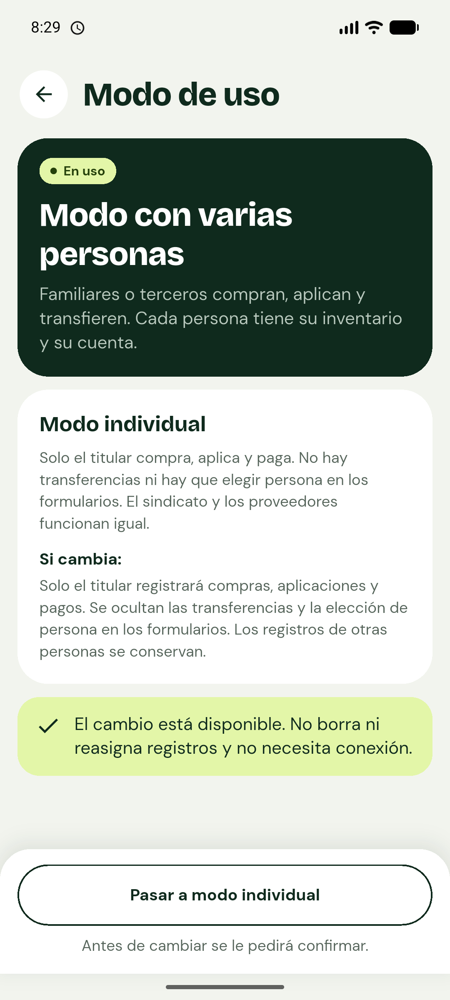 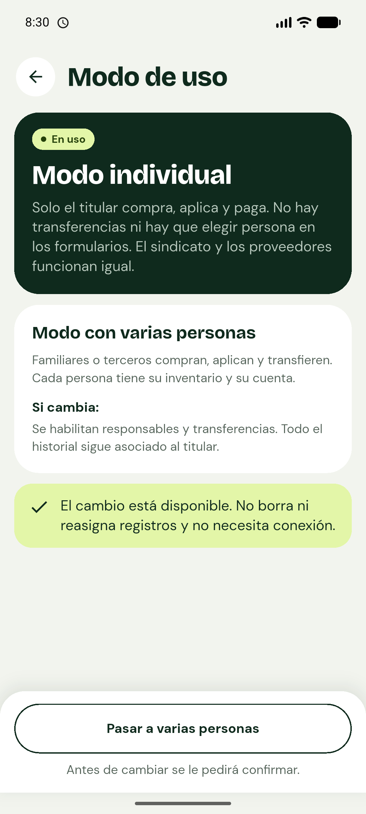 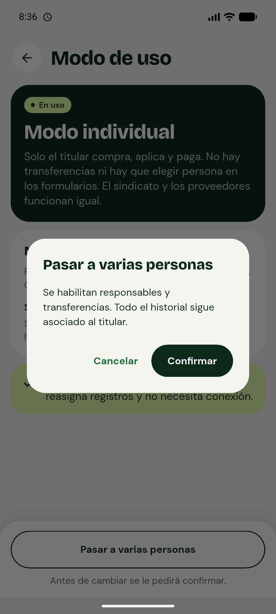

*Capturas `M5_07_modo_sin_pendientes.png`, `M5_08_modo_individual_activo.png` y `M5_20_confirmar_varias.png`. 2026-11-13; Mobile `aeeb4f0`; emulador `Cierre_Pixel8`; datos sintéticos. Las cifras fueron idénticas antes y después de cada cambio.*

*Verificación:* Emulador (cierre), ida y vuelta sin pérdida (M5). El cambio **bloqueado** por terceros: sólo Pruebas (el hogar sintético no tenía terceros).

---

## 18. Actualizar la aplicación

- Instalar la versión nueva **encima** de la anterior conserva todos los datos: al abrirla, la base pasa del esquema 19 al 20 y no hay que volver a activar.
- La app anterior (esquema 19, contrato 3) sigue funcionando sin conexión, pero en convocatorias dice «Esta versión de la aplicación ya no puede leer las compras conjuntas del sindicato. Actualice la aplicación. Lo guardado en el teléfono, incluido lo pendiente de envío, se conserva.»
- Tras actualizar, consulte las convocatorias (Sindicato › «Actualizar») para ver si alguna participación pide revisión (apartado 14.2).

**Todavía no hay una APK distribuible** que instalar: este apartado describe cómo se comporta la actualización, comprobada en un emulador con APK de revisión.

*Verificación:* Emulador (cierre): actualización de `507efc8` a `aeeb4f0` con `install -r`, cifras idénticas, 44 → 45 tablas (M2). Sin teléfono físico. La actualización exige que la APK nueva esté firmada con la misma clave que la instalada (manual técnico).

---

## 19. Límites conocidos

- Sin prueba en teléfono físico de ninguna función de esta versión; sin audio real para la voz; sin sesiones con agricultores.
- No hay API desplegada ni APK distribuible (la release sale sin firmar; la candidata OE5 es una compilación de prueba con la clave de depuración): este manual describe la app tal como se probó con datos sintéticos. No se ha autorizado su uso con datos reales.
- La superficie de un chaco no se puede editar.
- «Resumen de campaña» en modo individual incluye chacos de terceros, sin aviso.
- El cambio de modo no avisa de envíos pendientes (H1; aviso en la rama `fix/textos-rutas-y-aviso-modo`, pendiente de fusión).
- Cinco textos remiten a pantallas que no existen; cuatro tienen corrección pendiente de fusión (apartado 20).
- El aviso de revisión de Inicio aparece tras consultar las convocatorias (O2).
- La dosis del plan exige coma decimal (O1).
- La sesión caducada: «Volver a autenticar» vuelve a Inicio y hay que regresar a la convocatoria.

## 20. Textos de la app que no coinciden con la navegación

**Estado de la corrección:** los cuatro primeros se corrigen en la rama `fix/textos-rutas-y-aviso-modo` (**pendiente de fusión**). Mientras no se fusione, la app de `main` muestra los textos de la columna «La app dice». Al fusionarla, basta con actualizar esta línea y la columna «Estado» (y las remisiones de los apartados 5, 16 y 19).

| Dónde | La app dice (`main`, comprobado en `65e1004`) | Navegación real | Estado |
|---|---|---|---|
| Compra sin campaña activa | «No hay una campaña activa. Actívala en Más, Administrar datos.» | Inicio › campaña, o Ajustes y datos › «Campañas» | Pendiente de fusión |
| Compra «Todavía no», varias personas | «Puede anotarlo después en Operaciones, Compras.» | Actividad › «Lista de compras» | Pendiente de fusión |
| Restaurar desde la nube | «… hasta que usted los libere en Sincronización.» | Sindicato › «Ver estado de los envíos» › «Liberar» | Pendiente de fusión |
| Actividad, modo individual | Franja «Proveedores y saldos» | La pantalla se titula «Proveedores» | Pendiente de fusión |
| Almacén › «Estimación del consumo», sesión rechazada | «Hace falta verificar su acceso en línea (Sincronización) antes de consultar la estimación.» | Inicio o Ajustes y datos › «Acceso en línea» / «Cuenta y titular» › «Recuperar acceso» (apartado 2) | Detectado en esta revisión; **no** está en la lista de la rama anterior |

## 21. Capturas usadas

| Archivo | Ubicación | Fecha | Versión | Entorno |
|---|---|---|---|---|
| `M2_01`, `M2_02`, `M2_03`, `M3_01`, `M3_04`, `M3_06`, `M3_07`, `M3_08`, `M4_01`, `M4_05`, `M4_06`, `M5_07`, `M5_08`, `M5_09`, `M5_10`, `M5_11`, `M5_12`, `M5_14`, `M5_15`, `M5_16`, `M5_17`, `M5_18`, `M5_20`, `M6_13`, `M6_15`, `M6_18` (y citadas `M6_02`, `M6_12`, `M6_14`, `M6_16`) | `docs/evidence/CIERRE/mobile/` | 2026-11-13 | Mobile `aeeb4f0` (M6: con modelos de voz) | Emulador `Cierre_Pixel8`, API real aislada |
| `11_retirar_autorizacion_dialogo`, `12_autorizacion_retirada`, `18_CB_cerrada_revisada` | `docs/evidence/E4/mobile/` | 2026-11-13 | Mobile `08bb6f7` (E4) | Emulador `Pixel_8`, API real aislada |
| `e03c_alta_individual`, `e07_inicio_vacio_I02`, `e17_proveedores_I05`, `e18b_pago_1000`, `e34_ajustes_I50` | Mobile `docs/evidence/rediseno-individual/2026-11-13/emulador/` | 2026-11-13 | Mobile `b8248fb` | Emulador `RDM_Pixel8`, sin servidor |
| `b4_dialogo_avisos`, `b6_avisos_inventario` | Mobile `docs/evidence/rediseno-movil/2026-11-12/ronda2/B/despues/` | 2026-11-12 | Rediseño móvil, ronda 2 | Arnés de capturas de las pruebas |
| `f08_reportes_excel` | Mobile `docs/evidence/rediseno-movil/2026-11-12/integracion/` | 2026-11-12 | Mobile `6b397c9` | Emulador |

Todos los datos son sintéticos. **Sin captura actual:** activación con `aeeb4f0`, aplicación y plan con varias personas, Personas › Costos, reportes con la corrección del ámbito, estimación del consumo, identificación con foto (móvil), respaldos y la evidencia de dictado de la compilación de evaluación.

## 22. Trazabilidad

Según `docs/cierre/MATRIZ_DOCUMENTO_GRADO.md` (sólo los IDs que cita el repositorio): acceso RU-01, RU-09, RF-01, RF-17; modos CU-05, RF-06, RN-17; vencimientos y existencias RU-22, CU-22, RF-42–RF-44; aplicación RU-05, CU-09, RF-05, RF-12; necesidades RU-07, CU-10, RF-14, RF-15; reversión RU-14, CU-17, RF-13; identificación RF-33, RF-34, CU-18; sincronización RU-16, CU-11, RF-18; respaldos RU-11, CU-14, CU-15, RF-26, RF-27; voz RU-12, CU-16, RF-28, RF-29, INT-07. Compras conjuntas, consentimiento y planes: **ID por confirmar** por el autor.
