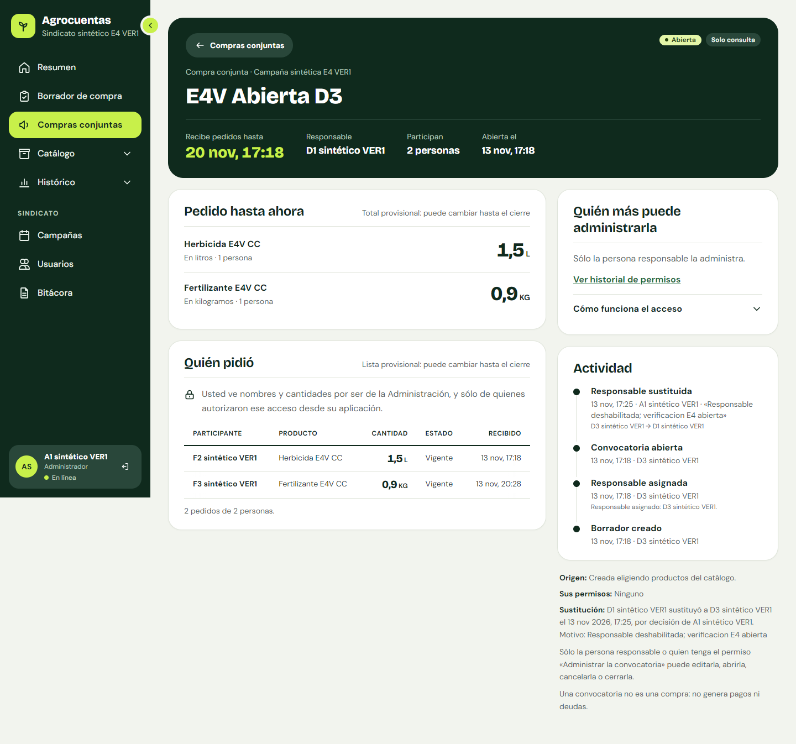
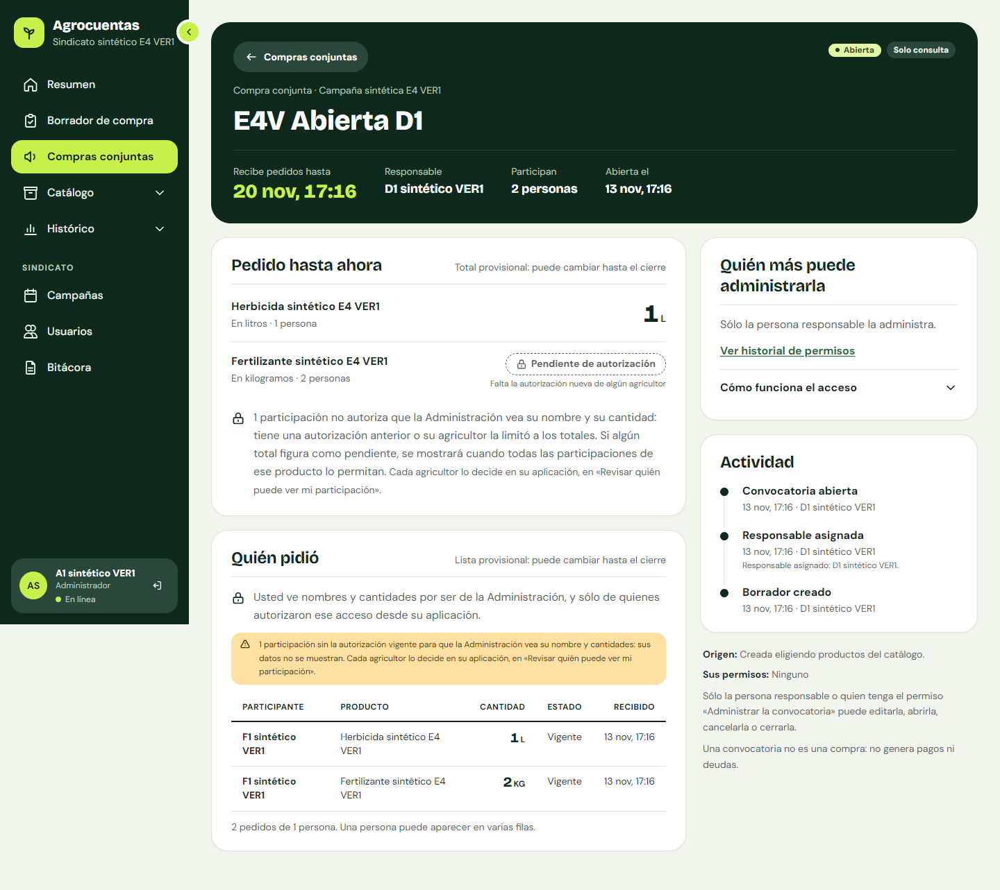
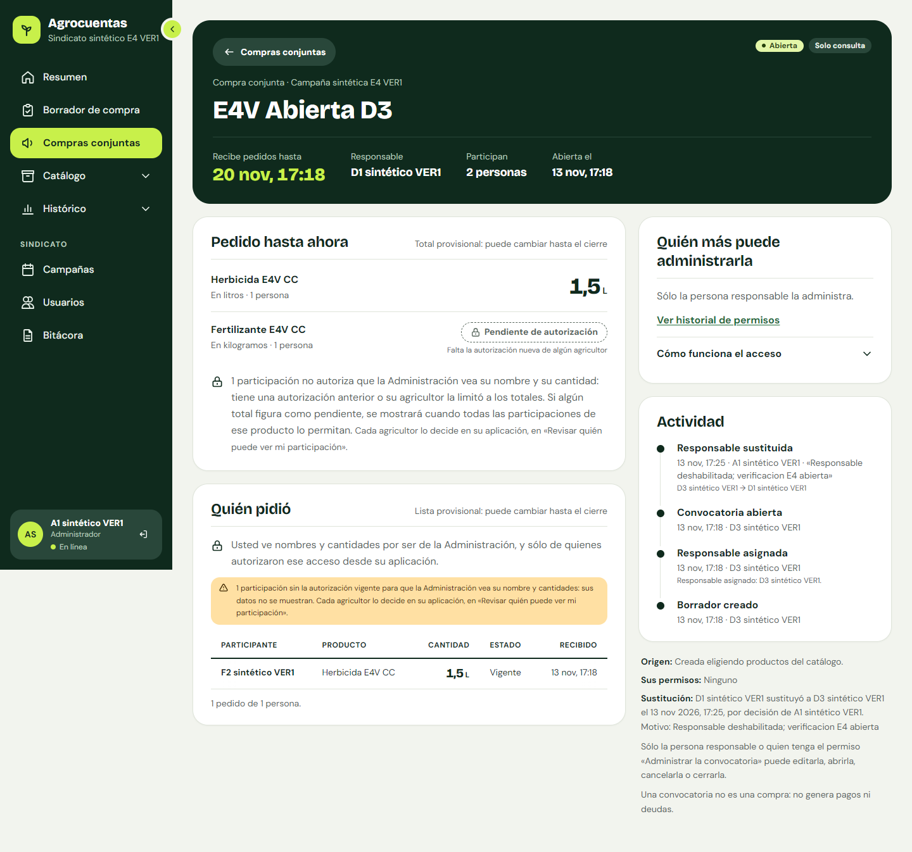
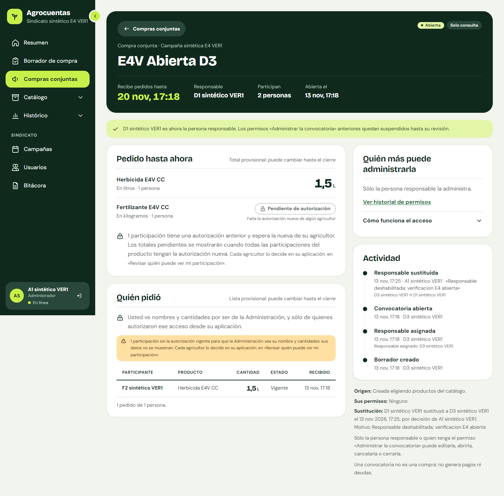
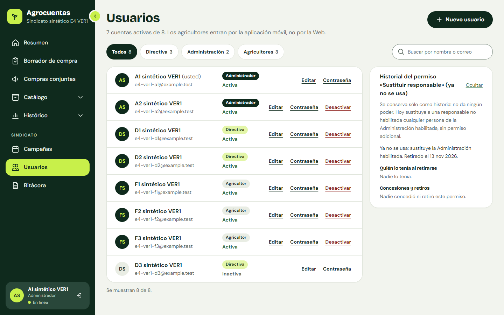

# Manual de la Administración: Web institucional de Agrocuentas

| Campo | Valor |
|---|---|
| Estado | **Manual actual** de la Administración (composición final de cierre). **No hay despliegue institucional** ni datos reales |
| Fecha de redacción | 2026-11-13 |
| Versión descrita | Backend/Web `main` `200fe60` (código `0946d9f`) |
| Revisión | 2026-11-14: textos, menú, guardas por rol y reglas comprobados contra Backend/Web `af449ba` (`main` `f64a4bb`), que registra en la Bitácora los cambios de cuentas y roles (apartados 4 y 5) |
| Cómo se obtuvieron los textos | Copiados de `Web/src` en `0946d9f` y vueltos a buscar en `Web/src` de `af449ba` |
| Relación con el manual de la Directiva | La Administración (rol «Administrador») ejerce **todas las funciones de la Directiva**: resumen, cobertura, borrador, convocatorias, catálogo, histórico, campañas, bitácora y Excel. Están en el [manual de la Directiva](MANUAL_WEB_DIRECTIVA.md) y no se repiten aquí. Este manual describe sólo lo que **añade** la Administración |
| Manuales relacionados | [Agricultor](MANUAL_AGRICULTOR.md) · [Técnico](MANUAL_TECNICO_INSTALACION.md) · [Índice](README.md) |

Las marcas de *Verificación* son las del manual de la Directiva. Todo se recorrió con **datos sintéticos** en un entorno aislado; no hubo teléfono físico, lector de pantalla ni aceptación visual registrada.

---

## 1. Qué cambia respecto de la Directiva

| Función | Directiva | Administración |
|---|---|---|
| Menú «Usuarios» (ruta `/users`) | No: ni en el menú ni por la dirección (guarda de Administración) | Sí |
| «Bitácora» | Sí | Sí (la misma) |
| Detalle individual de una convocatoria («Quién pidió» con nombres y cantidades) | Nunca (la API responde 403) | Sólo de quienes **autorizaron** ese acceso con CONV-4 desde su aplicación (alcance `ADMINISTRATION`), y sólo en pantalla |
| «Sustituir responsable…» | No | Sí, cuando la responsable ya no está habilitada; **nunca a sí misma** |
| Etiqueta en la barra lateral | «Directiva» | «Administrador» |

Ser responsable de una convocatoria **no** da acceso a nombres ni cantidades: el detalle depende del rol de Administración y de la autorización de cada agricultor. El menú sólo oculta; quien decide cada acceso es el servidor.

---

## 2. Detalle individual autorizado

En el detalle de una convocatoria, «Quién pidió»:
- «Usted ve nombres y cantidades por ser de la Administración, y sólo de quienes autorizaron ese acceso desde su aplicación.»
- tabla «Participantes de la convocatoria»: «Participante», «Producto», «Cantidad», «Estado» («Vigente» / «Retirada»), «Recibido»; al cerrar, «Detalle por participante al cierre»;
- quien no autorizó (texto anterior o retirada) **no aparece**: «N participaciones sin la autorización vigente para que la Administración vea su nombre y cantidades: sus datos no se muestran.» y «Cada agricultor lo decide en su aplicación, en «Revisar quién puede ver mi participación».»;
- un total puede quedar «Pendiente de autorización» («Falta la autorización nueva de algún agricultor»): la Administración ve por nombre a unos, y el total sólo se publica cuando todas las participaciones de ese producto lo permiten.

**Alcances y acuse.** Cada participación tiene en el servidor un alcance: `ADMINISTRATION` (el agricultor aceptó CONV-4: la Administración ve su nombre y sus cantidades) o `TOTALS_ONLY` (retiró la autorización: sólo cuenta en los totales, sin nombre). Las participaciones con textos anteriores a CONV-4 no dan acceso a nadie hasta que el agricultor las revise. **Una decisión del agricultor no rige hasta que el servidor la recibe** (acuse): mientras esté pendiente de envío en su teléfono, la Web sigue mostrando lo que corresponde a la decisión anterior.

**Sin exportación** (decisión D-07 del autor): el detalle identificado queda **sólo en pantalla**. No hay Excel ni otro archivo de convocatorias, con nombres o sin ellos.

Si la cuenta deja de ser de la Administración mientras mira el detalle, la Web borra nombres y cantidades: «Ya no puede ver el detalle identificado de esta convocatoria: su cuenta ya no es de la Administración habilitada. …»

 

*Capturas `M7_A1_CC__escritorio.png` («Quién pidió»: F2 y F3 sintéticos, después de que F3 autorizara desde el emulador) y `A1_CA__escritorio.png` (sólo F1, que aceptó CONV-4; aviso de pendientes). 2026-11-13; Web `0946d9f`; API real aislada; cuenta sintética de Administración «A1»; datos sintéticos. También `A1_CB`, `A1_CC`, `A2_CA`, `A2_CM1` en `CIERRE/plan_convocatorias/web/`.*

*Verificación:* Web real (cierre) y API real (33 pasos: la Directiva recibe 403 al pedir participantes; la Administración, 200 sólo con las autorizadas). La retirada de la autorización y la convocatoria cerrada revisada: Web real (anterior, E4, `docs/evidence/E4/web/movil_retirada_CM2__escritorio.png` y `movil_revisada_cerrada_CB__escritorio.png`). La primera muestra el texto de pendientes que E4 registró como defecto D1 («tiene una autorización anterior»); en `0946d9f` el texto dice «… tiene una autorización anterior o su agricultor la limitó a los totales», sin captura con la API real.

---

## 3. Sustituir a la responsable (sin autosustitución)

Cuando la persona responsable de una convocatoria ya no tiene una cuenta habilitada, el detalle dice «Responsable no habilitada» y, para la Administración, ofrece **«Sustituir responsable…»**.

1. Pulse «Sustituir responsable…». El diálogo «Sustituir a la responsable» explica:
   - «La nueva responsable coordinará la convocatoria y podrá conceder «Administrar la convocatoria».»
   - «Ser responsable no da acceso a nombres ni cantidades …»
   - «Los permisos «Administrar la convocatoria» anteriores quedan suspendidos hasta que ella los revise.»
   - «No reabre la convocatoria ni cambia su fecha límite, los pedidos, las cantidades ni el consolidado.»
   - «No pide ninguna autorización nueva a los agricultores.»
   - «Lo hace una persona de la Administración habilitada, sin permiso adicional. Quien sustituye no puede nombrarse a sí misma.»
2. Elija la «Nueva persona responsable»: «Otra persona activa de la Directiva o la Administración, distinta de usted y de la responsable actual.» **Usted no aparece en la lista.**
3. Escriba el «Motivo» («Obligatorio. Queda en el historial y en la bitácora.», hasta 280 caracteres).
4. Marque «Confirmo que {X} sustituye a {anterior} como persona responsable de «{conv}».» y pulse «Sustituir responsable».

Resultado: «{X} es ahora la persona responsable. …». En el historial: «{nueva} sustituyó a {anterior} el {fecha}, por decisión de {actor}. Motivo: {motivo}» y el evento «Responsable sustituida». La nueva responsable confirma o retira los permisos suspendidos.

El antiguo permiso «Sustituir responsable» ya no existe: Usuarios conserva sólo su «Historial … (ya no se usa)», de sólo lectura.

 

*Capturas `A1_CC_dialogo_sustituir__escritorio.png` (2026-11-13; Web `0946d9f`; la propia A1 no figura entre las candidatas) y `E4/web/A1_CC_sustituida__escritorio.png` (2026-11-13; Web `05a4ab9`, verificación E4, anterior al cierre; historial «Responsable sustituida»). API real aislada; datos sintéticos.*

*Verificación:* API real (cierre): la Directiva recibe 403 al intentarlo; A1 nombrándose a sí misma, 422; la sustitución D1 → D2, 200, sin cambiar cantidades ni consolidado. Web real (E4) para la sustitución completa en una convocatoria abierta y en una cerrada.

---

## 4. Usuarios y roles

**«Usuarios»** («{sindicato} · solo Administración»): «N cuentas activas de M. Los agricultores entran por la aplicación móvil, no por la Web.» Filtros «Todos», «Directiva», «Administración», «Agricultores» y buscador.

| Acción | Cómo | Notas |
|---|---|---|
| Crear | «Nuevo usuario»: «Nombre», «Correo electrónico», «Contraseña» («Al menos 8 caracteres.»), «Rol» › «Crear usuario» | Para otro administrador, casilla «Confirmo crear otro usuario con rol Administrador.» |
| Cambiar el rol o reactivar | «Editar»: «Rol» y «Cuenta activa» › «Guardar cambios» | «El correo no se puede cambiar desde la Web.» «Cambiar el rol no concede permisos sobre convocatorias.» No puede quitarse su propio rol de administrador |
| Restablecer la contraseña | «Contraseña»: «Nueva contraseña», «Repetir la contraseña» › «Guardar» | La app del agricultor no permite recuperar la contraseña: se restablece aquí. Comunique la contraseña por un canal seguro; no la escriba en documentos ni mensajes compartidos |
| Desactivar | «Desactivar» | «Ya no podrá ingresar. Sus datos no se borran y la cuenta se puede volver a activar desde «Editar».» No se ofrece sobre su propia cuenta |

**Efectos de un cambio de rol o de una desactivación:** el servidor lo aplica en la siguiente petición. Pasar a Directiva quita el acceso al detalle individual; una cuenta desactivada recibe 401 y la Web vuelve al inicio de sesión. Si la persona desactivada era responsable de una convocatoria, ésta queda «Responsable no habilitada» (apartado 3).

*Captura `A1_usuarios__escritorio.png`: lista con los filtros por rol y el historial del permiso retirado. 2026-11-13; Web `0946d9f`; API real aislada; cuentas sintéticas `@example.test`.*

*Verificación:* Web real (cierre) para la lista y para el cambio de rol y la desactivación (`plan_rol_cierre/`: `A2_rol_1_antes` … `A2_rol_4_deshabilitada`). Crear usuario y restablecer contraseña: API real (E4 creó la Directiva D3 con `POST /users`) y Pruebas; los diálogos no se capturaron en el cierre.

**Bitácora:** desde `af449ba` cada alta, cambio de nombre o de rol, desactivación, reactivación y restablecimiento de contraseña queda en la «Bitácora», filtro «Cuentas» (apartado 5). La entrada nombra la cuenta y el valor anterior y nuevo; nunca la contraseña ni el correo.

---

## 5. Bitácora

La Administración y la Directiva ven la misma «Bitácora» (manual de la Directiva, apartado 9). Para la Administración interesa en particular:
- «Convocatorias» y «Permisos»: sustituciones con su motivo, permisos concedidos o retirados, aperturas, cierres y cancelaciones;
- «Catálogo»: identificaciones y correcciones con su motivo, uniones de nombres equivalentes y altas, ediciones e inactivaciones de productos;
- «Cuentas»: «Cuenta creada», «Nombre de la cuenta cambiado», «Cambio de rol», «Cuenta desactivada», «Cuenta reactivada» y «Contraseña restablecida».

La Directiva también ve las entradas de «Cuentas» (sin correos). Siguen sin registro generar un borrador, fijar o quitar su referencia de estimación y las acciones del módulo de acceso (`iam`) (H-08, reducido).

*Verificación:* Web real (anterior, rediseño Web v2); Pruebas. Las entradas de cuentas y catálogo: pruebas del Backend con PostgreSQL y de la Web en `af449ba` (`docs/evidence/REVISION_OE1_OE4_CORRECCIONES_2026-11-13.md`); no se recorrieron en un navegador.

---

## 6. Límites

- Los mismos del manual de la Directiva.
- Bitácora todavía incompleta: generar borradores, referencia de estimación y acceso (`iam`).
- El detalle identificado de las convocatorias no se exporta (D-07).
- De Directiva a Administración, el menú se actualiza al renovar la sesión o recargar.
- El Excel de la Administración no se descargó en el recorrido del cierre (sólo el de la Directiva).

## 7. Capturas usadas

| Archivo | Carpeta (`docs/evidence/…`) | Fecha | Versión | Entorno |
|---|---|---|---|---|
| `M7_A1_CC` | `CIERRE/mobile/web_M7/web/` | 2026-11-13 | Web `0946d9f` | Navegador sin interfaz, API real aislada |
| `A1_CA`, `A1_CC_dialogo_sustituir`, `A1_usuarios` (citadas `A1_CB`, `A1_CC`, `A2_CA`, `A2_CM1`) | `CIERRE/plan_convocatorias/web/` | 2026-11-13 | Web `0946d9f` | Ídem |
| `A2_rol_1_antes` … `A2_rol_4_deshabilitada` (citadas) | `CIERRE/plan_rol_cierre/web/` | 2026-11-13 | Web `0946d9f` | Ídem |
| `A1_CC_sustituida` (citadas `movil_retirada_CM2`, `movil_revisada_cerrada_CB`) | `E4/web/` | 2026-11-13 | Web `05a4ab9` (E4) | Ídem |

Todos los datos son sintéticos.

## 8. Trazabilidad

Según `docs/cierre/MATRIZ_DOCUMENTO_GRADO.md`: administración de cuentas RU-18, RU-19, RN-23; detalle por rol RF-24, RNF-05, RU-18, RU-19; aislamiento RNF-04, RNF-05, RN-12, RN-23; bitácora RF-25, RNF-12. Sustitución y consentimiento: **ID por confirmar** por el autor.
