# Manual de la Directiva: Web institucional de Agrocuentas

| Campo | Valor |
|---|---|
| Estado | Manual de la composición final de cierre. **No hay despliegue institucional** ni datos reales |
| Fecha de redacción | 2026-11-13 |
| Versión descrita | Backend/Web `main` `200fe60` (código `0946d9f`). Contrato institucional v2 |
| Cómo se obtuvieron los textos | Los textos entre comillas («…») se copiaron de `Web/src` en `0946d9f` |
| Sustituye a | La Parte II de [`F11_MANUAL_USUARIO.md`](F11_MANUAL_USUARIO.md) (histórico) |
| Manuales relacionados | [Administración](MANUAL_WEB_ADMINISTRACION.md) (todo lo de este manual, más el detalle autorizado, la sustitución y los usuarios) · [Agricultor](MANUAL_AGRICULTOR.md) · [Técnico](MANUAL_TECNICO_INSTALACION.md) · [Índice](README.md) |

## Cómo leer este manual

*Verificación* al final de cada apartado:

| Marca | Significado |
|---|---|
| **Web real (cierre)** | Navegador sin interfaz contra la Web `0946d9f` y la API real aislada, el 2026-11-13, con datos sintéticos (`docs/evidence/CIERRE/README.md`) |
| **Web real (anterior)** | Recorrido con la API real sobre una versión muy cercana (rediseño Web v2 `06283da`–`d9ab720`, o verificación E4 `05a4ab9`), con su carpeta de evidencia |
| **Pruebas** | Sólo pruebas automatizadas (Web: 743/743 en `0946d9f`) |

«Teléfono» en las capturas significa un navegador a 390 px de ancho; no se probó en un teléfono físico ni con un lector de pantalla. Ninguna captura tiene datos reales. La aceptación visual del autor del rediseño Web **no está registrada**.

**Política aplicada en todo el recorrido:** `F07-POL-02` («totales sin nombres, sin mínimo de aportantes»), activada por configuración en el entorno sintético. En un entorno real su activación es una **decisión institucional** pendiente (manual técnico).

---

## 1. Entrar y moverse por la Web

1. Abra la Web e «Ingresar» con su «Correo electrónico» y su «Contraseña». Si no puede, «hable con la administración de su sindicato».
2. La Web abre el **Resumen**.

**Menú lateral** (en el teléfono, barra inferior con «Resumen», «Borrador», «Compras», «Catálogo» y «Más»):
- «Resumen», «Borrador de compra», «Compras conjuntas», «Catálogo», «Histórico»;
- sección «Sindicato»: «Campañas» y «Bitácora». («Usuarios» sólo lo ve la Administración.)

La tarjeta del usuario muestra su nombre, el rol («Directiva») y «En línea» / «Sin conexión». Para salir, «Cerrar sesión».

**Los agricultores no usan la Web.** Si una cuenta de agricultor entra, sólo ve «Esta cuenta utiliza la aplicación móvil.» con «Cambiar de cuenta» y «Cerrar sesión». Las vistas Web del agricultor y el Calendario se retiraron (la dirección `/calendar` lleva a Campañas).

*Verificación:* Web real (anterior): 22 rutas por rol, a 1440 y 390 px, sobre `d9ab720` (`docs/evidence/rediseno-web-v2/orquestador/recorrido_final_d9ab720.json`).

---

## 2. Resumen de la campaña y política aplicada

**«Resumen de la campaña»** (elija la «Campaña» arriba):
- **Cobertura:** «agricultores vinculados con cifras publicadas», con «Ver cobertura» y la advertencia «Ausencia de aporte = desconocido, no cero. No es el total del sindicato.»
- **«Necesidades declaradas»** («Lo que cada agricultor dijo que necesita»), con buscador y filtros «Todos», «Litros», «Kilogramos», «Sin cifra».
- **«Consumo publicado»** («Lo que registraron. No se resta de la necesidad.»).
- **Política:** «Política aplicada: F07-POL-02 (totales sin nombres, sin mínimo de aportantes).» con la nota «Son datos agregados, sin nombres. Con pocas personas aportando, quien sepa quién participó podría deducir cuánto aportó cada una.» y «Las cifras se publican aunque aporte una sola persona.»
- **«Para atender»:** campaña sin activar, campaña cerrada sin sellar, «Revisar el borrador de compra», cifras con cambios sin publicar, productos por identificar.
- **«Versión de las cifras»:** «Abierta», «Cerrada», «Sellada». «Cerrar no es sellar.»
- Botones «Actualizar», «Descargar Excel» y «Revisar borrador →».

Si el sindicato no aprobó la política: «El sindicato no aprobó aún la política de publicación. Cuando se apruebe, aquí aparecerán las necesidades y el consumo.» La insignia «Datos sintéticos» aparece cuando el servidor está en modo sintético.

**Lo que no se muestra:** nombres de agricultores, quién aportó ni cuándo sincronizó cada persona.

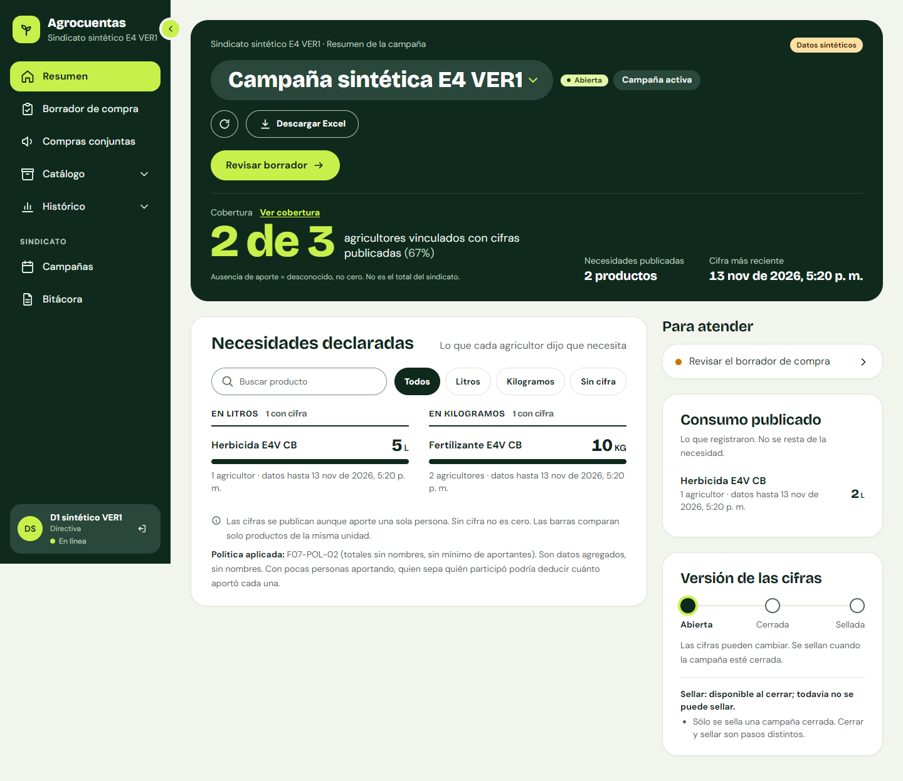

*Captura `D1_resumen__escritorio.png` (también `__movil`). 2026-11-13; Web `0946d9f`, API real aislada con `F07-POL-02`; cuenta sintética de Directiva «D1»; datos sintéticos.*

*Verificación:* Web real (cierre): política visible, sin «umbral», «anónim» ni nombres (`plan_colectivo/`).

---

## 3. Cobertura

Desde «Ver cobertura»: «Vinculados · N», «Con cifras publicadas · N» y «Quién aportó» («No se muestra, ni tampoco cuándo sincronizó cada persona …»), con la misma línea de «Política aplicada». «Seguimiento de sincronización» dice **«Todavía sin consulta del servidor»**: el último envío por agricultor no está implementado (BE #207, fuera de `main`). Cobertura no tiene Excel.

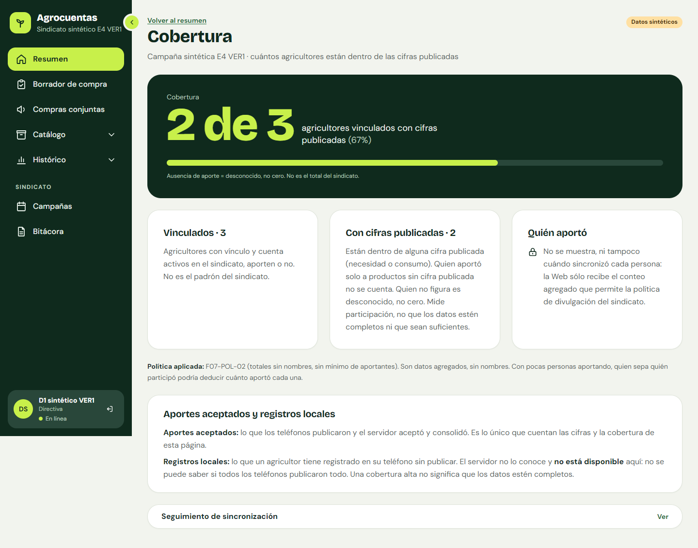

*Captura `D1_cobertura__escritorio.png`. 2026-11-13; Web `0946d9f`; API real aislada; datos sintéticos.*

*Verificación:* Web real (cierre).

---

## 4. Borrador de compra y consumo estimado

**«Borrador de compra»:** «Borrador basado en las necesidades declaradas publicadas. No ejecuta ninguna compra.»

1. «Generar borrador» (o «Generar borrador nuevo»).
2. Pestañas «Borrador actual», «Borradores anteriores» y «Cómo se calculó».
3. «Líneas del borrador»: «Llevar», «Producto», «Necesidad declarada», «Consumo estimado».
4. **Consumo estimado:** «Obtener referencia» fija una estimación del servidor («Consumo estimado fijado»; puede quedar «desactualizado», «Calculando la referencia…» o «Referencia restringida»). La cifra se muestra redondeada a la décima, con «≈» si no es exacta; la cifra exacta aparece al pasar el puntero («Cifra exacta: …»). «Es una referencia para comparar. No se suma a la necesidad declarada ni decide cuánto comprar.»
5. «Cómo se calculó»: campañas anteriores de la misma temporada, método «Suavizado exponencial simple», comparado con «El último consumo publicado (línea base naive)».
6. Marque los productos, «Guardar selección» («Elegir no inscribe a nadie ni asigna cantidades») y **«Preparar convocatoria»**, que abre el formulario de convocatoria con esos productos.
7. «Descargar Excel» exporta el borrador con la referencia fijada (`propuesta-{ref}.xlsx`).

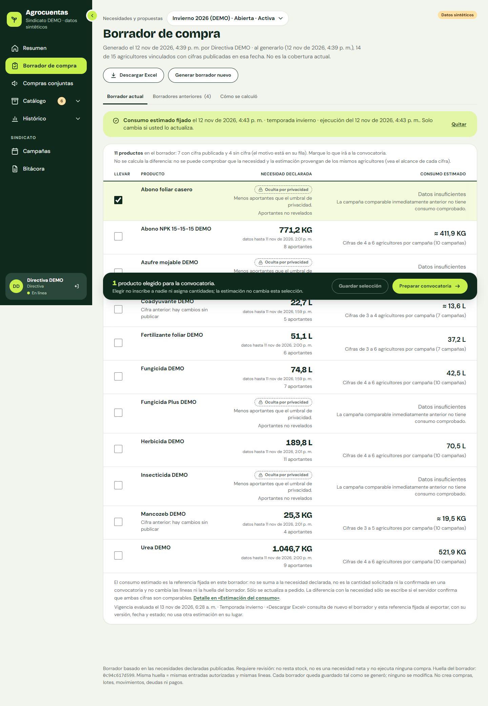 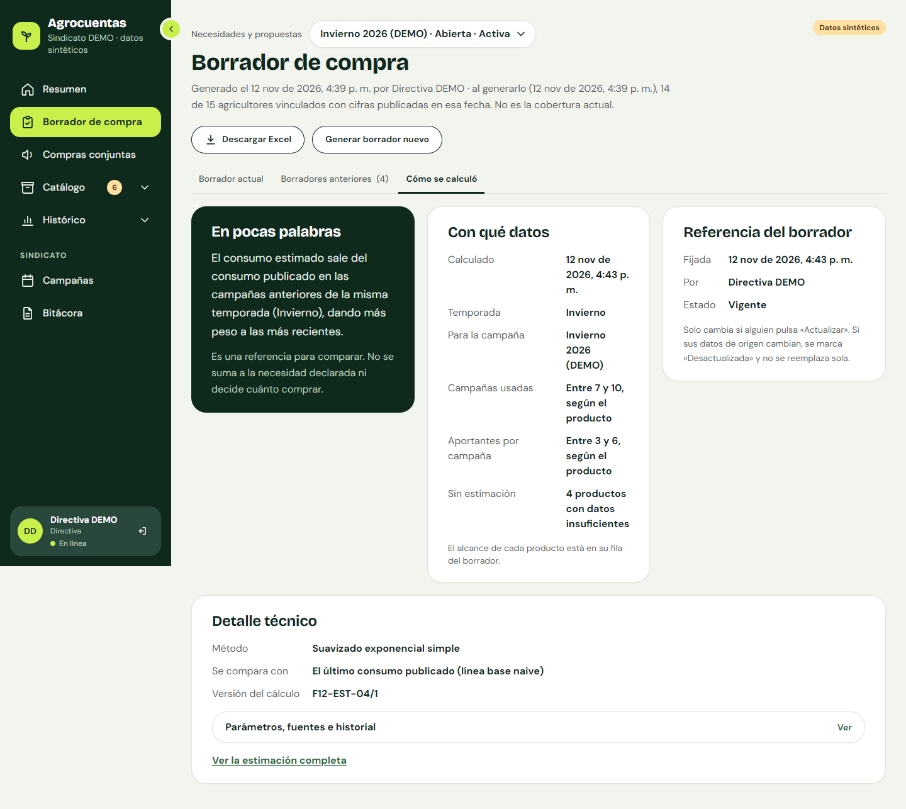

*Capturas `06-borrador-actual__escritorio.png` y `08-como-se-calculo__escritorio.png`. 2026-11-13; rediseño Web v2, sesión A (integrada en `d9ab720`), **anterior** a E4 y al cierre; API real aislada; datos sintéticos.*

*Verificación:* Web real (anterior); Pruebas en `0946d9f`. No se recorrió en el cierre.

---

## 5. Compras conjuntas (convocatorias)

**«Compras conjuntas»:** «Los agricultores piden desde su aplicación. Pedir no es comprar ni genera deuda.» Filtros «Todas», «Abiertas», «Borradores», «Cerradas», «Canceladas».

### 5.1 Crear

«Nueva convocatoria» (sólo con la campaña **planificada o abierta**): «Nombre», «Fecha y hora límite» («El plazo se cumple con el reloj del servidor»), «Responsable» y «Productos» («Del catálogo» o «De un borrador de compra»). «Crear borrador»: «Se crea como borrador: los agricultores no la ven hasta que la abra.»

Si nombra a otra persona responsable, la Web avisa antes: «Antes de guardar: dejará de administrar este borrador». **Ser responsable no da acceso a nombres ni cantidades.**

### 5.2 Abrir, cerrar y cancelar

Sólo la persona responsable o quien tenga «Administrar la convocatoria» ve estos botones:

| Acción | Botón | Confirmación | Efecto |
|---|---|---|---|
| Abrir | «Abrir convocatoria…» | Casilla «Confirmo que se abre «{nombre}».» | «Los agricultores la verán en su aplicación y podrán pedir.» Nombre, fecha y productos dejan de ser editables |
| Cerrar | «Cerrar y consolidar…» | «Confirmo que se cierra «{nombre}».» | «Se consolidan los pedidos recibidos hasta este momento, con la hora del servidor.» «No se puede reabrir.» «No es una compra: no genera pagos ni deudas.» |
| Cancelar | «Cancelar convocatoria…» | «Motivo» obligatorio y «Confirmo que se cancela «{nombre}». No se puede deshacer.» | Los pedidos quedan sin efecto, sin consolidado; los productos quedan libres |

Al vencer el plazo, la convocatoria se cierra sola («Convocatoria cerrada al vencer el plazo», actor «Sistema»).

### 5.3 Lo que ve la Directiva: sólo totales

- «Pedido hasta ahora», con el «Total provisional solicitado» por producto; al cerrar, «Consolidado al cierre».
- En «Quién pidió»: «El detalle identificado sólo lo consulta la Administración, con la autorización de cada agricultor.» y «Participan N personas; sus nombres y cantidades no se muestran.»
- Un total puede figurar «Pendiente de autorización» hasta que todas las participaciones de ese producto lo permitan; los consolidados anteriores pueden decir «Visible por la regla anterior: lo pidieron 3 o más personas».
- **La Directiva nunca ve nombres ni cantidades individuales**, ni en pantalla, ni por la API, ni en el Excel.

### 5.4 Conceder «Administrar la convocatoria»

La persona responsable puede «Conceder «Administrar la convocatoria»» a otra persona de la Directiva o la Administración: «Edita, abre, cierra y cancela la convocatoria. No da acceso a participantes ni a cantidades individuales.» Se puede retirar o renunciar.

### 5.5 Responsable no habilitada

Si la cuenta de la responsable se deshabilita: «Nadie puede administrarla. … Si no se hace nada, se cerrará sola al vencer el plazo.» y, para la Directiva, «Para nombrar a otra persona responsable, pida la intervención de una persona de la Administración del sindicato.» La Directiva no puede sustituirla.

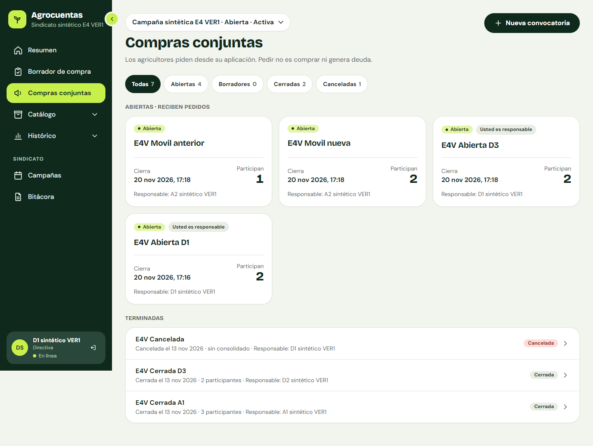 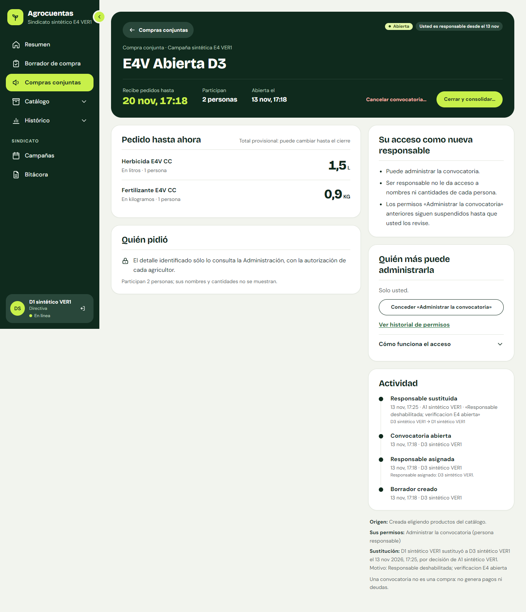 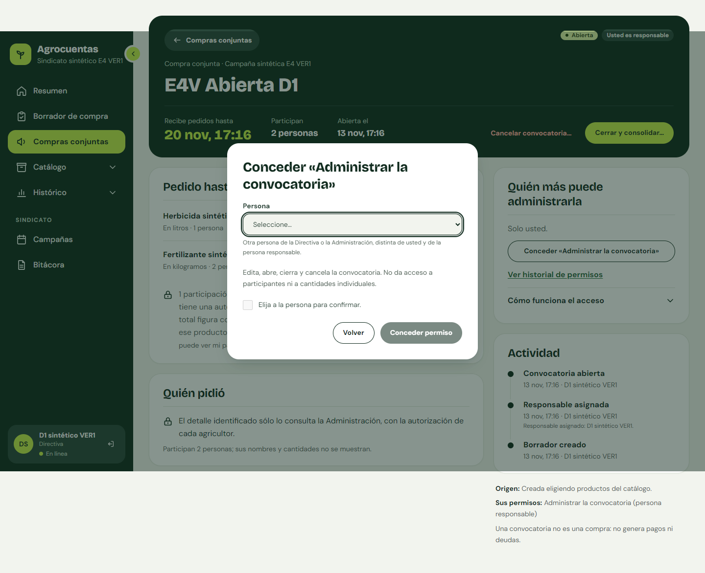

*Capturas `D1_lista__escritorio.png`, `M7_D1_CC__escritorio.png` (Directiva responsable de «CC»: sólo totales, «Participan 2 personas; sus nombres y cantidades no se muestran.») y `D1_CA_conceder__escritorio.png`. 2026-11-13; Web `0946d9f`; API real aislada; datos sintéticos. Otras: `D1_CB`, `D1_CD`, `D1_CX` (cancelada), `D2_CA`, `D2_CB` en la misma carpeta.*

*Verificación:* Web real (cierre): la Directiva no ve nombres en ninguna convocatoria y no pide `/participants`. Crear, abrir y cerrar: Web real (anterior, convocatoria «Recorrido v2 (sintética)», `06283da`) y API real del cierre. Cancelar: API real (E4). 

---

## 6. Catálogo e identificación de productos

**«Catálogo»**, pestañas:
- **«Productos»:** «Nuevo producto» («Nombre», «Unidad» —«La unidad no se puede cambiar después.»—, «Ingrediente activo», «Categoría», «Nombre comercial»); «Inactivar producto» («No se puede reactivar después.»).
- **«Nombres equivalentes»:** «Unir» dos nombres con «Motivo» y «Confirmo que «A» y «B» son el mismo producto.»; «Separar».
- **«Por identificar»** («Pendientes» / «Ya identificados»): productos que los agricultores reportaron desde el teléfono. «Usted propone la identificación y el agricultor confirma el vínculo en su aplicación: hasta entonces, su inventario y sus compras no cambian. Nada se identifica solo por parecido.»
  - Si el agricultor compartió la foto: «Ver la foto». «La foto se pide al servidor con su sesión y no se guarda en este equipo.»
  - «¿Qué es este producto?»: «Ya está en el catálogo» («Confirmar identificación»), «Es un producto nuevo» («Crear e identificar») o «Falta información» («Dejar pendiente», con una nota que el agricultor verá).
  - El «Motivo» es obligatorio y queda en la bitácora. No se muestra quién lo reportó.
  - «Corregir identificación…»: «Las cifras ya selladas no se modifican.»

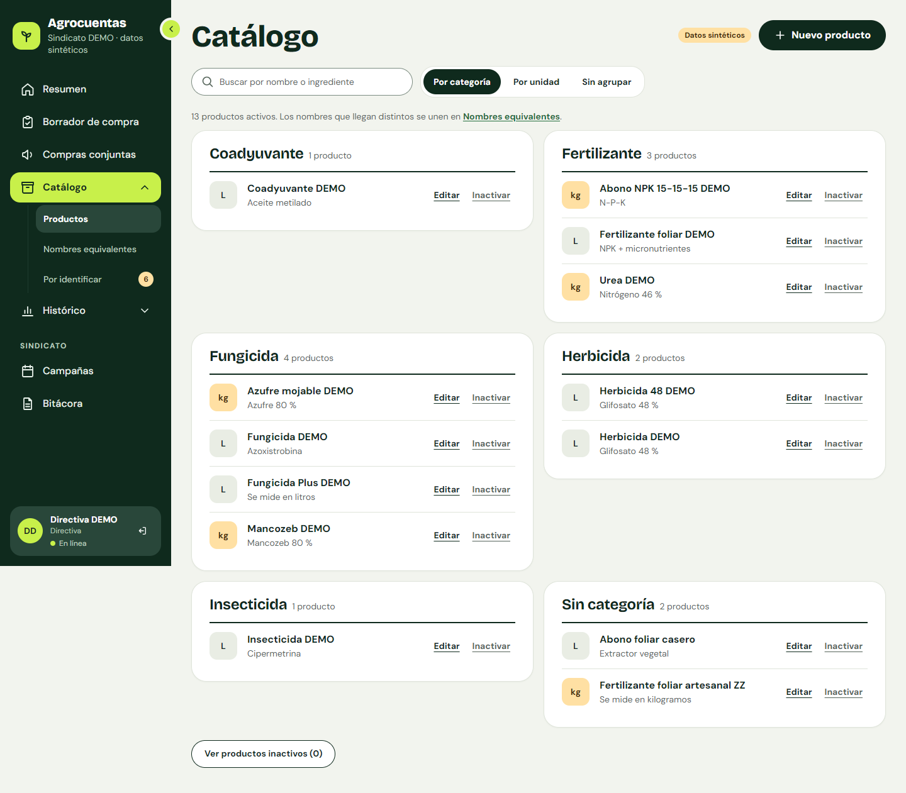 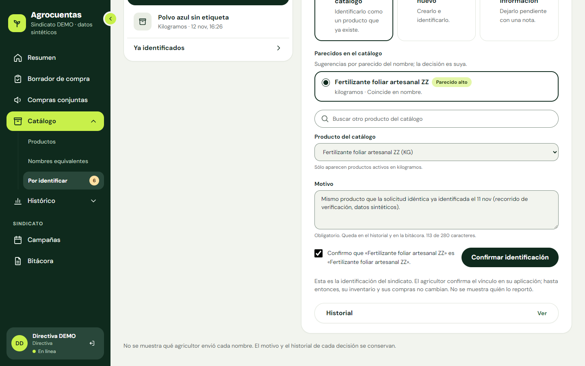

*Capturas `21-productos__escritorio.png` (rediseño Web v2, sesión C, integrada en `d9ab720`) y `23-antes-de-confirmar__escritorio.png` (verificación con la API real sobre `06283da`). 2026-11-13; anteriores a E4 y al cierre; datos sintéticos. Ya identificados: `24-ya-identificados__escritorio.png`.*

*Verificación:* Web real (anterior): una solicitud identificada con la foto cargada sólo con la sesión. Pruebas en `0946d9f`.

---

## 7. Histórico, estimación y sellado

**«Histórico»** tiene dos vistas:
- **«Histórico sellado»:** «Consumo publicado» o «Necesidad declarada» por campaña sellada, con «Versión sellada», «Política al sellar» y «Cobertura al sellar». Excel `tendencias-….xlsx`.
- **«Estimación del consumo»:** «Un cálculo a partir de campañas anteriores, hecho por el servidor. Es una referencia: no se suma a la necesidad ni crea compras.» «Generar estimación» (campaña planificada o abierta), la «Cifra exacta» debajo de la redondeada, «Cálculos anteriores», «Guardar copia» para consultarla sin conexión, y Excel.

**Sellar** fija las cifras de una campaña **cerrada** («Sellar esta versión…», con la casilla «Revisé la cobertura y los avisos, y entiendo que la versión sellada no se corrige ni se reabre.»). Lo sellado conserva la política con que se selló («Política aplicada al sellar»): lo sellado con F07-POL-01 no se recalcula. El sellado sólo está disponible si el servidor lo tiene habilitado (manual técnico).

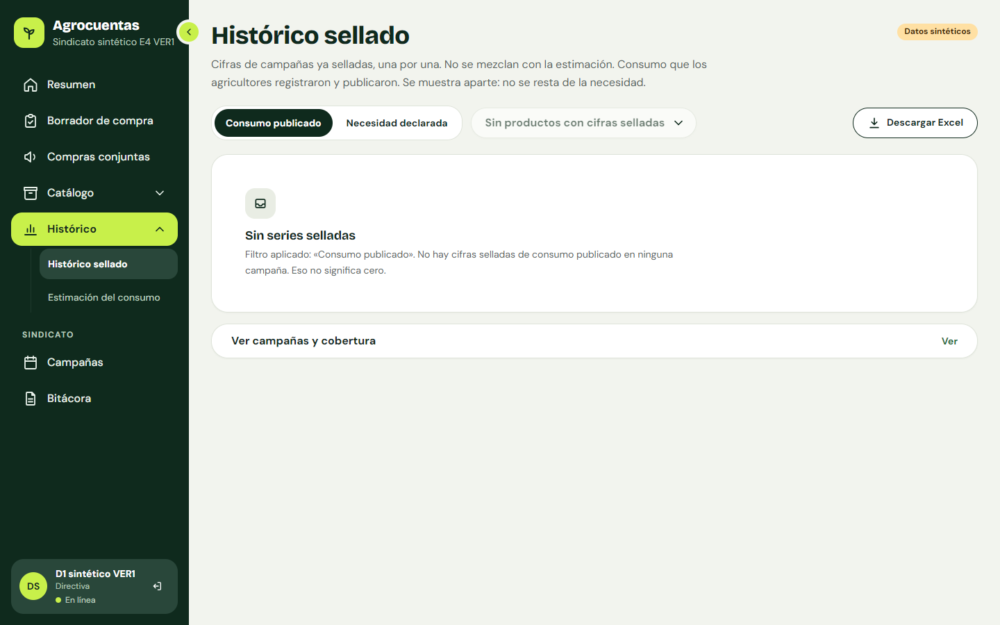 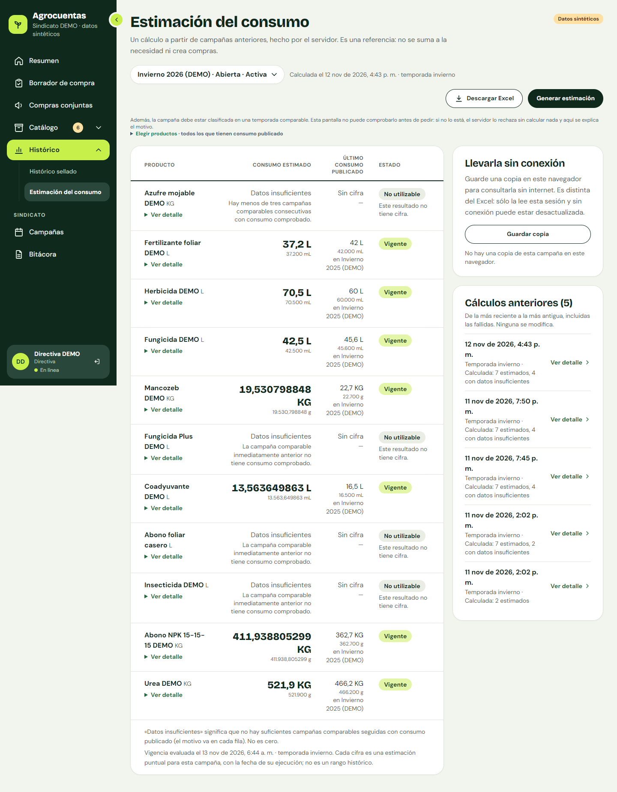

*Capturas `D1_historico__escritorio.png` (2026-11-13; Web `0946d9f`; API real aislada, sin campañas selladas) y `26-estimacion__escritorio.png` (2026-11-13; rediseño Web v2, sesión A, anterior al cierre). Datos sintéticos.*

*Verificación:* Histórico: Web real (cierre), sólo la vista vacía. **Sellado y tendencias con F07-POL-02: no verificados** con la API real (no había ningún sellado en la base del cierre); lo cubren las pruebas del Backend. Estimación: Web real (anterior).

---

## 8. Campañas

**«Campañas»:** la «Campaña activa» y «Otras campañas». La Directiva y la Administración pueden «Nueva campaña», «Editar», «Abrir campaña» y «Cerrar campaña…» («Cerrar no es sellar, y una campaña cerrada no se puede reabrir. Al cerrarla se bloquean las operaciones normales asociadas a este periodo.»). Sin campaña activa: «Los agricultores no pueden registrar en una campaña hasta que la Directiva abra una.» No hay acción para cancelar una campaña en la Web. El detalle muestra «Versión de las cifras», el sellado y los «Borradores de compra».

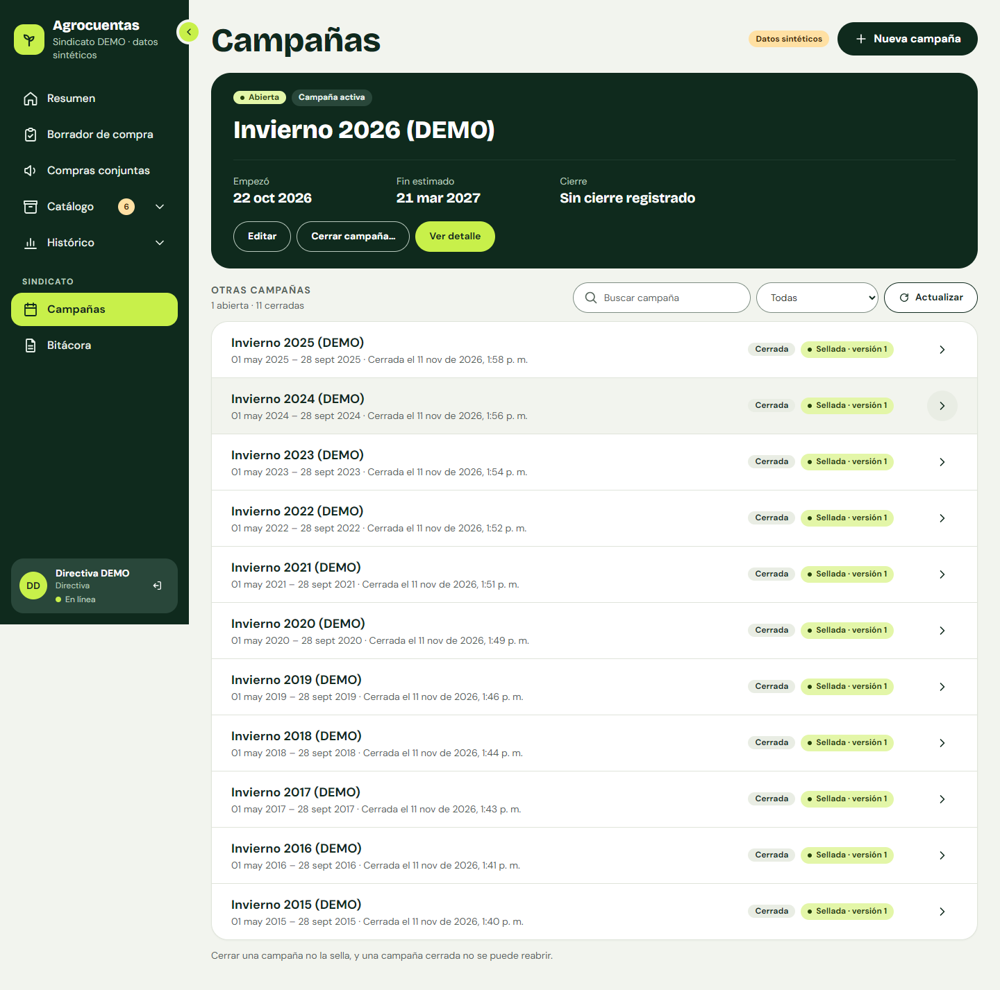

*Captura `28-campanas__escritorio.png`. 2026-11-13; rediseño Web v2, sesión C (integrada en `d9ab720`), anterior al cierre; datos sintéticos.*

*Verificación:* Web real (anterior); Pruebas.

---

## 9. Bitácora

**«Bitácora»** («Lo que se hizo en la Web, de lo más reciente a lo más antiguo.»): filtros «Tipo de acción» («Convocatorias», «Permisos», «Catálogo», «Campañas», «Borradores», «Otras») y «Más filtros» (campaña, persona, fechas). «Detalle» abre «Qué pasó». Muestra como máximo las últimas 300 acciones.

**Límite:** la bitácora no registra todas las acciones que la Web confirma (hallazgo H-08); en particular, los cambios de cuentas y roles no tienen registro localizado.

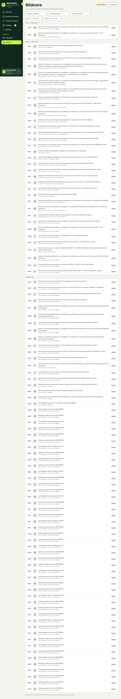

*Captura `32-bitacora__escritorio.png`. 2026-11-13; rediseño Web v2, sesión C, anterior al cierre; datos sintéticos.*

*Verificación:* Web real (anterior); Pruebas.

---

## 10. Exportaciones a Excel

| Página | Archivo |
|---|---|
| Resumen | `resumen-{campaña}.xlsx`, con «Política aplicada» y la fila «Totales con pocas personas» |
| Borrador de compra | `propuesta-{ref}.xlsx` |
| Histórico sellado | `tendencias-consumo-publicado.xlsx` o `tendencias-necesidad-declarada.xlsx` |
| Estimación del consumo | `estimacion-{campaña}.xlsx` |

**No hay CSV** (retirado el 2026-11-12). Compras conjuntas, Cobertura, Catálogo, Campañas y Bitácora no exportan.

*Verificación:* Web real (cierre): Excel del Resumen descargado por la Directiva, sin nombres de agricultores ni «umbral» ni «anónim» (`docs/evidence/CIERRE/plan_excel/descargas/resumen_D1.xlsx`). Los demás: Web real (anterior, 4 archivos XLSX válidos en `06283da`).

---

## 11. Si cambia su rol

El servidor decide cada acceso. Si su rol cambia mientras tiene la Web abierta, la Web adopta el rol vigente tras una respuesta 403, al renovar la sesión o cuando el detalle de una convocatoria detecta un cambio de acceso; la barra lateral se actualiza y una página que el rol nuevo no puede ver lleva a su inicio. **Límite:** de Directiva a Administración, en una página de la Directiva, el menú se actualiza al renovar la sesión o al recargar. Una cuenta deshabilitada vuelve al inicio de sesión.

*Verificación:* Web real (cierre), `plan_rol_cierre/` (defecto encontrado y corregido en `a35f8c2`).

## 12. Límites

- Sin despliegue institucional, sin datos reales y sin aceptación visual registrada.
- Activar `F07-POL-02` en un entorno real es una decisión institucional pendiente.
- Seguimiento de sincronización por agricultor: no disponible.
- Bitácora incompleta (H-08).
- Sellado con la política nueva: sin recorrido con la API real.

## 13. Capturas usadas

| Archivo | Carpeta (`docs/evidence/…`) | Fecha | Versión | Entorno |
|---|---|---|---|---|
| `D1_resumen`, `D1_cobertura`, `D1_historico` | `CIERRE/plan_colectivo/web/` | 2026-11-13 | Web `0946d9f` | Navegador sin interfaz, API real aislada, `F07-POL-02` |
| `D1_lista`, `D1_CA_conceder` (citadas `D1_CB`, `D1_CD`, `D1_CX`, `D2_CA`, `D2_CB`) | `CIERRE/plan_convocatorias/web/` | 2026-11-13 | Web `0946d9f` | Ídem |
| `M7_D1_CC` | `CIERRE/mobile/web_M7/web/` | 2026-11-13 | Web `0946d9f` | Ídem |
| `06-borrador-actual`, `08-como-se-calculo`, `26-estimacion` | `rediseno-web-v2/a/` | 2026-11-13 | Web v2, sesión A (en `d9ab720`) | API real aislada (base `agro_demo` sintética) |
| `21-productos`, `28-campanas`, `32-bitacora` | `rediseno-web-v2/c/` | 2026-11-13 | Web v2, sesión C (en `d9ab720`) | Ídem |
| `23-antes-de-confirmar` (citada `24-ya-identificados`) | `rediseno-web-v2/verificacion/identificacion/` | 2026-11-13 | Web `06283da` | Ídem |

Todos los datos son sintéticos. Las capturas del rediseño Web v2 son **anteriores** a E4 y al cierre: los textos de la política y de las convocatorias pueden diferir; para esos temas se usan las capturas del cierre.

## 14. Trazabilidad

Según `docs/cierre/MATRIZ_DOCUMENTO_GRADO.md`: proyección colectiva RU-08, RU-10, RU-17, CU-12, CU-13, RF-16, RF-21, RF-22, RF-24, RNF-05; política y sellado RF-24, RNF-05; borrador RU-08, CU-12, RF-23; estimación RU-20, RU-21, CU-20, CU-21, RF-35–RF-40, INT-09; identificación RF-33, RF-34, CU-18; Web institucional INT-02, RU-18, RU-19; bitácora RF-25, RNF-12. Convocatorias y acceso por rol: **ID por confirmar** por el autor (E4, apartado 10 del contrato).
